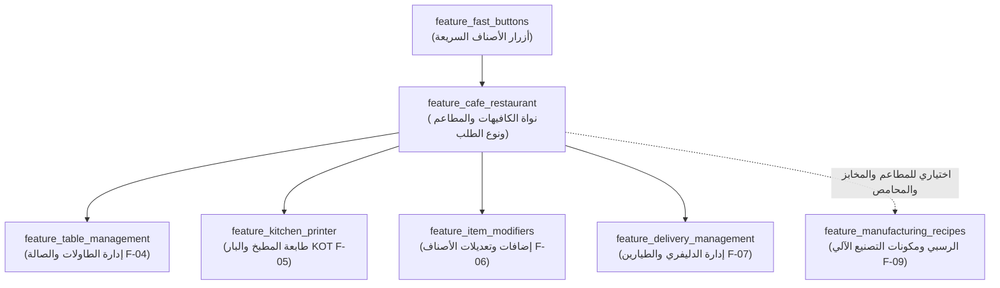

# الخطة المعمارية والهندسية الشاملة لمنظومة الكافيهات والمطاعم — نظام رفيق POS
# Rafiq POS — Comprehensive Cafe & Restaurant Module Architecture Plan (F-04, F-05, F-06, F-07 & F-09)

> **حالة التنفيذ والاعتماد:** **مكتمل 100% ومعتمد (Implemented & Verified in Milestone 14 — Stories 139 to 143 / Features #196 to #200 — Migrations 56 to 59)**
> **وثيقة معمارية معتمدة (Senior Engineering Blueprint):**
> صُممت ونُفذت هذه الخطة بعد الفحص الدقيق لبنية مشروع **رفيق POS** (`FeatureRegistry.cs`, `StoreTemplateService.cs`, `StoreFeaturesTab.tsx`, `HeldSaleRepository.cs`, `SaleService.cs`, `DrawerCashCalculator.cs`, `PrinterService.cs`, `SecurityService.cs`, و `MigrationRunner.cs` حتى الإصدار 59).
> تلتزم هذه الوثيقة التزاماً حرفياً بالقواعد الصارمة في [`AGENTS.md`](./AGENTS.md): الحسابات المالية بالأعداد الصحيحة بالقروش (`long` Piasters)، الكميات بالمللي (`milli-units`)، المعاملات الذرية (`SQLiteTransaction`)، العزل التام للأخطاء، التوافق مع `.NET Framework 4.8` و `C# 5` و `Chromium 109` (ويندوز 7 إلى 11)، صفر إيموجي (`Lucide SVG Icons` فقط)، صفر `<select>` افتراضي (`CustomSelect` فقط)، وتكامل مصفوفة الصلاحيات (`RBAC`) وبوابة الميزات (`Feature Gate`).

---

## 1. فلسفة الحوكمة وتفعيل الميزات (Root Toggle & Auto-Activation Architecture)

بناءً على هندسة الميزات المركزية في رفيق (Feature #182)، تعمل ميزات الكافيهات والمطاعم وفق القواعد الثلاث التالية:

1. **التحكم المطلق لحساب المطور (`Root`):**
   - جميع ميزات الكافيهات والمطاعم مسجلة في [`FeatureRegistry.cs`](./desktop/Common/FeatureRegistry.cs) وفي [`featureTypes.ts`](./frontend/src/context/featureTypes.ts) وتظهر في شاشة **إعدادات المتجر ← ميزات المتجر** ([`StoreFeaturesTab.tsx`](./frontend/src/views/settings/StoreFeaturesTab.tsx)) تحت تبويب تصنيف جديد خاص: **`cafe_restaurant` (الكافيهات والمطاعم)**.
   - يستطيع حساب **`Root` (المطور)** فتح أو قفل أي ميزة منها في أي وقت لأي محل (حتى لو كان المحل سوبرماركت أو مخبز أو محمصة يريد تفعيل ميزة الإضافات أو الدليفري أو الوصفات)، مع تطبيق فحص التبعيات التلقائي (`FeatureRegistry.ValidateDependencies`).
2. **التفعيل التلقائي الكامل لنشاط الكافيهات والمطاعم (`cafe_restaurant`):**
   - عند اختيار قالب **«مطاعم وكافيهات ووجبات سريعة» (`cafe_restaurant`)** من معالج التشغيل الأول (`FirstRunWizardModal`) أو تغيير النشاط من الإعدادات، يقوم [`StoreTemplateService.cs`](./desktop/Services/StoreTemplateService.cs) و [`storeTemplates.ts`](./frontend/src/constants/storeTemplates.ts) **بتفعيل حزمة ميزات الكافيهات تلقائياً (`true`)** وإغلاق الميزات غير الملائمة (مثل الصيدلية، الميزان، ومصفوفة الملابس).
3. **العزل التام وحماية البيانات التاريخية (`Server-Side Feature Gate`):**
   - عند إغلاق أي ميزة بواسطة الـ `Root`، تختفي أزرارها وتبويباتها فوراً من الواجهة (`isEnabled(...)`)، ويمنع [`IpcDispatcher.cs`](./desktop/Bridge/IpcDispatcher.cs) عبر `CheckFeatureGate` أي أوامر كتابة أو تعديل (`OwnedCommands`) تخصها، مع بقاء أوامر القراءة والتقارير التاريخية (`IsHistoricalOrReadCommand`) متاحة دائماً لعدم إخفاء أي فواتير سابقة.

---

## 2. هيكل مفاتيح الميزات والتبعيات (Feature Registry Keys & Dependency Graph)



### جدول مفاتيح الميزات الجديدة في `FeatureRegistry.cs`

| مفتاح الميزة (`Key`) | الاسم بالعربية (`NameAr`) | القيمة الافتراضية العامة (`DefaultValue`) | حالة التفعيل في قالب `cafe_restaurant` | يتطلب (`Requires`) | الأوامر المحمية (`OwnedCommands`) |
|---|---|---|---|---|---|
| `feature_cafe_restaurant` | **موديول الكافيهات والمطاعم المتكامل** | `false` | **`true` (تلقائي)** | `feature_fast_buttons` | `cafe:saveConfig` |
| `feature_table_management` | **إدارة الطاولات والصالة (Dine-In)** | `false` | **`true` (تلقائي)** | `feature_cafe_restaurant` | `tables:save`, `tables:delete`, `tables:open`, `tables:updateOrder`, `tables:transfer`, `tables:merge`, `tables:split`, `tables:setStatus`, `tables:close` |
| `feature_kitchen_printer` | **طابعة المطبخ والبار (KOT)** | `false` | **`true` (تلقائي)** | `feature_cafe_restaurant` | `printer:printKOT`, `printer:saveKOTRouting` |
| `feature_item_modifiers` | **تعديلات وإضافات الأصناف (Modifiers)** | `false` | **`true` (تلقائي)** | `feature_cafe_restaurant` | `modifiers:saveGroup`, `modifiers:deleteGroup`, `modifiers:saveOption`, `modifiers:deleteOption`, `modifiers:linkProduct` |
| `feature_delivery_management` | **إدارة الدليفري والطيارين وعناوين التوصيل** | `false` | **`true` (تلقائي)** | `feature_cafe_restaurant` | `delivery:saveRider`, `delivery:deleteRider`, `delivery:saveZone`, `delivery:deleteZone`, `delivery:assignOrder`, `delivery:updateStatus`, `delivery:settleRider` |
| `feature_manufacturing_recipes` | **نظام التصنيع والرسبي وخصم المكونات (BOM)** | `false` | **`true` (تلقائي للكافيهات والمخابز والمحامص)** | *(لا يوجد — يعمل مستقلاً)* | `recipes:save`, `recipes:delete`, `recipes:produce` |

---

## 3. التصميم الهندسي التفصيلي للميزات الخمس

---

### المرحلة الأولى: نواة الكافيهات وإدارة الطاولات والصالة (F-04: Table & Floor Management)

#### أ) الفكرة المعمارية والربط مع النظام الحالي
- يدعم الكاشير في وضع الكافيهات 3 أنماط تشغيل للطلب (`order_type`):
  1. **صالة (`dine_in`):** مربوط بطاولة محددة، مع إمكانية إضافة أصناف على دفعات (Rounds) وتحصيل الحساب في نهاية الجلسة، وحساب **رسم الخدمة (`service_charge_piasters`)** أو الحد الأدنى للطلب (`min_charge_piasters`) اختيارياً.
  2. **تيك أواي / سفري (`takeaway`):** فاتورة سريعة تأخذ **رقم نداء متسلسل يومي (`order_call_number`: مثل طلب #45)** يُطبع بخط ضخم أعلى الفاتورة وأوردر المطبخ.
  3. **دليفري / توصيل (`delivery`):** مربوط بعميل وعنوان ومنطقة توصيل وطيار.
- **التكامل الذكي مع `held_sales`:**
  - بدلاً من اختراع مسار مبيعات موازٍ يكسر تقارير النظام، الطاولة المفتوحة هي في جوهرها سجل في `held_sales` مرتبط بـ `restaurant_tables.current_held_sale_id`.
  - **حماية حاسمة:** يجب تعديل `HeldSaleRepository.CleanupOldHeldSales` بحيث **تستثني الفواتير المعلقة المرتبطة بطاولة نشطة (`occupied`)** حتى لا تُحذف طاولة مفتوحة أثناء التنظيف التلقائي.

#### ب) مخطط قاعدة البيانات (Migration 56)
```sql
-- 1. جدول مناطق وأقسام الصالة والطاولات
CREATE TABLE IF NOT EXISTS restaurant_tables (
    id                      TEXT PRIMARY KEY,
    table_number            INTEGER NOT NULL,
    table_name              TEXT NOT NULL,           -- مثال: "طاولة 1" أو "تراس 4" أو "VIP 2"
    capacity                INTEGER NOT NULL DEFAULT 4,
    zone                    TEXT NOT NULL DEFAULT 'indoor', -- 'indoor' | 'outdoor' | 'vip' | 'family'
    status                  TEXT NOT NULL DEFAULT 'free',   -- 'free' | 'occupied' | 'bill_printed' | 'reserved' | 'dirty'
    current_held_sale_id    TEXT DEFAULT NULL,       -- رابط الفاتورة المعلقة النشطة
    waiter_name             TEXT DEFAULT '',         -- اسم الويتر/الكابتن المسؤول عن الطاولة
    guests_count            INTEGER NOT NULL DEFAULT 1,
    opened_at               TEXT DEFAULT NULL,       -- وقت جلوس الزبون (لحساب مدة الإشغال)
    reservation_name        TEXT DEFAULT '',
    reservation_phone       TEXT DEFAULT '',
    reservation_time        TEXT DEFAULT NULL,
    display_order           INTEGER NOT NULL DEFAULT 0,
    is_active               INTEGER NOT NULL DEFAULT 1,
    created_at              TEXT NOT NULL,
    updated_at              TEXT NOT NULL
);
CREATE INDEX IF NOT EXISTS idx_rest_tables_status ON restaurant_tables(status);
CREATE INDEX IF NOT EXISTS idx_rest_tables_zone ON restaurant_tables(zone, display_order);

-- 2. توسيع جدول الفواتير sales و held_sales لدعم أنماط الكافيهات
-- عبر PRAGMA table_info في Migration 56 تتم إضافة الأعمدة التالية بأمان:
-- في جدول sales:
--   order_type TEXT NOT NULL DEFAULT 'takeaway'   -- 'dine_in' | 'takeaway' | 'delivery'
--   order_call_number INTEGER NOT NULL DEFAULT 0  -- رقم النداء اليومي (1، 2، 3...)
--   table_id TEXT DEFAULT NULL
--   table_name TEXT DEFAULT ''
--   guests_count INTEGER NOT NULL DEFAULT 1
--   waiter_name TEXT DEFAULT ''
--   service_charge_piasters INTEGER NOT NULL DEFAULT 0  -- رسم خدمة الصالة بالقروش (Integer)
--   delivery_fee_piasters INTEGER NOT NULL DEFAULT 0    -- رسوم التوصيل بالقروش (Integer)
-- في جدول held_sales:
--   table_id TEXT DEFAULT NULL
--   table_name TEXT DEFAULT ''
--   order_type TEXT NOT NULL DEFAULT 'dine_in'
--   waiter_name TEXT DEFAULT ''
--   guests_count INTEGER NOT NULL DEFAULT 1
--   printed_kot_quantities_json TEXT DEFAULT '{}' -- لتتبع الكميات التي طُبعت للمطبخ مسبقاً ومنع تكرار طباعتها عند زيادة الصنف!
```

#### ج) العمليات الهندسية الدقيقة للطاولات (`TableManagementService.cs`)
1. **فتح طاولة / تعليق طلب عليها (`tables:open` / `tables:updateOrder`):**
   - داخل `SQLiteTransaction`: يحفظ/يحدث سجل `held_sales` ويضبط `restaurant_tables.status = 'occupied'` و `opened_at = UtcNow` (إن كانت فارغة).
2. **نقل طاولة (`tables:transfer`):**
   - نقل `current_held_sale_id`, `waiter_name`, `guests_count`, `opened_at` من الطاولة المصدر (`fromTableId`) إلى الطاولة الهدف (`toTableId` التي يشترط أن تكون `free`)، وتحرير الطاولة المصدر إلى `free`، مع إمكانية طباعة إشعار نقل صغير للمطبخ (`طاولة 3 انتقلت إلى طاولة 7`).
3. **دمج طاولتين (`tables:merge`):**
   - دمج مصفوفة الأصناف `CartJson` من الطاولة المصدر داخل الفاتورة المعلقة للطاولة الهدف، وإعادة حساب `SubtotalPiasters` و `TotalPiasters` بالأعداد الصحيحة (`Money`)، وحذف الـ `held_sale` القديم وتحرير الطاولة الأولى.
4. **تقسيم فاتورة الطاولة (`tables:split` — Split Bill):**
   - ميزة جوهرية في الكافيهات عندما يريد مجموعة أصدقاء على طاولة واحدة أن يحاسب كل شخص على طلباته منفرداً:
   - يسمح بنقل بنود محددة (أو كميات محددة) من الفاتورة المعلقة للطاولة إلى سلة الكاشير مباشرة للمحاسبة الفورية، مع إبقاء الطاولة مفتوحة بباقي الأصناف لزملائه!
5. **طباعة شيك مبدئي للعميل (`tables:printPreBill`):**
   - يطبع "بيان حساب مبدئي (غير مدفوع)" ليراجعه الزبون على الطاولة، ويحول حالة الطاولة إلى `bill_printed` (بلون كهرماني مميز على خريطة الصالة).
6. **محاسبة وإغلاق الطاولة (`tables:close`):**
   - عند إتمام الدفع عبر `SaleService.ProcessSale`، يتم تمرير `tableId` ليقوم داخل نفس المعاملة الذرية (`Transaction`) بحذف الـ `held_sale` المرتبط وتفريغ الطاولة (`status = 'free'`, `current_held_sale_id = NULL`).

---

### المرحلة الثانية: تعديلات وإضافات الأصناف (F-06: Item Modifiers & Customizations)

#### أ) الفكرة المعمارية وحسابات القروش الصارمة
- في الكافيهات والمطاعم، الصنف الواحد (مثل: «قهوة تركي»، «كريب فاهيتا»، «برجر لحم») له:
  - **تفضيلات مجانية (`extra_price_piasters = 0`):** مثل درجة السكر (سادة، على الريحة، مضبوط، زيادة)، درجة التسوية (Well Done, Medium)، أو استثناءات (بدون بصل، بدون مايونيز).
  - **إضافات مدفوعة (`extra_price_piasters > 0`):** مثل (إضافة شوت إسبريسو +1500 قرش، إضافة جبنة شيدر +1000 قرش، صوص رانش +800 قرش).
- **القاعدة المالية الذهبية في `SaleService.cs`:**
  - لكل سطر في الفاتورة (`SaleItem`) قائمة تعديلات مختارة `Modifiers`.
  - مجموع أسعار الإضافات للوحدة الواحدة = $\sum \text{modifier.ExtraPricePiasters}$.
  - السعر الفعلي للوحدة (`EffectiveUnitPricePiasters`) = `BaseUnitPricePiasters + ModifiersUnitExtraPiasters`.
  - إجمالي السطر (`TotalPiasters`) = `(EffectiveUnitPricePiasters * QuantityMilli) / 1000 - DiscountPiasters`.
  - **حماية سلطة التسعير (`enforcePriceAuthority`):** في `SaleService.cs`، عند التحقق من أن الكاشير لم يتلاعب بالسعر، يتحقق الخادم من سعر الصنف الأساسي + مجموع أسعار الإضافات المسجلة فعلياً في قاعدة البيانات (`modifier_options`)، فلا يفشل فحص الأمان ولا يسمح للكاشير بتزوير سعر الإضافة!
- **فصل سطور السلة الذكي (`Cart Line Hashing`):**
  - إذا طلب العميل (1 قهوة تركي سادة) و (1 قهوة تركي مضبوط)، لا يجمعهما الكاشير في سطر واحد بكمية 2، بل ينشئ لكل تركيبة تعديلات بصمة فريدة (`modifierSignature`) ليبقى كل منهما في سطر مستقل يظهر بوضوح للباريستا!

#### ب) مخطط قاعدة البيانات (Migration 57)
```sql
-- 1. مجموعات التعديلات (مثل: "درجة السكر"، "إضافات الجبنة والصوصات"، "حجم الكوب")
CREATE TABLE IF NOT EXISTS modifier_groups (
    id              TEXT PRIMARY KEY,
    name            TEXT NOT NULL,
    selection_type  TEXT NOT NULL DEFAULT 'single', -- 'single' (اختيار واحد مثل السكر) | 'multiple' (اختيار متعدد مثل الإضافات)
    is_required     INTEGER NOT NULL DEFAULT 0,     -- 1 = إجباري عند اختيار الصنف في الكاشير
    min_selections  INTEGER NOT NULL DEFAULT 0,
    max_selections  INTEGER NOT NULL DEFAULT 10,
    display_order   INTEGER NOT NULL DEFAULT 0,
    is_active       INTEGER NOT NULL DEFAULT 1,
    created_at      TEXT NOT NULL,
    updated_at      TEXT NOT NULL
);

-- 2. خيارات التعديل داخل كل مجموعة
CREATE TABLE IF NOT EXISTS modifier_options (
    id                      TEXT PRIMARY KEY,
    group_id                TEXT NOT NULL REFERENCES modifier_groups(id) ON DELETE CASCADE,
    name                    TEXT NOT NULL,          -- "مضبوط"، "سادة"، "إضافة شيدر"
    extra_price_piasters    INTEGER NOT NULL DEFAULT 0 CHECK (extra_price_piasters >= 0),
    extra_cost_piasters     INTEGER NOT NULL DEFAULT 0 CHECK (extra_cost_piasters >= 0),
    linked_ingredient_id    TEXT DEFAULT NULL REFERENCES products(id) ON DELETE SET NULL, -- اختياري: لخصم الإضافة من المخزن!
    linked_qty_milli        INTEGER NOT NULL DEFAULT 0,
    is_default              INTEGER NOT NULL DEFAULT 0,
    display_order           INTEGER NOT NULL DEFAULT 0,
    is_active               INTEGER NOT NULL DEFAULT 1,
    created_at              TEXT NOT NULL
);
CREATE INDEX IF NOT EXISTS idx_mod_options_group ON modifier_options(group_id, display_order);

-- 3. ربط مجموعات التعديلات بالأصناف أو بالأقسام كاملة (لتوفير وقت الإدخال!)
CREATE TABLE IF NOT EXISTS product_modifier_groups (
    id              TEXT PRIMARY KEY,
    product_id      TEXT DEFAULT NULL REFERENCES products(id) ON DELETE CASCADE,
    category_id     TEXT DEFAULT NULL REFERENCES categories(id) ON DELETE CASCADE, -- ربط بقسم كامل مثل "المشروبات الساخنة"
    group_id        TEXT NOT NULL REFERENCES modifier_groups(id) ON DELETE CASCADE,
    display_order   INTEGER NOT NULL DEFAULT 0
);
CREATE INDEX IF NOT EXISTS idx_pmg_product ON product_modifier_groups(product_id);
CREATE INDEX IF NOT EXISTS idx_pmg_category ON product_modifier_groups(category_id);

-- 4. التعديلات المحفوظة فعلياً مع كل سطر بيع في الفاتورة النهائية
CREATE TABLE IF NOT EXISTS sale_item_modifiers (
    id                      TEXT PRIMARY KEY,
    sale_item_id            TEXT NOT NULL REFERENCES sale_items(id) ON DELETE CASCADE,
    modifier_option_id      TEXT DEFAULT NULL,
    group_name              TEXT NOT NULL DEFAULT '',
    option_name             TEXT NOT NULL,
    extra_price_piasters    INTEGER NOT NULL DEFAULT 0,
    extra_cost_piasters     INTEGER NOT NULL DEFAULT 0,
    created_at              TEXT NOT NULL
);
CREATE INDEX IF NOT EXISTS idx_sim_sale_item ON sale_item_modifiers(sale_item_id);
```
> **ميزة هندسية ذكية:** إضافة `category_id` في `product_modifier_groups` تتيح لصاحب الكافيه ربط مجموعة «درجة السكر» بقسم «المشروبات الساخنة» كله بضغطة زر واحدة بدلاً من ربطها بـ 50 مشروباً واحداً تلو الآخر!

---

### المرحلة الثالثة: طابعة المطبخ والبار وأوامر التحضير (F-05: Kitchen & Bar Order Ticket - KOT)

#### أ) الفكرة المعمارية وتوجيه الطابعات الذكي (Multi-Station Routing)
- في الكافيهات والمطاعم، قد يوجد:
  - **طابعة كاشير رئيسية:** تطبع إيصال العميل المالي بالأسعار.
  - **طابعة مطبخ (`Kitchen Printer`) وطابعة بار/باريستا (`Bar Printer`):** تطبع تذكرة تحضير **`KOT` بدون أسعار نهائياً**، وبخط عريض وكبير جداً (`16pt - 22pt`) يوضح:
    - نوع الطلب (`صالة - طاولة 5` أو `تيك أواي - طلب #42` أو `دليفري`).
    - اسم الكاشير/الويتر والوقت بالساعة والدقيقة.
    - الكمية × اسم الصنف + تحته مباشرة **التعديلات والملاحظات (`بدون بصل`، `سكر مضبوط`)** داخل إطار واضح.
- **منع تكرار الطباعة للطاولات (`Delta KOT Printing`):**
  - عندما تطلب طاولة 5 في البداية (2 شاي + 1 كريب)، يطبع المطبخ (1 كريب) ويطبع البار (2 شاي)، ويُسجل في `printed_kot_quantities_json` أن هذه البنود طُبعت.
  - بعد نصف ساعة، طلبت نفس الطاولة (1 وافل إضافي). عند الضغط على «تحديث وإرسال للمطبخ»، يرسل النظام **فقط الإضافة الجديدة (`[إضافة على الطلب] 1 × وافل`)** ولا يعيد طباعة الشاي والكريب القديمين!
- **عزل أخطاء الطابعات (`Fault Isolation`):**
  - إذا كانت طابعة المطبخ الشبكية أو الـ USB مفصولة أو نفد منها الورق، **لا تفشل عملية حفظ الفاتورة أو فتح الطاولة أبداً**، بل تُحفظ العملية 100% في SQLite ويظهر تنبيه واضح باللغة العربية للكاشير مع زر «إعادة طباعة أمر المطبخ».

#### ب) إعدادات التوجيه (محفوظة في جدول `settings` وجدول `categories`)
- إضافة حقل `kot_station` في جدول `categories` (`'none'` | `'kitchen'` | `'bar'` | `'both'`) في Migration 56، بحيث يحدد صاحب الكافيه لكل قسم (مثلاً قسم «المشروبات الساخنة والعصائر» ← `bar`، قسم «الساندوتشات والبيتزا» ← `kitchen`).
- مفاتيح `settings`:
  - `kot_kitchen_printer_name`: اسم طابعة المطبخ (أو نفس طابعة الكاشير إذا لم تتوفر سوى طابعة واحدة في المحل الصغير!).
  - `kot_bar_printer_name`: اسم طابعة البار.
  - `kot_auto_print_on_sale`: طباعة أمر التحضير تلقائياً عند حفظ الطلب (`1` / `0`).
  - `kot_print_on_single_printer`: خيار ذكي للمحلات الصغيرة التي تملك طابعة واحدة فقط: يطبع فاتورة العميل أولاً، ثم يقص الورق تلقائياً (`ESC/POS Cut`) ويطبع كعب المطبخ الصغير ليعطيه الكاشير للشيف/الباريستا!

---

### المرحلة الرابعة: إدارة الدليفري والطيارين وحسابات التوصيل (F-07: Delivery & Riders Management)

#### أ) الفكرة المعمارية والعزل المحاسبي لنقدية الطيارين
- دورة حياة طلب الدليفري في الكافيه والمطعم:
  1. **اتصال العميل (Caller Lookup):** يكتب الكاشير رقم هاتف العميل ← يجلب النظام تلقائياً اسم العميل وعناوينه السابقة ومنطقة التوصيل ورسومها المعتادة، أو ينشئ عميلاً جديداً في لحظة.
  2. **تجهيز الطلب (`preparing`):** يُحفظ الطلب ويُطبع أمر المطبخ (`KOT`) وبوليصة التوصيل (`Delivery Slip` تحتوي على العنوان التفصيلي ورقم الهاتف وإجمالي المطلوب تحصيله شاملة خدمة التوصيل).
  3. **تسليم الطلب للطيار (`out_for_delivery`):** يختار الكاشير الطيار (`Rider`) المسؤول عن الطلب. هنا تصبح قيمة الفاتورة النقدية **في عهدة الطيار (`Rider Custody`)**.
  4. **تحصيل وتصفية عهدة الطيار (`delivered` & `settleRider`):** في نهاية الوردية (أو بعد العودة)، يفتح الكاشير شاشة **«تصفية حساب الطيارين»**: تعرض إجمالي الفواتير التي خرج بها الطيار (مثلاً 12 فاتورة بإجمالي 2,450 ج.م.)، وكم منها دُفع مسبقاً بإنستاباي/محفظة، وصافي النقدية المطلوب استلامها منه للدرج، وعدد التوصيلات لحساب عمولة الطيار!

#### ب) التكامل المالي الدقيق مع `DrawerCashCalculator.cs`
- في الفواتير النقدية العادية (`dine_in` / `takeaway`)، تدخل النقدية للدرج لحظة إصدار الفاتورة.
- أما في فواتير الدليفري النقدية (`order_type = 'delivery'` و `payment_method = 'cash'`):
  - يتم تضمين `delivery_fee_piasters` ضمن `total_piasters` للفاتورة بحيث تتطابق المعادلة المحاسبية تماماً:
    $$\text{TotalPiasters} = \text{SubtotalPiasters} - \text{DiscountPiasters} + \text{TaxPiasters} + \text{ServiceChargePiasters} + \text{DeliveryFeePiasters}$$
  - يظهر في لوحة الوردية وإقفال اليومية (`DailyClosingService.cs`) تفصيل واضح:
    - **نقدية بالدرج مستلمة من الكاشير والصالة.**
    - **نقدية بطرف الطيارين تحت التحصيل (`Pending Rider Cash`)** + تنبيه عند إغلاق الوردية إذا كان هناك طيار لم تتم تصفية عهدته بعد!

#### ج) مخطط قاعدة البيانات (Migration 58)
```sql
-- 1. جدول مناطق التوصيل ورسومها الثابتة
CREATE TABLE IF NOT EXISTS delivery_zones (
    id                      TEXT PRIMARY KEY,
    name                    TEXT NOT NULL,          -- "المنطقة الأولى - وسط البلد"، "المنطقة الثانية - الجامعة"
    delivery_fee_piasters   INTEGER NOT NULL DEFAULT 0 CHECK (delivery_fee_piasters >= 0),
    rider_commission_piasters INTEGER NOT NULL DEFAULT 0 CHECK (rider_commission_piasters >= 0),
    estimated_minutes       INTEGER NOT NULL DEFAULT 30,
    is_active               INTEGER NOT NULL DEFAULT 1,
    created_at              TEXT NOT NULL
);

-- 2. جدول الطيارين (مندوبي التوصيل)
CREATE TABLE IF NOT EXISTS delivery_riders (
    id                      TEXT PRIMARY KEY,
    name                    TEXT NOT NULL,
    phone                   TEXT NOT NULL DEFAULT '',
    vehicle_number          TEXT DEFAULT '',
    commission_per_order_piasters INTEGER NOT NULL DEFAULT 0,
    status                  TEXT NOT NULL DEFAULT 'available', -- 'available' | 'on_delivery' | 'off_duty'
    is_active               INTEGER NOT NULL DEFAULT 1,
    created_at              TEXT NOT NULL,
    updated_at              TEXT NOT NULL
);

-- 3. جدول طلبات التوصيل وحالتها وعهدة الطيار
CREATE TABLE IF NOT EXISTS delivery_orders (
    id                      TEXT PRIMARY KEY,
    sale_id                 TEXT NOT NULL UNIQUE REFERENCES sales(id) ON DELETE CASCADE,
    customer_id             TEXT DEFAULT NULL REFERENCES customers(id) ON DELETE SET NULL,
    customer_name           TEXT NOT NULL,
    customer_phone          TEXT NOT NULL,
    customer_address        TEXT NOT NULL,
    zone_id                 TEXT DEFAULT NULL REFERENCES delivery_zones(id) ON DELETE SET NULL,
    zone_name               TEXT DEFAULT '',
    rider_id                TEXT DEFAULT NULL REFERENCES delivery_riders(id) ON DELETE SET NULL,
    rider_name              TEXT DEFAULT '',
    delivery_fee_piasters   INTEGER NOT NULL DEFAULT 0,
    rider_commission_piasters INTEGER NOT NULL DEFAULT 0,
    order_total_piasters    INTEGER NOT NULL DEFAULT 0,
    amount_to_collect_piasters INTEGER NOT NULL DEFAULT 0, -- المطلوب تحصيله نقداً من العميل
    status                  TEXT NOT NULL DEFAULT 'preparing', -- 'preparing' | 'out_for_delivery' | 'delivered' | 'cancelled'
    is_rider_settled        INTEGER NOT NULL DEFAULT 0,        -- 1 = سلّم الطيار النقدية للدرج
    settled_at              TEXT DEFAULT NULL,
    settled_by_user_id      TEXT DEFAULT NULL,
    shift_id                TEXT DEFAULT NULL,
    dispatched_at           TEXT DEFAULT NULL,
    delivered_at            TEXT DEFAULT NULL,
    notes                   TEXT DEFAULT '',
    created_at              TEXT NOT NULL,
    updated_at              TEXT NOT NULL
);
CREATE INDEX IF NOT EXISTS idx_deliv_orders_status ON delivery_orders(status);
CREATE INDEX IF NOT EXISTS idx_deliv_orders_rider ON delivery_orders(rider_id, is_rider_settled);
CREATE INDEX IF NOT EXISTS idx_deliv_orders_shift ON delivery_orders(shift_id);
```

---

### المرحلة الخامسة: نظام الرسبي والتصنيع وخصم الخامات الآلي (F-09: Recipes / BOM & Auto-Depletion)

#### أ) لماذا هذه الميزة حرجة جداً للكافيهات والمطاعم؟
- الكافيه لا يشتري «كوب كابتشينو» جاهزاً من المورد، بل يشتري **خامات (`Raw Materials`)**: كيلو بن إسبريسو، لتر حليب، أكواب ورقية، سكر، صوص كراميل.
- عبر ميزة **`feature_manufacturing_recipes` (الرسبي وخصم المكونات BOM)**، ندعم نمطين:
  1. **الخصم اللحظي التلقائي عند البيع بالكاشير (`Auto-Deplete on Sale` — خاص بالكافيهات والمطاعم):**
     - يُعرّف صاحب الكافيه وصفة «كوب لاتيه»: (18 جرام بن إسبريسو + 200 مل حليب + 1 كوب ورقي).
     - لحظة بيع «كوب لاتيه» في `SaleService.cs`، يخصم النظام تلقائياً (18,000 مللي جرام بن + 200 مللي حليب + 1000 مللي كوب) من مخزون الخامات بحركة مخزنية `RECIPE_SALE_CONSUMPTION`، ويحسب تكلفة الكوب الحقيقية (`UnitCostPiasters`) من مجموع تكلفة خاماته بدقة القرش!
  2. **التحضير المسبق لدفعات الإنتاج (`Batch Production` — للمطاعم والمخابز والمحامص):**
     - مثل تجهيز «10 كيلو تتبيلة شاورما» أو «تحميص 20 كيلو توليفة بن مخصوص»: يضغط زر «تسجيل دفعة إنتاج» فيخصم الخامات دفعة واحدة ويضيف الرصيد للمنتج النهائي.

#### ب) مخطط قاعدة البيانات (Migration 59)
```sql
CREATE TABLE IF NOT EXISTS recipes (
    id                      TEXT PRIMARY KEY,
    product_id              TEXT NOT NULL UNIQUE REFERENCES products(id) ON DELETE CASCADE,
    name                    TEXT NOT NULL,
    yield_quantity_milli    INTEGER NOT NULL DEFAULT 1000 CHECK (yield_quantity_milli > 0),
    depletion_mode          TEXT NOT NULL DEFAULT 'on_sale', -- 'on_sale' (خصم لحظي بالكاشير للكافيه) | 'batch' (إنتاج دفعات مسبقة)
    notes                   TEXT DEFAULT '',
    is_active               INTEGER NOT NULL DEFAULT 1,
    created_at              TEXT NOT NULL,
    updated_at              TEXT NOT NULL
);

CREATE TABLE IF NOT EXISTS recipe_ingredients (
    id                      TEXT PRIMARY KEY,
    recipe_id               TEXT NOT NULL REFERENCES recipes(id) ON DELETE CASCADE,
    ingredient_product_id   TEXT NOT NULL REFERENCES products(id) ON DELETE RESTRICT,
    quantity_milli          INTEGER NOT NULL CHECK (quantity_milli > 0), -- مثال: 18 جرام من كيلو = 18
    unit_label              TEXT DEFAULT '',
    wastage_bps             INTEGER NOT NULL DEFAULT 0, -- نسبة الهالك بنقاط الأساس (مثلاً 500 = 5%)
    created_at              TEXT NOT NULL
);
CREATE INDEX IF NOT EXISTS idx_recipe_ing_recipe ON recipe_ingredients(recipe_id);

CREATE TABLE IF NOT EXISTS production_batches (
    id                      TEXT PRIMARY KEY,
    recipe_id               TEXT NOT NULL REFERENCES recipes(id),
    product_id              TEXT NOT NULL REFERENCES products(id),
    multiplier_milli        INTEGER NOT NULL DEFAULT 1000,
    produced_quantity_milli INTEGER NOT NULL,
    total_cost_piasters     INTEGER NOT NULL DEFAULT 0,
    produced_by             TEXT DEFAULT '',
    notes                   TEXT DEFAULT '',
    created_at              TEXT NOT NULL
);
```

---

## 4. مصفوفة الصلاحيات الشاملة (Mandatory RBAC Integration - Rule 8)

وفقاً للقاعدة 8 من [`AGENTS.md`](./AGENTS.md)، تُدرج الصلاحيات التالية في:
1. `desktop/Services/SecurityService.cs` (`ALL_PERMISSIONS`, `GetPermissionsForRole`, `SyncPermissionAliases`)
2. `frontend/src/components/UserManagerModal.tsx` (مجموعة صلاحيات جديدة باسم **«الكافيهات والمطاعم والصالة والدليفري»** بأيقونة `Coffee` من `lucide-react`)
3. `desktop/Common/FeatureRegistry.cs` (`OwnedPermissions`)

| مفتاح الصلاحية (`Permission Key`) | الاسم العربي في مصفوفة الموظفين | الميزة المالكة (`Feature`) | `root` | `admin` | `cashier` |
|---|---|---|---|---|---|
| `cafe.tables.view` | فتح واستعراض خريطة الصالة والطاولات | `feature_table_management` | نعم | نعم | نعم |
| `cafe.tables.operate` | فتح طاولة وتعليق الطلبات وإصدار الشيك | `feature_table_management` | نعم | نعم | نعم |
| `cafe.tables.transfer_merge` | نقل ودمج الطاولات وتقسيم الشيك | `feature_table_management` | نعم | نعم | نعم |
| `cafe.tables.manage_layout` | إضافة وتعديل وحذف طاولات وأقسام الصالة | `feature_table_management` | نعم | نعم | لا |
| `cafe.modifiers.manage` | إدارة مجموعات التعديلات والإضافات وأسعارها | `feature_item_modifiers` | نعم | نعم | لا |
| `cafe.kot.reprint` | إعادة طباعة أوامر المطبخ والبار (KOT) | `feature_kitchen_printer` | نعم | نعم | نعم |
| `cafe.kot.manage` | ضبط وتوجيه طابعات المطبخ والبار والأقسام | `feature_kitchen_printer` | نعم | نعم | لا |
| `cafe.delivery.dispatch` | تسجيل طلبات الدليفري وتعيين الطيارين | `feature_delivery_management` | نعم | نعم | نعم |
| `cafe.delivery.settle` | تصفية نقدية وعهدة الطيارين واستلام التحصيل | `feature_delivery_management` | نعم | نعم | نعم |
| `cafe.delivery.manage` | إدارة بيانات الطيارين ومناطق ورسوم التوصيل | `feature_delivery_management` | نعم | نعم | لا |
| `recipes.view` | الاطلاع على وصفات التصنيع ومكونات الأصناف | `feature_manufacturing_recipes` | نعم | نعم | لا |
| `recipes.manage` | إنشاء وتعديل وصفات التصنيع والرسبي (BOM) | `feature_manufacturing_recipes` | نعم | نعم | لا |
| `recipes.produce` | تنفيذ دفعات الإنتاج والتوليف وخصم الخامات | `feature_manufacturing_recipes` | نعم | نعم | لا |

---

## 5. تصميم تجربة المستخدم والشاشات (UI/UX Design & 1024×768 Ergonomics)

مع الالتزام الكامل بباليت رفيق (`brand` `#004D3F`، `paid` `#006D41`، `surface`، `canvas`، `line`) وصفر إيموجي وصفر `<select>` افتراضي:

### 1. شريط نمط الطلب الذكي أعلى الكاشير (`PosOrderModeBar.tsx`)
يظهر في `PosView.tsx` **فقط عندما تكون `isEnabled('feature_cafe_restaurant')` مفعلة**:
- **3 أزرار تبديل سريعة بلمسة واحدة (Touch-Friendly 44px height):**
  - `[ صالة / طاولات (F6) ]` (أيقونة `Utensils`) — يعرض رقم الطاولة المختارة حالياً أو يفتح خريطة الصالة.
  - `[ تيك أواي / سفري (F7) ]` (أيقونة `ShoppingBag`) — يعرض رقم النداء القادم تلقائياً (`طلب #42`).
  - `[ دليفري / توصيل (F8) ]` (أيقونة `Bike` أو `Truck`) — يفتح شريط بيانات عنوان العميل ومنطقة التوصيل والطيار.

### 2. نافذة ولوحة خريطة الصالة والطاولات (`FloorTablesModal.tsx`)
- تُفتح من الكاشير بضغطة على زر «الطاولات (F6)» أو من شريط الكاشير العلوي:
- **شريط تصفية المناطق (`Zones`):** (الكل | الصالة الداخلية | التراس الخارجي | VIP | العائلات).
- **شبكة كروت الطاولات (`Responsive Grid`):**
  - **طاولة فارغة (`free`):** خلفية `surface` وحدود `line` مع أيقونة `CheckCircle2` خضراء هادئة وسعة الكراسي.
  - **طاولة مشغولة (`occupied`):** خلفية `brand-soft` وحدود `brand`، تعرض: **إجمالي الحساب الحالي بالقروش المحولة للجنيه**، **مدة الجلوس بالدقائق (`منذ 35 د`)**، **اسم الويتر**، وعدد الأصناف.
  - **طاولة طُبع لها الشيك (`bill_printed`):** خلفية `warn-soft` وحدود `warn` لتنبيه الكاشير أن الزبون ينتظر الدفع.
- **أزرار الإجراءات السريعة على الطاولة المشغولة:**
  - `إضافة طلبات للطاولة` | `طباعة شيك مبدئي` | `نقل لطاولة أخرى` | `دمج مع طاولة` | `تقسيم الحساب (Split)` | `محاسبة وإغلاق (F1)`.

### 3. نافذة اختيار الإضافات والتعديلات السريعة (`ItemModifiersModal.tsx`)
- عند الضغط على صنف في الكاشير مرتبط بمجموعات تعديل (مثل «لاتيه» أو «برجر»):
  - تفتح نافذة لمس سريعة تعرض المجموعات (مثلاً: **درجة السكر [إجباري]** ← أزرار كبيرة: `سادة` | `على الريحة` | `مضبوط` | `زيادة`، ثم **الإضافات [اختياري]** ← `شوت إسبريسو (+15 ج.م)` | `نكهة بندق (+10 ج.م)`).
  - حقل «ملاحظة خاصة للباريستا/الشيف» + زر «إضافة للسلة» مع عرض السعر الإجمالي بعد الإضافات لحظياً.
  - إذا لم يكن للصنف أي تعديلات، يُضاف للسلة فوراً في `0ms` دون أي نافذة!

### 4. مركز إدارة الدليفري والطيارين (`DeliveryCommandModal.tsx`)
- نافذة متكاملة بـ 3 تبويبات:
  1. **الطلبات الجارية (`Active Orders`):** بطاقات الطلبات في المطبخ (`قيد التحضير`)، الطلبات التي خرجت (`مع الطيار`)، وزر تعيين طيار بضغطة واحدة أو تسليم الطلب.
  2. **تصفية عهدة الطيارين (`Rider Settlement`):** جدول يوضح لكل طيار: عدد التوصيلات، إجمالي النقدية المطلوبة منه، عمولته المستحقة، وزر **«استلام النقدية وتصفية العهدة»**.
  3. **إعدادات الطيارين والمناطق (`Riders & Zones Setup`):** إضافة وتعديل الطيارين ومناطق التوصيل ورسوم كل منطقة.

### 5. تبويب الرسبي والمكونات في نافذة الصنف (`ProductRecipeModal.tsx`)
- داخل شاشة المنتجات (`ProductsView.tsx`)، زر/تبويب «مكونات الصنف والرسبي (BOM)» لتحديد المواد الخام التي تُخصم تلقائياً عند بيع هذا المشروب أو الوجبة، مع حساب تكلفة الصنف المعيارية تلقائياً من أسعار شراء الخامات!

---

## 6. خطة التنفيذ المرحلية المرتبة (Execution Roadmap & Stories Breakdown)

لضمان التنفيذ الهندسي المنظم بدون أي تعارض وبأعلى جودة، تقسم الخطة إلى **5 قصص متتابعة (Stories)** قابلة للتنفيذ والاختبار المستقل:

| المرحلة / القصة | الميزة في الخريطة | المخرجات الأساسية (Deliverables) |
|---|---|---|
| **القصة 1 (Foundation & F-04)** | تسجيل الميزات + قالب الكافيهات + إدارة الطاولات والصالة | • Migration 56 (`restaurant_tables` + أعمدة `sales` و `held_sales`).<br/>• تسجيل مفاتيح الميزات الـ 6 في `FeatureRegistry.cs` و `featureTypes.ts` و `StoreFeaturesTab.tsx`.<br/>• تفعيلها تلقائياً في قالب `cafe_restaurant` داخل `StoreTemplateService.cs` و `storeTemplates.ts`.<br/>• بناء `TableRepository.cs`, `TableManagementService.cs`, `IpcDispatcher.Tables.cs`.<br/>• بناء `PosOrderModeBar.tsx` و `FloorTablesModal.tsx` (فتح، تعليق، نقل، دمج، تقسيم، شيك مبدئي، محاسبة). |
| **القصة 2 (F-06 Modifiers)** | تعديلات وإضافات الأصناف (Item Modifiers) | • Migration 57 (`modifier_groups`, `modifier_options`, `product_modifier_groups`, `sale_item_modifiers`).<br/>• بناء `ModifierRepository.cs`, `ModifierService.cs`, وتحديث `SaleService.cs` لحساب الإضافات بالقروش واعتمادها في `enforcePriceAuthority`.<br/>• بناء `ModifierManagerModal.tsx` (إدارة المجموعات وربطها بالأقسام/الأصناف) و `ItemModifiersModal.tsx` في الكاشير. |
| **القصة 3 (F-05 KOT Printer)** | طابعة المطبخ والبار وأوامر التحضير (KOT) | • إضافة `PrintKitchenOrderTicket` في `PrinterService.cs` مع دعم فصل أقسام المطبخ عن البار، ودعم الطابعة الواحدة (قص الورق)، وطباعة الإضافات الجديدة فقط (`Delta KOT`).<br/>• إضافة إعدادات طابعة المطبخ والبار في `PrinterSettingsTab.tsx`. |
| **القصة 4 (F-07 Delivery)** | إدارة الدليفري والطيارين وتصفية العهدة | • Migration 58 (`delivery_zones`, `delivery_riders`, `delivery_orders`).<br/>• بناء `DeliveryRepository.cs`, `DeliveryService.cs`, `IpcDispatcher.Delivery.cs`.<br/>• تحديث `SaleService.cs` و `DrawerCashCalculator.cs` و `DailyClosingService.cs` لعزل وتتبع نقدية الطيارين ورسوم التوصيل.<br/>• بناء `DeliveryCommandModal.tsx` وبوليصة التوصيل الحرارية في `PrinterService.cs`. |
| **القصة 5 (F-09 Recipes/BOM)** | نظام الرسبي وخصم الخامات الآلي والتصنيع | • Migration 59 (`recipes`, `recipe_ingredients`, `production_batches`).<br/>• بناء `RecipeRepository.cs`, `RecipeService.cs`، والخصم الذري التلقائي للمكونات في `SaleService.cs` عند البيع وعكسها عند المرتجع/الإلغاء.<br/>• بناء `RecipeManagerModal.tsx` وشاشة دفعات الإنتاج. |

---

## 7. سيناريوهات الاختبار الذهبية والاعتماد (Golden QA Scenarios)

1. **اختبار حوكمة الـ Root والقوالب (`Template & Root Gate Test`):**
   - اختيار قالب `cafe_restaurant` ← التحقق من أن `feature_cafe_restaurant`, `feature_table_management`, `feature_kitchen_printer`, `feature_item_modifiers`, `feature_delivery_management`, `feature_manufacturing_recipes` كلها أصبحت `true` تلقائياً.
   - اختيار قالب `supermarket` ← التحقق من أنها جميعاً `false` تلقائياً، ثم الدخول بحساب `Root` وتفعيل `feature_delivery_management` يدوياً ← التحقق من عملها فوراً.
2. **اختبار دورة الصالة والطاولات (`Dine-In Lifecycle Test`):**
   - فتح «طاولة 4» بطلب (2 قهوة + 1 تشيز كيك) ← نقلها إلى «طاولة 8» ← دمجها مع «طاولة 9» ← تقسيم الحساب لدفع 1 قهوة نقداً وإبقاء الباقي معلقاً على الطاولة ← إغلاق الطاولة النهائي والتأكد من تحول حالتها إلى `free` ومطابقة إجمالي الفاتورة بالقرش.
3. **اختبار الإضافات والرسبي (`Modifiers & BOM Depletion Test`):**
   - بيع «1 لاتيه (سعر 4500 قرش) + إضافة شوت إسبريسو (+1500 قرش) + نكهة كراميل (+1000 قرش)» ← التحقق من أن إجمالي السطر = `7000 قرش`، وأن مخزون البن والحليب والأكواب انخصم بالمللي جرام/مللي لتر بدقة داخل نفس الـ `Transaction`، وعند إلغاء الفاتورة يعود مخزون الخامات بالكامل.
4. **اختبار الدليفري وعهدة الطيار (`Delivery & Rider Cash Custody Test`):**
   - تسجيل فاتورة دليفري بـ `20000 قرش` + خدمة توصيل `2000 قرش` = `22000 قرش` وتعيين «طيار: أحمد» ← التحقق من ظهور `22000 قرش` في عهدة الطيار، ثم تنفيذ `delivery:settleRider` والتأكد من دخول النقدية في حساب الدرج وتصفير ذمة الطيار.

