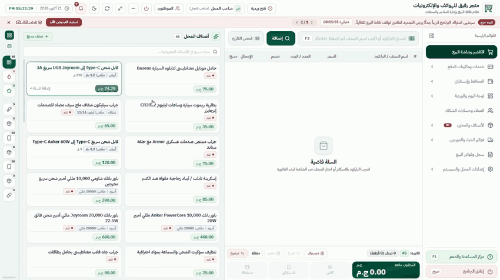
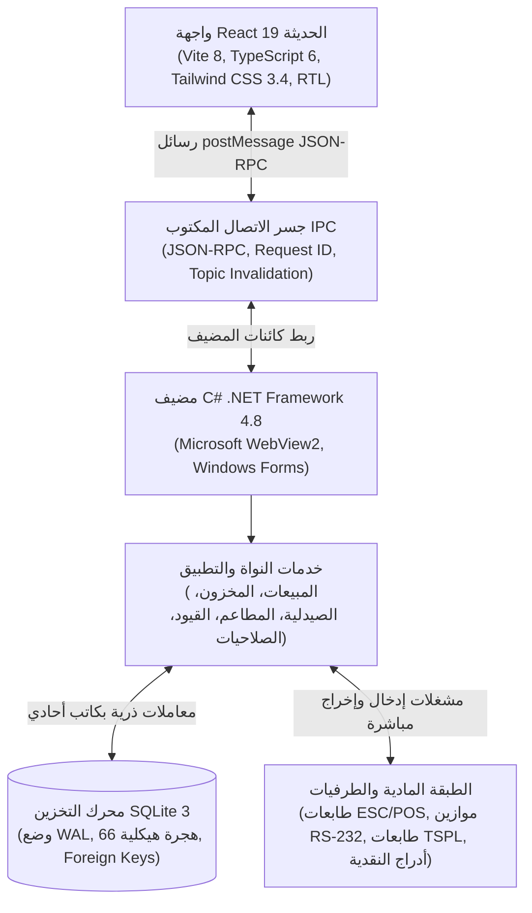

# نظام رفيق لإدارة نقاط البيع والمتاجر (Rafiq POS)

برنامج سطح مكتب لإدارة نقاط البيع والأنشطة التجارية، مصمم للعمل بدون إنترنت (Offline-First) على أنظمة ويندوز من Windows 7 وحتى Windows 11.

[English Version / النسخة الإنجليزية](README.md)

[](desktop/Properties/AssemblyInfo.cs)
[-0078D4.svg)](desktop/app.manifest)
[](desktop/RafiqPOS.csproj)
[](frontend/package.json)
[-003B57.svg)](desktop/Database/MigrationRunner.cs)
[](frontend/test/)

---

## نظرة عامة

<p align="center">
  
</p>

عروض تشغيلية مسجلة:
* [دورة عمل الكاشير والبيع الكاملة](https://github.com/ISlamKhaledAli/RAFIQ/raw/main/frontend/public/videos/pos_cashier_synced.mp4) (فيديو MP4 بدقة 1080p وصوت عربي)
* [إدارة حسابات العملاء والبيع الآجل](https://github.com/ISlamKhaledAli/RAFIQ/raw/main/frontend/public/videos/customer_credit_synced.mp4) (فيديو MP4 بدقة 1080p وصوت عربي)
* [إضافة وتكويد الأصناف وإدارة المخزون](https://github.com/ISlamKhaledAli/RAFIQ/raw/main/frontend/public/videos/add_new_product_tutorial_synced.mp4) (فيديو MP4 بدقة 1080p وصوت عربي)

<!-- TODO: إضافة لقطات شاشة للوحة التحكم والتقارير المباشرة -->

---

## دوافع وتحديات البناء

تواجه المتاجر ومحلات التجزئة في السوق المحلي قيودا تشغيلية لا تلائمها تطبيقات الويب العادية. غالبا ما يعمل المتجر على أجهزة قديمة بمعالجات Celeron وذاكرة وصول عشوائي 2 جيجابايت ونظام Windows 7 SP1. تنقطع شبكة الإنترنت والكهرباء بصورة متكررة ومفاجئة، ويكتب الكاشير باللغة العربية أثناء مسح الباركود الإنجليزي. تم بناء رفيق ليعمل محليا بالكامل بدون إنترنت، ويحمي البيانات المالية من التلف عند انقطاع الكهرباء، ويصحح مدخلات الباركود العربية تلقائيا، ويتصل مباشرة بالموازين الإلكترونية وطابعات الفواتير الحرارية.

---

## الموديولات والأنشطة التجارية

### السوبرماركت ومحلات التجزئة
* دورة بيع سريعة عبر لوحة المفاتيح باستخدام اختصارات F1 حتى F12 بدون استخدام الفأرة.
* معالج قراءة الباركود الذي يصحح حروف لوحة المفاتيح العربية والروابط المزدوجة تلقائيا.
* قراءة وفك باركود الموازين الإلكترونية (للوزن والسعر المدمج).
* إدارة حسابات العملاء، حدود الائتمان، كشوف الحسابات وسندات السداد الجزئي والكلي.
* إدارة الورديات وتقفيل الخزينة النقدية وطباعة تقارير X-Report و Z-Report.

### الصيدليات والرقابة السريرية
* محرك سريري لفحص التفاعلات الدوائية (DDI) يغطي 127 زوجا حرجا من التعارضات.
* دليل محلي مدمج للأدوية المصرية يحتوي على أكثر من 26 ألف صنف دوائي.
* تتبع التشغيلات (Batches) وتواريخ الصلاحية وتطبيق قاعدة الصرف حسب الأسبق انتهاء (FEFO).
* تجزئة وفك الوحدات (علبة، شريط، قرص) مع توزيع دقيق للتكلفة والربحية.
* دفتر رسمي لتسجيل صرف أدوية الجدول والمواد المراقبة.
* طباعة ملصقات جرعات الاستخدام الحرارية للمرضى.

### الكافيهات والمطاعم
* خريطة بصرية تفاعلية للطاولات تشمل فتح، نقل، دمج، وتقسيم الشيكات.
* توجيه تذاكر المطبخ والبار (KOT) مع طباعة الفروق والطلبات الجديدة فقط.
* تعديلات وإضافات الأصناف (درجات السكر، الإضافات، وملاحظات التحضير).
* إدارة أسطول الدليفري، تعيين الطيارين، وتصفية العهد النقدية.
* نظام الرسبي وخصم الخامات والمكونات المخزنية آليا عند كل طلب.

### الدفع الإلكتروني والمحافظ الرقمية
* دعم السداد عبر بطاقات الدفع البنكية والمحافظ الإلكترونية (فودافون كاش، إنستاباي، فوري، أمان).
* فصل رسوم وعمولات الخدمة الإلكترونية محاسبيا عن صافي المبيعات.
* مطابقة المقبوضات الرقمية مع الخزينة النقدية في الإقفال اليومي.

### قوالب الأنشطة الجاهزة
11 قالبا تخصصيا مهيئا بضغطة زر: سوبرماركت، صيدلية، مطعم وكافيه، محمصة وعطارة، مخبز وحلواني، ملابس، إلكترونيات، حدايد وبويات، عطور، أدوات مكتبية، وتجارة عامة.

---

## المعمارية الهندسية



### القرارات التصميمية الأساسية

1. **حسابات مالية بالأعداد الصحيحة:** تُحسب وتُخزن كافة الأسعار والضرائب والخصومات بالقروش كأعداد صحيحة (long في C# و number في TypeScript). تُحسب النسب المئوية بنقاط الأساس (100% = 10,000 bps). يتم التحويل للجنيه حصرا في شاشة العرض النهائية باستخدام تقريب AwayFromZero لمنع أخطاء الفواصل العائمة.
2. **الحماية من انقطاع الكهرباء عبر وضع WAL:** تُنفذ عمليات البيع وتعديل المخزون داخل معاملات ذرية (`conn.BeginTransaction()`). يضمن وضع Write-Ahead Logging مع `PRAGMA synchronous = FULL` و `PRAGMA busy_timeout = 5000` ثبات وسلامة قاعدة البيانات عند انقطاع التيار الكهربائي المفاجئ.
3. **الاسترداد الذري للفواتير عبر مفاتيح عدم التكرار:** يرفق كل طلب بيع بمفتاح UUIDv4 فريد (Idempotency Key). عند حدوث مهلة زمنية في جسر الاتصال، يستعلم الجسر عن الفاتورة عبر `sales:getByIdempotencyKey` قبل إعادة المحاولة، مما يمنع تكرار الحساب أو ازدواجية الخصم المخزني.
4. **ترحيل هيكلي تراكمي مع تراجع تلقائي:** تم بناء هيكل البيانات عبر 66 إصدار ترحيل متسلسل في `MigrationRunner.cs`. تُؤخذ نسخة احتياطية فورية قبل أي ترحيل، ويتم التراجع واستعادة النسخة تلقائيا في حال فشل أي خطوة.
5. **حظر الحذف المادي وسجل تدقيق مشفر:** لا يتم حذف أي فاتورة أو حركة مخزنية أو قيد مالي ماديا من قاعدة البيانات، بل يتم التصحيح عبر قيود معاكسة (Contra Entries). تُسجل العمليات الإدارية الحساسة داخل سجل تدقيق مشفر بسلسلة بصمات SHA-256.
6. **تكيف المؤثرات البصرية مع مواصفات الجهاز:** تفحص أداة فحص العتاد مواصفات المعالج والذاكرة ونظام التشغيل، وتضبط توكنز الحركة في الواجهة ديناميكيا (إلغاء المؤثرات `duration-0` على الأجهزة الضعيفة) لمنع سقوط الإطارات أثناء عمليات البيع السريعة.
7. **واجهة بدون مكتبات توجيه أو إدارة حالة خارجية:** تعتمد الواجهة على بنية التبويبات المخصصة والتنقل المشروط مع التحميل الكسول للتبويبات عبر `visitedTabs` Set، وتعتمد مزامنة الشاشات على ناقل أحداث داخلي (Event Bus) ينشط عند تعديل البيانات.
8. **مشغل WebView2 مزدوج حسب بيئة ويندوز:** يتحقق المضيف من رقم بناء ويندوز عند الإقلاع، فيستخدم المشغل الثابت Fixed Runtime 109 على Windows 7 و 8 و 8.1، ويعتمد على مشغل Evergreen المدمج على Windows 10 و 11.

---

## حزمة التقنيات المستخدمة

| الطبقة | التقنية | الإصدار | الوظيفة |
| :--- | :--- | :--- | :--- |
| **واجهة المستخدم** | React | 19.3.0 | عرض وتصيير الشاشات |
| **لغة البرمجة** | TypeScript | 6.0.3 | النماذج والأنواع الصارمة |
| **أداة البناء** | Vite | 8.3.0 | تجميع وحزم الواجهة لاستهداف `chrome109` |
| **تنسيقات التصميم** | Tailwind CSS | 3.4.17 | نظام التوكنز البصرية ودعم الوضع الداكن |
| **أداة الفحص** | Oxlint | 1.85.0 | فحص الأكواد الثابت عبر 472 ملفا |
| **مضيف سطح المكتب** | C# / WinForms | .NET 4.8 | غلاف البرنامج التنفيذي لويندوز 7 حتى 11 |
| **مشغل الويب** | Microsoft WebView2 | 1.0.1518.46 | بيئة تشغيل الكروميوم (Fixed 109 / Evergreen) |
| **قاعدة البيانات** | SQLite 3 | 3.53 (SQLite3 Multiple Ciphers 2.4.0) | محرك التخزين المحلي عبر `Microsoft.Data.Sqlite.Core` 9.0.10 خلف طبقة التوافق `RafiqPOS.Data` (المجلد `desktop/Data/`) |
| **الطرفيات المادية** | ESC/POS, TSPL, RS-232 | C# Native | طابعات الفواتير، طابعات الباركود، والموازين |
| **الجداول والإكسيل** | SheetJS (xlsx) / ClosedXML | 0.20.3 / 0.95.4 | استيراد وتصدير الأصناف والحسابات |

---

## الجودة والاختبارات الآلية

يتضمن المشروع اختبارات آلية تغطي الواجهة ومضيف C#.

### اختبارات الواجهة (Node.js Test Runner)
تعتمد الواجهة على مشغل اختبارات Node.js المدمج مع `node:assert/strict` عبر 160 ملف اختبار:
```bash
cd frontend
npm test
```
النتيجة: **2,355 اختبارا ناجحا** عبر 516 حزمة اختبارية في نحو 15 ثانية.

### فحص جودة الواجهة (Linting)
```bash
cd frontend
npm run lint
```
النتيجة: **0 تحذيرات و 0 أخطاء** عبر 472 ملفا.

### بناء الواجهة للإنتاج
```bash
cd frontend
npm run build
```
النتيجة: بناء مكتمل في نحو 5 ثوان إلى مجلد `frontend/dist`. حجم حزم الجافاسكريبت غير المضغوطة مجتمعة نحو 3.97 ميجابايت (نحو 932 كيلوبايت بعد ضغط gzip موزعة على حزم مقسمة).

### اختبارات مضيف C# (NUnit 3)
يغطي مشروع اختبارات C# نحو 64 ملف سيناريو (من S1 حتى S71):
```cmd
desktop\packages\NUnit.ConsoleRunner.3.16.3\tools\nunit3-console.exe desktop\RafiqPOS.Tests\bin\Release\RafiqPOS.Tests.dll
```
النتيجة: **657 اختبارا ناجحا** (0 فشل، 0 تخطي) تغطي الحسابات المالية، ترحيل البيانات، حماية الصلاحيات، وحالات انقطاع الطاقة.

---

## دليل التشغيل للمطورين

### المتطلبات المسبقة
* نظام تشغيل Windows 7 SP1 أو أحدث (32-bit أو 64-bit).
* بيئة Node.js بإصدار 18 أو 20 LTS.
* حزمة تطوير .NET Framework 4.8 Developer Pack.
* أدوات بناء MSBuild (Visual Studio Build Tools).
* برنامج Inno Setup 6 (اختياري، لبناء ملف التثبيت النهائي).

### خطوات التشغيل والتطوير
1. استنساخ المستودع:
   ```bash
   git clone https://github.com/ISlamKhaledAli/RAFIQ.git
   cd RAFIQ
   ```
2. تثبيت حزم الواجهة:
   ```bash
   cd frontend
   npm install
   ```
3. تشغيل خادم تطوير الواجهة:
   ```bash
   npm run dev
   ```
4. بناء مشروع C#:
   ```cmd
   MSBuild desktop\RafiqPOS.csproj /p:Configuration=Release /p:Platform=x86 /v:m
   MSBuild desktop\RafiqPOS.csproj /p:Configuration=Debug /p:Platform=x86 /v:m
   ```
5. تشغيل البرنامج بوضع التطوير:
   ```cmd
   Run_Dev_Mode.bat
   ```

### بناء حزمة التثبيت المستقلة (Setup)
```cmd
Build_Installer_Full.bat
```
يتم إنشاء ملف التثبيت في المسار: `installer/Output/RafiqPOS_Setup_v1.1.0.exe`.

---

## مصفوفة توافق الأجهزة والطرفيات

| نوع الجهاز | البروتوكول والمنفذ | الموديلات والأنواع المدعومة |
| :--- | :--- | :--- |
| **طابعات الفواتير الحرارية** | ESC/POS عبر USB أو منفذ تسلسلي وهمي COM | Xprinter (XP-N160M, XP-Q800), Epson (TM-T20, TM-T88), Rongta, Sunmi (80 مم و 58 مم) |
| **طابعات ملصقات الباركود** | TSPL / ZPL / مشغل ويندوز | Xprinter XP-365B, XP-420B, Zebra ZD220, Rongta RP400 (مقاسات 50x30, 38x25, 40x25 مم) |
| **قارئات الباركود** | محاكاة لوحة المفاتيح USB HID | Honeywell Voyager, Zebra LS2208, Datalogic QuickScan، وقارئات CCD العامة |
| **الموازين الإلكترونية** | بروتوكول تسلسلي RS-232 / USB Serial | CAS (PD-II, ER Plus), Rongta RLS1000, Mettler Toledo (قراءة مستمرة للوزن) |
| **أدراج النقدية** | إشارة كهربائية RJ11 / RJ12 | الأدراج القياسية بجهد 12V و 24V المرتبطة بالطابعة (Pin 2 و Pin 5) |
| **شاشات عرض السعر للعميل** | منفذ تسلسلي COM ESC/POS | شاشات العرض VFD سطرين في 20 حرفا |

---

## الأمان والحوكمة ومصفوفة الصلاحيات

يعتمد النظام تسلسلا هرميا للأدوار محكوما بكلمات مرور ورموز PIN:
```
Root (المطور الفني / المالك التقني)
  └── Admin (مدير وصاحب المتجر)
        ├── Supervisor (مشرف الفرع)
        ├── Cashier (كاشير المبيعات والورديات)
        ├── Pharmacist (الصيدلي السريري والصرف)
        └── Rider (طيار التوصيل والدليفري)
```

### الضوابط المفروضة من الخادم (C# Host)
* **سلطة الأسعار:** يتم التحقق من صحة أسعار الأصناف والضرائب والخصومات المرسلة من الواجهة ومطابقتها مع قاعدة البيانات في خادم C# لمنع أي تلاعب عبر الواجهة.
* **رمز المشرف لتجاوز الحدود:** يتطلب تجاوز سقف الخصم المسموح أو تخطي حد ائتمان العميل إدخال الرمز السري للمشرف للموافقة.
* **تجميد التعديل اليدوي للمخزون:** يمنع تعديل رصيد الصنف يدويا خارج مسارات العمل الرسمية (فاتورة شراء، محضر جرد، أو إذن مرتجع).
* **سجل تدقيق مشفر:** تسجل العمليات الحساسة (فتح الدرج، تعديل الأسعار، إلغاء الفواتير) في جدول مشفر بسلسلة تجزئة SHA-256.

---

## هيكل المجلدات

```
RAFIQ/
├── desktop/                      # مضيف ويندوز بلغة C# .NET 4.8 WinForms
│   ├── Bridge/                   # معالجات قنوات IPC لرسائل WebView2
│   ├── Common/                   # فحص عتاد الجهاز وميزات النظام
│   ├── Database/                 # محرك ترحيل قاعدة البيانات (66 إصدارا)
│   ├── Models/                   # كيانات النظام (الفواتير، الأصناف، العملاء)
│   ├── Properties/               # بيانات التجميع والإصدار v1.1.0
│   ├── Repositories/             # طبقة الوصول للبيانات وتنفيذ أوامر SQLite
│   ├── Services/                 # منطق الأعمال (المبيعات، المخزون، الصيدلية، المطاعم)
│   └── RafiqPOS.Tests/           # حزم اختبارات NUnit (السيناريوهات من S1 إلى S71)
├── frontend/                     # واجهة المستخدم React 19
│   ├── src/
│   │   ├── bridge/               # جسر استدعاءات IPC وناقل تحديث البيانات
│   │   ├── components/           # 109 مكونات ونوافذ منبثقة يعاد استخدامها
│   │   ├── context/              # سياقات إدارة الحالة (المستخدم، الميزات، المظهر)
│   │   ├── hooks/                # خطافات مخصصة (النماذج، الحركة، الطباعة)
│   │   ├── types/                # تعريفات TypeScript ونماذج البيانات
│   │   ├── utils/                # الحساب المالي بالقروش، الباركود، ومعالجة الصور
│   │   └── views/                # 16 شاشة وموديولا تجاريا ولوحات التحليلات
│   └── test/                     # 160 ملف اختبارات للواجهة (2,355 اختبارا)
├── installer/                    # سكريبتات تجميع حزمة التثبيت عبر Inno Setup 6
├── docs/                         # التوثيق المعماري، التصاميم، والعروض التوضيحية
└── scripts/                      # سكريبتات البناء والحزم والتحقق
```

---

## الحالة وخارطة الطريق

### منجز ومختبر برمجيا
* دورة البيع الكاملة عبر الكيبورد مع التخزين المحلي في SQLite.
* 11 قالبا تخصصيا ومحركات الأنشطة (سوبرماركت، صيدلية، مطاعم).
* حسابات العملاء، البيع الآجل، فواتير الشراء، وإقفال الورديات.
* نظام الترحيل التراكمي لقاعدة البيانات مع التراجع التلقائي.
* مشغلات الطرفيات لطابعات الفواتير، موازين السيريال، وطابعات الملصقات.
* نظام تكيف المؤثرات البصرية مع عتاد الجهاز ومعالجة شعارات الفواتير.
* أكثر من 3,000 اختبار آلي ناجح يغطي الواجهة والمضيف (2,355 في الواجهة + 657 في C# NUnit).

### قيد التخطيط والتصميم
* **الربط مع المتجر الإلكتروني:** تم توثيق التصميم المعماري الشامل في [`docs/ONLINE_STORE_DESIGN_DOC.md`](docs/ONLINE_STORE_DESIGN_DOC.md) لمزامنة الأصناف السحابية واستقبال طلبات الأونلاين. لم يبدأ التنفيذ البرمجي بعد.
* **مزامنة الشبكة المحلية بين عدة أجهزة كاشير:** يعمل النظام حاليا بنمط الجهاز المنفرد المستقل، ويجري التخطيط لدعم مزامنة أجهزة الكاشير عبر الشبكة المحلية في إصدار لاحق.

---

## قيود تشغيلية معروفة

* **نظام كاشير أحادي:** مصمم للعمل على جهاز نقطة بيع واحد متصل بقاعدة بيانات SQLite محلية، ولا يدعم مشاركة قاعدة البيانات المباشرة عبر الشبكة لأكثر من جهاز في نفس الوقت.
* **الاعتماد على بيئة ويندوز:** يعتمد مشغل سطح المكتب على Windows Forms و .NET Framework 4.8، ولا يعمل على أنظمة Linux أو macOS.
* **استهلاك الذاكرة لمشغل الويب:** نظرا لاعتماد الواجهة على Microsoft WebView2، يخضع استهلاك الذاكرة للعمليات الأساسية لمحرك Chromium (نحو 180 إلى 260 ميجابايت أثناء التشغيل الفعلي).
* **الحاجة لحزمة مشغل الويب في التثبيت الأول:** يعمل البرنامج بدون إنترنت نهائيا، ولكن يتطلب التثبيت الأول على أنظمة ويندوز 7 تضمين حزمة Fixed Runtime 109 في المثبت.

---

## المؤلف والترخيص

* **المؤلف:** إسلام خالد علي (Islam Khaled Ali)
<!-- TODO: إضافة ملف الترخيص الرسمي للمشروع (مثل MIT أو ترخيص تجاري مخصص) -->
* **حقوق النشر:** جميع الحقوق محفوظة © 2026 إسلام خالد علي.
