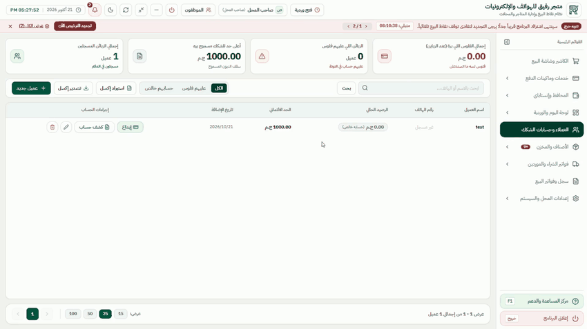
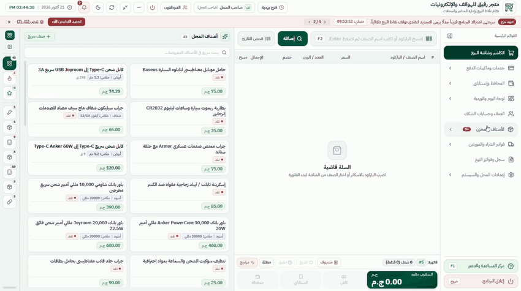
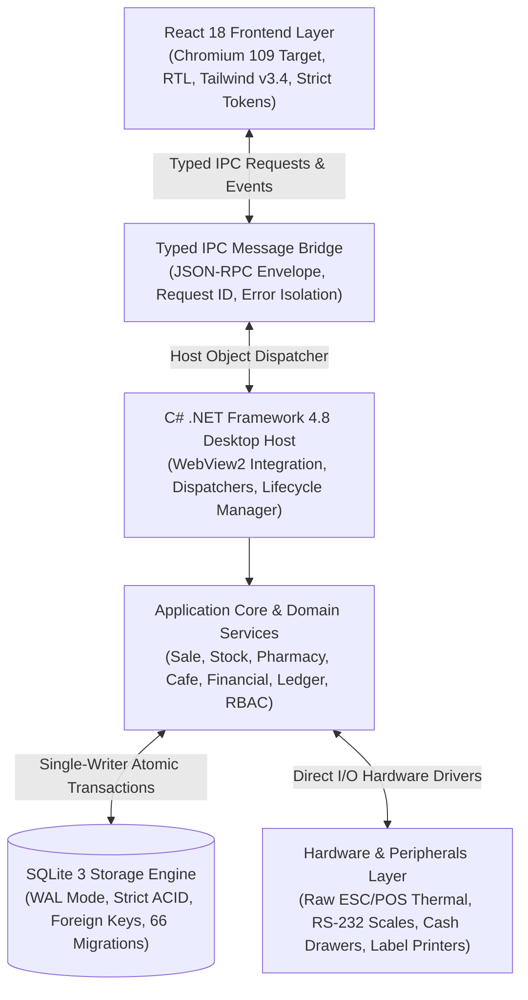
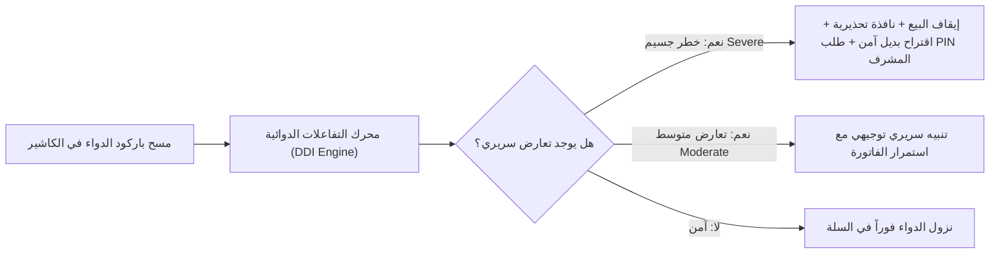
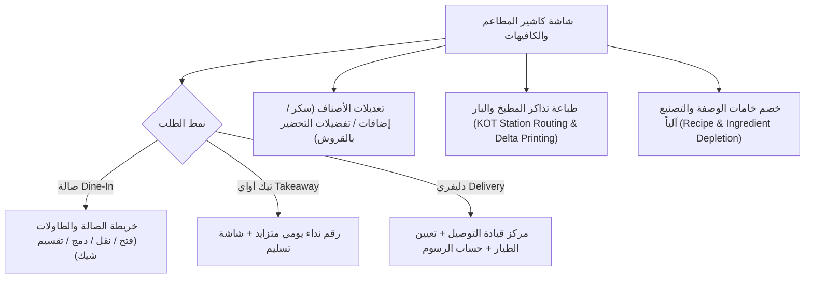

# <p align="center"><picture><source media="(prefers-color-scheme: dark)" srcset="branding/logo_full_dark.png"><source media="(prefers-color-scheme: light)" srcset="branding/logo_full.png"></picture><br/><b>نظام رفيق لإدارة نقاط البيع والمتاجر ومحلات التجزئة (Rafiq POS)</b><br/><sub>Enterprise-Grade, Offline-First Retail &amp; Store Management System</sub></p>

<p align="center">
  <a href="https://dotnet.microsoft.com/en-us/download/dotnet-framework/net48"></a>
  <a href="https://react.dev/"></a>
  <a href="https://www.sqlite.org/"></a>
  
  
  
  
  
  
</p>

---

## نظرة عامة تنفيذية (Executive Summary)

**رفيق (Rafiq POS)** هو نظام هندسي متكامل ومحكم لنقاط البيع وإدارة المنشآت التجارية ومحلات التجزئة، مصمم خصيصاً لمواجهة التحديات التشغيلية الصعبة في بيئة العمل الواقعية:
* **استقلال تام عن الإنترنت (100% Offline-First):** يعمل النظام محلياً بالكامل دون الحاجة لأي اتصال سحابي أو شبكي.
* **حزمة تثبيت موحدة وشاملة:** تثبيت وتشغيل فوري بنسخة واحدة متوافقة مع كافة إصدارات ويندوز من **Windows 7 SP1 (32-bit و 64-bit)** ومروراً بـ **Windows 8.1 / 10** وحتى **Windows 11**.
* **أداء فائق واستهلاك اقتصادي للموارد:** استهلاك ذاكرة منخفض للغاية (**RAM < 150MB**) وزمن إقلاع فوري (< ثانيتين) يضمن سلاسة التشغيل على أجهزة الكاشير القديمة والمتواضعة (2GB RAM).
* **أمان مالي صارم ومناعة ضد انقطاع الكهرباء:** حسابات مالية تعتمد كلياً على الأعداد الصحيحة بالقروش لمنع أخطاء التقريب العشري نهائياً، مع تفعيل وضع `SQLite WAL` لحفظ البيانات لحظياً وحمايتها من التلف حتى عند فصل الكهرباء الفجائي أثناء حفظ الفاتورة.
* **تغطية شاملة لكافة الأنشطة التجارية:** يدمج النظام موديولات تخصصية تلبي احتياجات السوبرماركت، الصيدليات، الكافيهات والمطاعم، المخابز والمحامص، محلات الملابس، والأجهزة الكهربائية والإلكترونيات عبر محرك قوالب ذكي.

---

## فهرس المحتويات (Table of Contents)

1. [العروض المرئية والتفاعلية (Interactive Video Showcases)](#العروض-المرئية-والتفاعلية-interactive-video-showcases)
2. [المعايير الهندسية الصارمة والمعمارية (Architecture & Engineering Invariants)](#المعايير-الهندسية-الصارمة-والمعمارية-architecture--engineering-invariants)
3. [الموديولات التخصصية للأنشطة التجارية (Specialized Business Modules)](#الموديولات-التخصصية-للأنشطة-التجارية-specialized-business-modules)
   - [موديول السوبرماركت ومحلات التجزئة (Supermarket & Retail)](#1-موديول-السوبرماركت-ومحلات-التجزئة-supermarket--retail)
   - [موديول الصيدليات والرقابة السريرية (Clinical Pharmacy Suite)](#2-موديول-الصيدليات-والرقابة-السريرية-clinical-pharmacy-suite)
   - [منظومة الكافيهات والمطاعم (Cafe & Restaurant POS Suite)](#3-منظومة-الكافيهات-والمطاعم-cafe--restaurant-pos-suite)
   - [إدارة الدفع الإلكتروني والمحافظ الرقمية (E-Payments & Wallets)](#4-إدارة-الدفع-الإلكتروني-والمحافظ-الرقمية-e-payments--wallets)
   - [محرك القوالب التخصصية للمتاجر (Store Templates Engine)](#5-محرك-القوالب-التخصصية-للمتاجر-store-templates-engine)
4. [مصفوفة الأجهزة والطرفيات المعتمدة (Certified Hardware Compatibility)](#مصفوفة-الأجهزة-والطرفيات-المعتمدة-certified-hardware-compatibility)
5. [اختصارات الكاشير والتحكم السريع (Zero-Mouse Keyboard Shortcuts F1-F12)](#اختصارات-الكاشير-والتحكم-السريع-zero-mouse-keyboard-shortcuts-f1-f12)
6. [نظام الصلاحيات والحوكمة الصارمة (Security & RBAC Matrix)](#نظام-الصلاحيات-والحوكمة-الصارمة-security--rbac-matrix)
7. [هيكل المشروع (Project Directory Layout)](#هيكل-المشروع-project-directory-layout)
8. [دليل التشغيل والبناء (Developer & Deployment Guide)](#دليل-التشغيل-والبناء-developer--deployment-guide)
9. [خارطة الطريق وسجل الإنجاز (Roadmap & Status - 100% Complete)](#خارطة-الطريق-وسجل-الإنجاز-roadmap--status---100-complete)

---

## العروض المرئية والتفاعلية (Interactive Video Showcases)

يحتوي النظام على مكتبة مرئية شاملة وتفاعلية تشرح دورات العمل الحقيقية في المتاجر ومحلات التجزئة، بصوت بشري استوديو واضح وعالي النقاء وجودة **1080p Full HD**:

---

### 1. دورة البيع الكاملة وشاشة الكاشير (POS Cashier Master Workflow)

<p align="center">
  
</p>

<p align="center">
  <a href="https://github.com/ISlamKhaledAli/RAFIQ/raw/main/frontend/public/videos/pos_cashier_synced.mp4" target="_blank">
    
  </a>
  <br/>
  <sub><a href="https://github.com/ISlamKhaledAli/RAFIQ/raw/main/frontend/public/videos/pos_cashier_synced.mp4" target="_blank">اضغط هنا لتشغيل الفيديو فورياً في المتصفح بدقة 1080p والصوت البشري</a></sub>
</p>

<details>
<summary><b>تفاصيل سيناريو دورة البيع الكاملة (اضغط للتفاصيل)</b></summary>

* **مسح الباركود الذكي:** قراءة فورية مع معالجة وتصحيح تلقائي لحروف لوحة المفاتيح عند الكتابة باللغة العربية بالخطأ دون الحاجة لتحويل لغة الويندوز.
* **البحث السريع بالكيبورد (`F2`):** كتابة الحروف الأولى، التنقل بالأسهم، والإنزال في السلة بـ `Enter` بدون لمس الفأرة نهائياً.
* **الميزان الإلكتروني للأصناف الموزونة:** نافذة قراءة فورية تحسب الوزن الصافي والسعر بالقروش بدقة متناهية.
* **الأصناف متغيرة الخصائص (Variants):** نافذة اختيار المقاسات، النكهات، والعبوات بضغطة زر واحدة.
* **تعليق واسترجاع الفواتير (`F6`):** إمكانية تعليق الفاتورة فوراً لخدمة عميل مستعجل والعودة إليها بكامل محتوياتها بثانية واحدة.
* **السداد النقدي والآجل:** حساب الباقي تلقائياً، إعطاء تنبيه فوري بالبصريات عند تجاوز حد ائتمان العميل، وفتح درج النقدية عبر إشارة الكاش درور الكهربائية وطباعة إيصال الفاتورة الحراري (80mm / 57mm).
</details>

---

### 2. إدارة حسابات العملاء والبيع الآجل والديون (Customer Accounts & Credit Debt Management)

<p align="center">
  
</p>

<p align="center">
  <a href="https://github.com/ISlamKhaledAli/RAFIQ/raw/main/frontend/public/videos/customer_credit_synced.mp4" target="_blank">
    
  </a>
  <br/>
  <sub><a href="https://github.com/ISlamKhaledAli/RAFIQ/raw/main/frontend/public/videos/customer_credit_synced.mp4" target="_blank">اضغط هنا لتشغيل الفيديو فورياً في المتصفح بدقة 1080p والصوت البشري</a></sub>
</p>

<details>
<summary><b>تفاصيل سيناريو إدارة حسابات العملاء والبيع الآجل (اضغط للتفاصيل)</b></summary>

* **تسجيل وإدارة حسابات العملاء:** إنشاء ملف العميل برقم الهاتف، العنوان، وتحديد سقف المديونية (حد الائتمان المسموح به).
* **البيع الآجل (الشكك):** تحويل الفاتورة لحساب العميل بضغطة زر مع فحص لحظي لحد الائتمان وحظر التجاوز إلا بصلاحية المشرف.
* **مؤشرات الحساب الفورية:** بطاقات إحصائية ملونة توضح (إجمالي الفلوس اللي برة، عدد الزبائن المديونين، وسقف الديون المسموح).
* **سندات سداد الديون:** تسجيل دفعات السداد الجزئي أو الكلي (نقداً أو عبر المحافظ الإلكترونية) مع تحديث فوري لرصيد العميل وطباعة إيصال قبض.
* **كشف حساب العميل التراكمي:** استعراض كافة حركات المشتريات والسدادات مع إمكانية التصدير والاستيراد من إكسيل.
</details>

---

### 3. إضافة وتكويد صنف جديد وإدارة الأسعار والمخزون (Add New Product & Stock Catalog Tutorial)

<p align="center">
  
</p>

<p align="center">
  <a href="https://github.com/ISlamKhaledAli/RAFIQ/raw/main/frontend/public/videos/add_new_product_tutorial_synced.mp4" target="_blank">
    
  </a>
  <br/>
  <sub><a href="https://github.com/ISlamKhaledAli/RAFIQ/raw/main/frontend/public/videos/add_new_product_tutorial_synced.mp4" target="_blank">اضغط هنا لتشغيل الفيديو فورياً في المتصفح بدقة 1080p والصوت البشري</a></sub>
</p>

<details>
<summary><b>تفاصيل سيناريو إضافة صنف جديد وتكويد المخزون (اضغط للتفاصيل)</b></summary>

* **إضافة وتكويد الصنف السريع:** إدخال اسم الصنف، قراءة الباركود بالقارئ أو توليد باركود تلقائي فريد للصنف.
* **التسعير الذكي وهامش الربح:** إدخال سعر التكلفة وسعر البيع مع احتساب نسبة هامش الربح المئوية آلياً.
* **التصنيف والأقسام:** ربط الصنف بالأقسام المناسبة (سوبرماركت، إلكترونيات، خضار، ملابس...) لسهولة الوصول من شاشة البيع.
* **إدارة النواقص والكميات:** تحديد الرصيد الافتتاحي وتعيين حد أدنى للنواقص لإرسال تنبيهات إعادة الطلب قبل نفاد الكمية.
* **النزول الفوري في البيع:** حفظ الصنف في قاعدة بيانات SQLite WAL ليظهر فورياً في شاشة الكاشير والبحث بدون إعادة تشغيل البرنامج.
</details>

---

## المعايير الهندسية الصارمة والمعمارية (Architecture & Engineering Invariants)

تم تصميم وبناء نظام "رفيق" وفق معمارية فصل الطبقات الصارمة (Clean Multi-Tier Architecture) لضمان أعلى درجات الموثوقية والأداء:



### القواعد المعمارية الثمانية الحاكمة (Senior Engineering Invariants)

#### 1. الأمان المالي المطلق (Integer Financial Arithmetic)
> [!IMPORTANT]
> يُمنع منعاً باتاً استخدام أنواع الفواصل العائمة (`float` أو `double`) في أي عملية حسابية مالية، خصم، ضريبة، أو تخزين مبالغ.
* تُحسب وتُخزّن جميع الأسعار والمبالغ والضرائب والخصومات **بالقروش (Piasters)** كأعداد صحيحة (`long` في C#، و `number` صحيح في TypeScript).
* النسب المئوية للضرائب والخصومات تُحسب وتُخزّن بنظام **نقاط الأساس (Basis Points - BPS)** حيث `100% = 10000 bps` لضمان دقة الكسر المحاسبي.
* التحويل للجنيه (`amount / 100.0`) يتم **فقط وحصرياً في واجهة العرض النهائية للمستخدم**، ولا يدخل مطلقاً في أي عمليات حسابية تراكمية.
* الأوزان والكميات الموزونة تُخزّن بوحدات قياسية دقيقة (المليجرام أو الجرام كأعداد صحيحة).

#### 2. المعاملات الذرية وحماية انقطاع الكهرباء (ACID Transactions & WAL Protection)
* أي عملية بيع، خصم مخزني، حركة سداد آجل، أو ترحيل وردية تُنفذ بالكامل داخل **معاملة ذرية واحدة (`conn.BeginTransaction()`)**.
* في حالة حدوث أي استثناء أو انقطاع مفاجئ للتيار الكهربائي، يتم التراجع التلقائي (`Rollback`) دون ترك أي بيانات يتيمة أو متضاربة.
* وضع قاعدة البيانات مهيأ دائماً بأعلى معايير الثبات:
  ```sql
  PRAGMA journal_mode = WAL;
  PRAGMA synchronous = NORMAL;
  PRAGMA foreign_keys = ON;
  PRAGMA busy_timeout = 5000;
  ```
* تشغيل فحص السلامة الآلي السريع (`PRAGMA quick_check;`) عند إقلاع البرنامج لضمان سلامة الفهارس والمفاتيح قبل بدء العمليات.

#### 3. حظر الحذف المادي وحفظ السجلات الدفترية (Immutable Ledger & Zero Hard Delete)
* يُحظر الحذف المادي (`Hard Delete`) للفواتير، المبيعات، حركات المخزون، أو قيود الخزينة نهائياً.
* أي تصحيح أو إلغاء لمعاملة يتم عبر **قيد محاسبي معاكس (Contra Entry)** موثق بالسبب، اسم المستخدم، والتاريخ الدقيق.
* تفعيل سجل تدقيق مشفر ومحمي بسلسلة بصمات SHA-256 (`Tamper-Evident Audit Trail`) لكافة العمليات الحساسة وتعديلات الأسعار والصلاحيات.

#### 4. التوافقية الشاملة وحزمة التشغيل المزدوجة (Universal Windows Compatibility)
* الالتزام الصارم بـ **.NET Framework 4.8** لدعم Windows 7 SP1 (32-bit و 64-bit) وحتى Windows 11 بنسخة تنفيذية موحدة.
* كشف بيئة النظام ديناميكياً:
  * **Windows 7 / 8 / 8.1:** استخدام مشغل **WebView2 Fixed Runtime 109** المستقل المدمج محلياً.
  * **Windows 10 / 11:** الاعتماد التلقائي على مشغل **WebView2 Evergreen** المحدث ذاتياً.
* ضبط هدف بناء الواجهة (Vite) على `chrome109` و `es2020`، والاعتماد الحصري على **Tailwind CSS v3.4** لتجنب أي ميزات CSS غير مدعومة في Chromium 109.

#### 5. استهلاك الذاكرة الاقتصادي والعزل الكامل (Ultra-Low Memory & Error Isolation)
* استهلاك إجمالي لذاكرة الجهاز لا يتجاوز **150 ميجابايت** أثناء أقصى درجات الضغط وسرعة إتمام الفاتورة.
* عزل أخطاء الأجهزة والطرفيات (مثل انقطاع كابل الطابعة أو توقف الميزان) عن حركة حفظ البيانات المالية؛ لا يتعطل تسجيل الفاتورة في قاعدة البيانات عند تعثر الطباعة.
* معالجة مستقلة لكافة الأخطاء برسائل عربية واضحة ومحددة ترشد المستخدم بدقة لحل المشكلة.

#### 6. التحديثات الهوائية الآمنة وحرمة قواعد البيانات (Air-Update Safety & Database Inviolability)
* **حظر الإغلاق أو إعادة التشغيل الإجباري:** تطبيق التحديثات وإعادة التشغيل يتم حصراً بنقرة زر يدوية صريحة من المستخدم مع إتاحة خيار التأجيل لنهاية الوردية.
* **حارس العمليات الجارية (Active Transaction Guard):** حظر تثبيت التحديث أو إغلاق النظام في حال وجود عملية بيع نشطة أو سلة معلقة لمنع ضياع المبيعات.
* **حرمة قاعدة البيانات:** حظر تضمين أي ملفات قاعدة بيانات (`.db` أو `.db-wal`) داخل حزم التحديث، مع تطبيق الترحيل التراكمي للجداول عبر 66 إصدار هجرة منظم في `MigrationRunner.cs`.
* **التراجع الذاتي الفوري (Automatic Rollback):** استعادة الملفات التنفيذية السابقة تلقائياً في حال فشل مطابقة بصمة التحديث (SHA-256) أو حدوث خطأ أثناء الاستبدال.

#### 7. الهوية البصرية الصارمة ومنع العناصر الافتراضية (Design System & Custom Tokens)
* حظر تام لاستخدام وسم HTML الافتراضي للمنسدلات (`<select>`) واستبداله بمكون `CustomSelect` المخصص لمنع المظهر الرمادي الشاذ على Windows 7.
* الالتزام الكامل بباليت الألوان المعتمدة في النظام:
  * الأخضر الرئيسي: `brand` (`#004D3F`)، `brand-dark` (`#00372D`)، `brand-soft` (`#E6F2ED`).
  * الأخضر المالي للنجاح: `paid` (`#006D41`)، `paid-soft` (`#EAF5EE`).
  * مساحات العمل: `canvas` (`#F8FAFC`)، `surface` (`#FFFFFF`)، `surface-2` (`#F1F5F4`).
  * الحدود والنصوص: `line` (`#DCE1DC`)، `ink` (`#0F172A`)، `ink-muted` (`#52605D`).
  * التحذيرات والأخطار: `warn` (`#B3720E`)، `danger` (`#B23A2E`).

#### 8. سياسة حظر الإيموجي والاعتماد الحصري على أيقونات SVG (Zero Emojis Policy)
> [!NOTE]
> يُحظر منعاً باتاً استخدام الرموز التعبيرية (Emojis) في واجهات النظام، الإشعارات، فواتير الطباعة، أو شفرة المصدر؛ نظراً لعدم دعمها في ويندوز 7 و 8 وظهورها كمربعات سوداء مشوهة. يتم الاعتماد كلياً على **أيقونات Lucide SVG المدمجة محلياً**.

---

## الموديولات التخصصية للأنشطة التجارية (Specialized Business Modules)

### 1. موديول السوبرماركت ومحلات التجزئة (Supermarket & Retail)
* **شاشة البيع السريع (Zero-Mouse Checkout):** تنفيذ الفاتورة كاملة عبر لوحة المفاتيح في أقل من 5 ثوانٍ.
* **المعالجة الآلية لأخطاء الباركود (Arabic Auto-Fix):** تحويل وتصحيح الحروف آلياً عند قراءة الباركود أثناء تفعيل لوحة المفاتيح العربية دون الحاجة لتغيير لغة الإدخال.
* **الموازين الإلكترونية والأصناف الموزونة:** الربط المباشر مع موازين الباركود والموازين الإلكترونية عبر منفذ السيريال (RS-232 / USB) لحساب الوزن الصافي والسعر بالقروش لحظياً.
* **تعدد وحدات البيع والشراء:** تسعير متعدد (قطعة، علبة، كرتونة، دائر) مع نسب تحويل دقيقة وتتبع الأرصدة بالوحدة الصغرى.
* **إدارة ديون العملاء والبيع الآجل:** سقف مديونية محدد، تنبيهات تجاوز حد الائتمان، كشوف حسابات تفصيلية، وسندات سداد جزئي وكلي.
* **تقارير الإقفال والورديات:** مطابقة العهدة النقدية في الدرج وإصدار تقارير اليومية الدقيقة (Z-Report و X-Report).

---

### 2. موديول الصيدليات والرقابة السريرية (Clinical Pharmacy Suite)

صُمم موديول الصيدليات ليعمل كمنظومة طبية وسريرية مستقلة ومتوافقة مع المعايير الصحية:



* **محرك التفاعلات والتعارضات الدوائية اللحظي (Clinical DDI Engine):**
  * فحص تلقائي وفوري لكافة أزواج الأدوية داخل سلة البيع بمجرد المسح.
  * قاعدة بيانات سريرية محلية تغطي أكثر من 127 تفاعلاً دوائياً حرجاً ومتوسطاً.
  * تصنيف ثلاثي لمستوى الخطورة: **حرج (Severe)** يمنع إتمام البيع إلا بموافقة المشرف أو استبدال الصنف، **متوسط (Moderate)**، و**طفيف (Minor)** مع توضيح الآلية والبديل الآمن.
* **الدليل المرجعي للأدوية المصرية (26,000+ دواء):** دليل محلي مدمج للاستعلام والبحث الفوري وتعبئة بيانات الأصناف الجديدة آلياً.
* **إدارة التشغيلات وتواريخ الصلاحية (Batch & Expiry Tracking):**
  * متابعة دقيقة لكل تشغيلة (`Batch Number`) وتاريخ صلاحيتها وسعر الشراء الخاص بها.
  * بيع تلقائي بنظام ما ينتهي أولاً يخرج أولاً (FEFO).
  * خريطة الصلاحيات الشهرية وتقرير الأدوية الراكدة والقابلة للإرجاع للشركات، مع محاضر الإعدام الرسمية (`EXPIRED_WRITE_OFF`).
* **تجزئة وفك العبوات (Unit Subdivision):** دعم بيع الدواء بالعلبة، الشريط، أو القرص مع احتساب التكلفة والربحية بدقة متناهية.
* **سجل الأدوية المراقبة وجدول المخدرات (Controlled Substances Ledger):** دفتر رسمي يطابق متطلبات التفتيش الصيدلي لتتبع حركات الصرف برقم تذكرة الطبيب وبيانات المريض والرقم القومي.
* **طباعة ملصقات الجرعات للمريض:** طباعة ملصق جرعة حراري يلصق على علبة الدواء يوضح اسم المريض، إرشادات الاستخدام بالعربية، وتاريخ الصرف.
* **مشتريات الصيدلية بسعر الجمهور وخصم الموزع:** إدخال الفاتورة بنمط الصيدليات الواقعي (سعر الجمهور + نسبة خصم الموزع + بضاعة البونص المجانية) وتوزيع التكلفة بالأعداد الصحيحة.
* **أرشفة الروشتات الطبية:** تصوير وحفظ الروشتة الطبية وتضمينها في النسخ الاحتياطي للنظام.

---

### 3. منظومة الكافيهات والمطاعم (Cafe & Restaurant POS Suite)

منظومة متكاملة لإدارة الصالة والمطابخ والتشغيل السريع:



* **إدارة الطاولات وخريطة الصالة (Floor Table Management):**
  * خريطة بصرية تفاعلية للطاولات وحالاتها (فارغة، مشغولة، جاري المحاسبة).
  * فتح طاولة، إضافة طلبات متتابعة، نقل طاولة، دمج طاولات، وتقسيم الشيك على أكثر من عميل.
  * طباعة شيك مبدئي للمحاسبة قبل إقفال الفاتورة.
* **أنماط الطلب المتعددة:** دعم فوري للتبديل بين (`صالة` / `تيك أواي برقم نداء يومي` / `دليفري`).
* **تعديلات وإضافات الأصناف (Item Modifiers):**
  * تخصيص الطلبات (درجة السكر، إضافات الجبن، شوت إضافي، ملاحظات الشيف).
  * تحديد أسعار إضافية بالقروش أو خيارات مجانية، مع ظهورها الواضح في الفاتورة وبون المطبخ.
* **طابعة المطبخ والبار وتذاكر التحضير (Kitchen Order Ticket - KOT):**
  * توجيه آلي للمشروبات لطابعة البار والمأكولات لطابعة المطبخ (أو طباعة مجمعة مع قص الورق).
  * طباعة الفروق فقط (`Delta KOT`) عند إضافة أصناف جديدة لطاولة مفتوحة دون تكرار الأصناف القديمة.
* **إدارة الدليفري والطيارين (Delivery Fleet Management):**
  * تسجيل بيانات العملاء ومناطق التوصيل ورسوم الخدمة آلياً.
  * تعيين الطيار لكل أوردر وطباعة بوليصة التوصيل بالعنوان ورقم الهاتف.
  * تتبع عهدة الطيارين النقدية وتصفيتها في نهاية الوردية مع احتساب العمولات.
* **نظام الرسبي والتصنيع وخصم الخامات الآلي (Recipes & BOM):**
  * تعريف وصفة مكونات لكل وجبة أو مشروب (خامات بالجرام أو المللي).
  * خصم الخامات المخزنية تلقائياً من الأرصدة عند إتمام البيع، وعكسها ذرياً عند الإلغاء أو المرتجع.
  * دعم دفعات التصنيع المسبق للمخابز والمحامص والحلواني.

---

### 4. إدارة الدفع الإلكتروني والمحافظ الرقمية (E-Payments & Wallets)
* دعم مباشر لمعاملات الدفع غير النقدي: **فودافون كاش، إنستاباي، فوري، أمان، ونقاط البيع الإلكترونية (POS Card Terminals)**.
* احتساب رسوم الخدمة والعمولات بالقروش وفصلها عن صافي المبيعات.
* تقارير تسوية مجمعة لكل محفظة وحساب إلكتروني لمطابقة الأرصدة مع البنوك والشركات المزودة.

---

### 5. محرك القوالب التخصصية للمتاجر (Store Templates Engine)
يوفر النظام 11 قالباً جاهزاً يُهيئ بيئة العمل بضغطة زر واحدة لتناسب طبيعة النشاط:

| القالب | رمز القالب | أبرز الإعدادات والخصائص المفعلة تلقائياً |
| :--- | :--- | :--- |
| **سوبرماركت وبقالة** | `supermarket` | الباركود السريع، الميزان الإلكتروني، تعديل الكميات السريع، الديون، وطباعة بون 80مم. |
| **صيدليات ومستحضرات** | `pharmacy` | محرك DDI السريري، التشغيلات والصلاحيات، فك العلب والشرائط، جدول المخدرات، ملصقات الجرعات. |
| **كافيهات ومطاعم** | `cafe_restaurant` | خريطة الصالة، تذاكر المطبخ KOT، تعديلات الأصناف، أسطول الدليفري، ونظام الرسبي والمكونات. |
| **محامص وعطارة ومكسرات** | `roastery` | البيع بالوزن والجرام، الباركود الموزون، الخلطات والتوليفات، والخصم المباشر للخامات. |
| **مخابز وحلواني** | `bakery` | تشغيلات الإنتاج اليومية، بيع القطع والعلب، الرسبي وخصم الدقيق والزيوت، وأرقام النداء. |
| **ملابس وأحذية** | `clothing` | مصفوفة المقاسات والألوان (Variants)، طباعة باركود الملابس، والتبديل والاسترجاع السريع. |
| **إلكترونيات وموبايل** | `electronics` | تتبع السيريال الفردي (IMEI/Serial)، كروت الضمان، تسجيل سدادات التقسيط، وفواتير A4. |
| **حدايد وبويات** | `hardware_tools` | البيع بالمتر والأطوال، حساب المقايسات، والخصومات الخاصة بمقاولي البناء والورش. |
| **عطور ومستحضرات تجميل** | `perfumes` | تركيب وتعبئة العطور، وحدات المليجرام، وتصنيف الماركات والشركات المصنعة. |

---

## مصفوفة الأجهزة والطرفيات المعتمدة (Certified Hardware Compatibility)

| نوع الطرفية | بروتوكول الاتصال | الموديلات والماركات المعتمدة والمختبرة |
| :--- | :--- | :--- |
| **طابعات الفواتير الحرارية** | Direct USB / Virtual COM (ESC/POS) | Xprinter (XP-N160M, XP-Q800), Epson (TM-T20, TM-T88), Bixolon, Rongta, Sunmi (80mm & 58mm). |
| **طابعات الباركود والملصقات** | TSPL / ZPL / Windows Driver | Xprinter XP-365B, XP-420B, Zebra ZD220, Rongta RP400 (مقاسات 50x30, 38x25, 40x25 مم). |
| **قارئات الباركود (1D & 2D)** | USB HID Keyboard Emulation | Honeywell Voyager, Zebra (Symbol LS2208), Datalogic QuickScan, Netum Wireless, Generic CCD Scanners. |
| **الموازين الإلكترونية** | RS-232 Serial COM / USB-to-Serial | CAS (PD-II, ER Plus), Rongta RLS1000, Mettler Toledo (بروتوكول القراءة المستمرة: `ST,GS,+00.500kg`). |
| **أدراج النقدية (Cash Drawers)** | RJ11 / RJ12 Kicker Pin (24V / 12V) | Posiflex, Rongta, Xprinter Kick-out drawers (Drawer Pin 2/5). |
| **شاشات العرض للعميل** | VFD / Line Display (COM ESC/POS) | شاشات عرض السعر للزبون 2x20 Characters Customer Pole Displays. |

### سياسة طباعة التقارير والفواتير (Paper Sizing Engine)
* **الفواتير وبونات المطبخ:** إرسال أوامر نقطية مباشرة (`Raw ESC/POS`) لطابعة الكاشير بمقاس 80 مم أو 58 مم بدون الحاجة لمعاينة الطباعة.
* **كشوف الحسابات والسندات:** تدعم الطباعة المزدوجة بضغطة زر (طابعة الكاشير الحرارية أو طابعة المستندات A4).
* **التقارير الإدارية والجداول العريضة:** (أرباح وخسائر، حركة المخزون، سجل الضرائب، وقوائم الجرد) تُطبع بصيغة رسمية واضحة على **مقاس A4** حصراً.

---

## اختصارات الكاشير والتحكم السريع (Zero-Mouse Keyboard Shortcuts F1-F12)

| المفتاح | الوظيفة | الوصف التشغيلي في بيئة نقاط البيع |
| :---: | :--- | :--- |
| `F1` | **دليل الاختصارات والمساعدة** | فتح النافذة الإرشادية لتعليمات واختصارات الكاشير. |
| `F2` | **البحث الذكي السريع** | فتح نافذة البحث بالاسم أو الباركود والتنقل بالأسهم والإنزال بالسلة. |
| `F3` | **تركيز حقل الباركود** | توجيه المؤشر فورياً لخانة المسح الضوئي للبدء بمسح الأصناف. |
| `F4` | **تعديل كمية الصنف** | تغيير كمية السطر النشط حالياً في السلة دون استخدام الفأرة. |
| `F5` | **تحديث البيانات** | إعادة مزامنة الأصناف والأسعار الحالية من قاعدة البيانات. |
| `F6` | **تعليق / استرجاع الفاتورة** | حفظ الفاتورة الحالية مؤقتاً لخدمة عميل آخر والعودة لها بضغطة زر. |
| `F7` | **إضافة خصم على الفاتورة** | تطبيق خصم نقدي أو نسبة مئوية محكومة بسقف صلاحية المستخدم. |
| `F8` | **تحديد العميل / البيع الآجل** | اختيار ملف العميل للبيع الآجل أو تسجيل نقاط الولاء. |
| `F9` | **السداد النقدي السريع** | فتح نافذة الدفع النقدي مع حساب الباقي التلقائي وإنهاء الفاتورة بـ `Enter`. |
| `F10` | **الدفع الإلكتروني والمحافظ** | إتمام السداد عبر نقاط البيع (فيزا / فودافون كاش / إنستاباي). |
| `F11` | **إقفال اليومية (Z-Report)** | الانتقال الفوري لشاشة جرد الخزينة وتقفيل الوردية الحالية. |
| `F12` | **فتح درج النقدية يدوياً** | إرسال نبضة كهربائية لفتح درج النقدية لحالات الصرف والتحويل الطارئ. |
| `Esc` | **إلغاء / رجوع** | إغلاق النوافذ المنبثقة أو إلغاء السطر المحدد من السلة. |

---

## نظام الصلاحيات والحوكمة الصارمة (Security & RBAC Matrix)

يعتمد النظام مصفوفة صلاحيات تفصيلية ودقيقة متعددة المستويات في خادم C# والواجهة:

```
[Root المطور / المالك الأعلى]
  └── [Admin مدير النظام وصاحب المتجر]
        ├── [Supervisor مشرف الفرع]
        ├── [Cashier كاشير المبيعات]
        ├── [Pharmacist الصيدلي السريري]
        └── [Rider طيار الدليفري]
```

### ضوابط الحماية المالية والأمنية:
* **حماية النواة المالي (`FinancialWriteLock`):** تجميد تعديل المخزون المباشر من بطاقة الصنف وحصره في حركات الجرد والمشتريات الرسمية.
* **سقف خصم الكاشير:** ضبط نسبة قصوى للخصم المسموح للكاشير؛ وأي تجاوز يتطلب إدخال الرمز السري للمشرف (`Supervisor PIN`).
* **حصر السحب النثري ومصروفات المحل:** إذن مقصور على المشرف والمدير مع تدوين البيان وربطه بحساب الخزينة.
* **حماية الأسعار التلقائية (`Price Authority`):** التحقق من صحة أسعار الأصناف والإضافات والضرائب من قاعدة البيانات في الخادم ومنع التلاعب من خلال الواجهة.

---

## هيكل المشروع (Project Directory Layout)

```
RAFIQ/
├── ARCHITECTURE_AND_PLAN.md      # وثيقة المعمارية الهندسية الشاملة
├── PROJECT_BACKLOG.md            # سجل المهام والمحطات (15 محطة، 143 قصة، مكتمل 100%)
├── CERTIFIED_HARDWARE_GUIDE.md   # دليل توصيل وضبط الطابعات والموازين والباركود
├── UI_DESIGN_CATALOG.md          # كتالوج ومراجع واجهات وتصاميم النظام
├── AGENTS.md                     # وثيقة الإرشادات المعمارية والقواعد الهندسية الصارمة
├── branding/                     # الهوية البصرية الرسمية والأيقونات والشعارات عالية الدقة
│   ├── logo_full.png             # شعار النظام الرسمي (الوضع الفاتح)
│   ├── logo_full_dark.png        # شعار النظام الرسمي (الوضع الداكن)
│   └── app_icon_512.png          # أيقونة التطبيق عالية الدقة 512x512
├── docs/                         # التوثيق والعروض المرئية والأدلة
│   ├── assets/demos/             # العروض المتحركة المصغرة (GIFs & Posters)
│   └── assets/badges/            # أزرار وبادجات تشغيل الفيديوهات
├── frontend/                     # واجهة المستخدم الحديثة (React 18 + TypeScript + Vite + Tailwind)
│   ├── public/videos/            # الفيديوهات التدريبية عالية الدقة 1080p بصوت استوديو
│   └── src/
│       ├── components/           # مكونات الواجهة وشاشات البيع والنوافذ المنبثقة
│       ├── types/                # تعريفات الأنواع الصارمة ونماذج الـ IPC
│       └── utils/                # مكتبات الحسابات المالية الدقيقة (Money in Piasters)
├── desktop/                      # المضيف المكتبي المدمج (C# .NET Framework 4.8 WinForms)
│   ├── Database/                 # محرك الترحيل التراكمي (MigrationRunner.cs - 66 Migration)
│   ├── Services/                 # خدمات النواة (Sales, Inventory, Pharma, Cafe, Security)
│   ├── Dispatchers/              # معالجات قنوات الـ IPC ومصادقة الطلبات
│   ├── RafiqPOS.csproj           # ملف مشروع المضيف المكتبي
│   └── RafiqPOS.Tests/           # حزم الاختبارات الآلية الشاملة (NUnit Test Scenarios S1-S63)
├── installer/                    # سكريبتات ومخرجات حزمة التثبيت المستقلة
│   └── setup_script.iss          # سكريبت التجميع Inno Setup 6
├── تشغيل_رفيق.bat                # تشغيل البرنامج المكتبي مباشرة بضغطة زر
├── تشغيل_وضع_المطور.bat          # تشغيل واجهة الويب بوضع التطوير السريع (Vite Dev Server)
└── انشاء_ملف_التثبيت_Setup.bat   # بناء وتجميع ملف التثبيت النهائي المستقل (.exe)
```

---

## دليل التشغيل والبناء (Developer & Deployment Guide)

### أولاً: للمستخدم النهائي وأصحاب المحلات (Store Run)

1. اضغط مرتين على ملف:
   ```cmd
   تشغيل_رفيق.bat
   ```
2. سيعمل البرنامج فوراً وستفتح شاشة البيع بدون أي إعدادات مسبقة أو حاجة للاتصال بالإنترنت.

---

### ثانياً: للمطورين والمهندسين (Developer Environment)

#### 1. المتطلبات المسبقة (Prerequisites):
* **Node.js** (إصدار 18 أو 20 LTS).
* **.NET Framework 4.8 Developer Pack**.
* **Visual Studio Build Tools / MSBuild**.
* **Inno Setup 6** (لإنتاج ملف التثبيت النهائي).

#### 2. تشغيل واجهة التطوير (Frontend Dev Server):
```bash
cd frontend
npm install
npm run dev
```
أو بضغطة زر واحدة عبر:
```cmd
تشغيل_وضع_المطور.bat
```

#### 3. الفحص الصارم للأكواد (Linting & Build Verification):
```bash
cd frontend
npm run lint
npm run build
```
*(يجب أن تنتهي الخطوة بدون أي أخطاء أو تحذيرات: 0 errors, 0 warnings).*

#### 4. بناء مشروع المضيف المكتبي (C# Desktop Host):
وفقاً لإرشادات المشروع، يجب بناء المشروع في وضعي **Release** و **Debug**:
```cmd
MSBuild desktop\RafiqPOS.csproj /p:Configuration=Release /p:Platform="Any CPU" /v:m
MSBuild desktop\RafiqPOS.csproj /p:Configuration=Debug /p:Platform="Any CPU" /v:m
```

#### 5. تشغيل حزمة الاختبارات الآلية (NUnit Test Suite):
```cmd
nunit3-console.exe desktop\RafiqPOS.Tests\bin\Release\RafiqPOS.Tests.dll
```
*(اجتياز أكثر من 50 سيناريو اختباري بنسبة نجاح 100%).*

---

### ثالثاً: بناء ملف التثبيت المستقل للإنتاج (Production Packaging)

يتم إنتاج ملف تثبيت تنفيذي واحد مستقل تماماً بحجم مضغوط يحتوي على كافة مكونات النظام ومحرك الويب المدمج ليعمل على أي كمبيوتر ويندوز بدون إنترنت:

1. اضغط مرتين على ملف:
   ```cmd
   انشاء_ملف_التثبيت_Setup.bat
   ```
2. يقوم السكريبت آلياً بـ:
   * فحص البيئة وتثبيت حزم الـ NPM.
   * بناء الواجهة بنسخة الإنتاج الموجهة لـ Chromium 109.
   * ترجمة مشروع C# .NET 4.8 بوضع الـ Release.
   * نسخ ملفات التوزيع وتجميع ملف التثبيت النهائي في مسار:
     `installer/Output/RafiqPOS_Setup_v1.0.0.exe`.

---

## خارطة الطريق وسجل الإنجاز (Roadmap & Status - 100% Complete)

تم تطوير النظام وفق منهجية المراحل الهندسية الصارمة (15 محطة، 143 قصة مستخدم، و 550+ مهمة موثقة ومكتملة بنسبة 100% في [PROJECT_BACKLOG.md](./PROJECT_BACKLOG.md)):

* [x] **المحطة 0: التحقق التقني والتجربة المصغرة (Spike Verification):** إثبات ثبات SQLite WAL و WebView2 على Windows 7 بمواصفات متواضعة (2GB RAM).
* [x] **المحطة 1: الأساس التقني القوي ومضيف C#:** بناء هيكل التطبيق، مشغل الويب المزدوج، وجسر الاتصال المكتوب (Typed IPC Bridge).
* [x] **المحطة 2: حماية البيانات والنسخ الاحتياطي:** إنشاء النسخ الاحتياطي الذاتي وحزمة نقل النظام المستقلة (`.rafiqpkg`).
* [x] **المحطة 3: المنتجات والمخزون الأساسي:** شجرة الأقسام، تكويد الأصناف، الباركود، والحد الأدنى للنواقص.
* [x] **المحطة 4: أول بيعة وشاشة الكاشير السريع:** إتمام الفاتورة بالكامل من الكيبورد، حساب الباقي، والربط بالميزان.
* [x] **المحطة 5: التسليم التجريبي الآمن:** تعليق واسترجاع الفواتير وتخصيص بون الطباعة الحرارية.
* [x] **المحطة 6: العملاء والبيع الآجل والديون:** إدارة حسابات العملاء، حدود الائتمان، وسندات القبض الجزئي والكلي.
* [x] **المحطة 6.5: وحدات البيع والشراء المتعددة:** هيكل الوحدات التراتبي (قطعة/علبة/كرتونة) وتتبع المخزون بالوحدة الصغرى.
* [x] **المحطة 6.6: الأمان والحماية وإدارة المستخدمين:** تسجيل الدخول بـ PIN، سجل التدقيق المشفر، ومصفوفة الصلاحيات التفصيلية.
* [x] **المحطة 7: اكتمال البيع والمرتجعات:** مرتجع المبيعات بالفاتورة أو بالباركود وقيد التسوية المحاسبي المعاكس.
* [x] **المحطة 8: المشتريات ومراقبة المخازن:** فواتير الشراء، مدفوعات الموردين، مرتجع المشتريات، وتسوية الجرد الدفترية.
* [x] **المحطة 9: التقارير والإقفال اليومي:** إقفال الوردية، مطابقة الخزينة النقدية، وإصدار تقارير الـ Z-Report والـ X-Report والأرباح والخسائر.
* [x] **المحطة 10: الاعتماد النهائي وحزمة التثبيت:** تجميع ملف التثبيت الموحد عبر Inno Setup وفحص المتطلبات المسبقة آلياً.
* [x] **المحطة 11: التراخيص والملحقات المتقدمة:** مصمم ملصقات الباركود والطباعة المباشرة على طابعات الملصقات الحرارية.
* [x] **المحطة 12: الدفع الإلكتروني والتحليلات الشاملة:** ربط المحافظ الإلكترونية وماكينات POS، وتحليلات هوامش الربح.
* [x] **المحطة 13: موديول الصيدليات والرقابة السريرية:** محرك التفاعلات الدوائية (DDI)، دليل الأدوية المصري (26 ألف دواء)، تتبع الصلاحيات والتشغيلات، وتجزئة العلب والشرائط.
* [x] **المحطة 14: منظومة الكافيهات والمطاعم والتحصين الهندسي:** خريطة الطاولات والصالة، تذاكر المطبخ KOT، تعديلات الأصناف، أسطول الدليفري، نظام الرسبي والمكونات، ومعالجة كافة ملاحظات التدقيق الهندسي الصارم.

---

<p align="center">
  <b>رفيق (Rafiq POS) — هندسة برمجية متقدمة لنقاط البيع وإدارة المنشآت التجارية</b><br/>
  صُمم وطُوّر بأعلى معايير الاستقرار الهندسي والأمان المالي.
</p>
