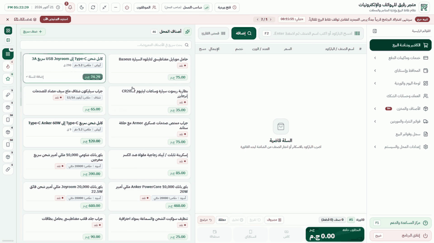
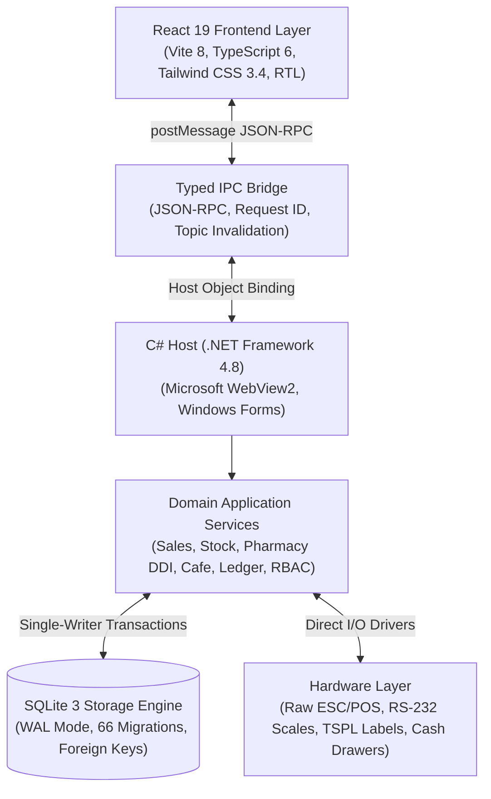

# Rafiq POS

Desktop point of sale and store management system designed for offline-first retail operations on Windows 7 through 11.

[Read in Arabic / النسخة العربية](README.ar.md)

[](desktop/Properties/AssemblyInfo.cs)
[-0078D4.svg)](desktop/app.manifest)
[](desktop/RafiqPOS.csproj)
[](frontend/package.json)
[-003B57.svg)](desktop/Database/MigrationRunner.cs)
[](frontend/test/)

---

## Overview

<p align="center">
  
</p>

Video walkthroughs:
* [Cashier Master Workflow](https://github.com/ISlamKhaledAli/RAFIQ/raw/main/frontend/public/videos/pos_cashier_synced.mp4) (MP4, 1080p, Arabic audio)
* [Customer Credit and Ledger](https://github.com/ISlamKhaledAli/RAFIQ/raw/main/frontend/public/videos/customer_credit_synced.mp4) (MP4, 1080p, Arabic audio)
* [Product Catalog and Inventory](https://github.com/ISlamKhaledAli/RAFIQ/raw/main/frontend/public/videos/add_new_product_tutorial_synced.mp4) (MP4, 1080p, Arabic audio)

<!-- TODO: Add live dashboard and reporting screenshots -->

---

## Why This Exists

Retail stores in Egypt operate under constraints that standard web apps cannot handle. Hardware is often a 15-year-old single-core or dual-core Celeron machine running Windows 7 SP1 with 2 GB RAM. Internet connections fail regularly, power cuts occur without warning, and cashiers switch between Arabic and English keyboard layouts while scanning barcodes. Rafiq POS is built to run entirely offline, survive sudden power loss without database corruption, auto-correct Arabic barcode input, and interface directly with serial scales and ESC/POS thermal printers.

---

## Business Modules

### Supermarket and Retail
* Keyboard-driven checkout using F1 to F12 hotkeys without mouse dependency.
* Barcode scanner interceptor that auto-corrects Arabic keyboard input and ligatures.
* Embedded scale barcode decoding (price and weight embedded formats).
* Customer credit accounts with credit limits, debt statements, and partial settlement vouchers.
* Shift management with cash drawer reconciliation, X-reports, and Z-reports.

### Clinical Pharmacy
* Real-time Drug-Drug Interaction (DDI) engine checking 127 critical interaction pairs.
* Local Egyptian drug reference directory with over 26,000 pre-indexed medications.
* Batch and expiry date tracking with First-Expired, First-Out (FEFO) dispensing.
* Unit subdivision supporting sales by box, blister strip, or individual tablet.
* Controlled drug register matching regulatory reporting requirements.
* Thermal prescription label printing with patient instructions.

### Cafe and Restaurant
* Interactive table floor map with table opening, merging, moving, and check splitting.
* Kitchen Order Ticket (KOT) station routing with delta printing for order updates.
* Item modifiers for customization (sugar levels, toppings, preparation notes).
* Delivery management with courier dispatching and cash settlement.
* Recipe bill-of-materials (BOM) deducting raw ingredients on sale.

### Electronic Payments and Digital Wallets
* Split payments across cash, POS card terminals, and electronic wallets (Vodafone Cash, InstaPay, Fawry, Aman).
* Wallet ledger tracking merchant fees separately from net revenue.
* Daily closing reconciliation matching digital receipts against cash drawers.

### Store Templates
11 built-in presets: Supermarket, Pharmacy, Cafe/Restaurant, Roastery, Bakery, Clothing, Electronics, Hardware Tools, Perfumery, Stationery, and General Retail.

---

## Architecture



### Key Engineering Decisions

1. **Integer Arithmetic for Financial Calculations:** All monetary values, taxes, and discounts are calculated and stored as whole piasters (long in C#, number in TypeScript). Percentages use basis points (100% = 10,000 bps). Floating-point conversions occur only at the final display string using AwayFromZero rounding, preventing IEEE 754 precision drift.
2. **Crash Resilience with SQLite WAL:** All sales and inventory mutations execute inside atomic transactions (`conn.BeginTransaction()`). Write-Ahead Logging (`WAL`), `PRAGMA synchronous = FULL`, and `PRAGMA busy_timeout = 5000` protect against corruption during sudden power outages.
3. **Idempotent Sales Recovery:** Client requests assign a UUIDv4 idempotency key. If an IPC timeout occurs during checkout, the IPC bridge queries `sales:getByIdempotencyKey` before retrying, preventing duplicate charges and double stock deductions.
4. **Additive Migrations with Snapshot Rollback:** Schema updates run through 66 incremental versions in `MigrationRunner.cs`. A database backup snapshot is created before running any migration. If a migration step fails, the previous database file is restored automatically.
5. **No Hard Deletes and Tamper-Evident Audit Trail:** Financial records, invoices, and inventory movements are never hard-deleted. Corrections are written as reversing contra entries. Sensitive actions (price overrides, cash drawer triggers, role changes) append to a SHA-256 chained audit log.
6. **Hardware-Adaptive UI Motion:** Low-tier POS terminals experience frame drops during CSS layout transitions. A device tier detection utility profiles CPU cores, memory, and OS version, dynamically applying Tailwind transition tokens (`duration-0` on budget hardware) to maintain responsive checkout.
7. **Zero-Dependency Navigation and State:** The frontend avoids external routing and state libraries (no React Router, Redux, or Zustand). Tab routing is managed through custom state with lazy tab mounting via a `visitedTabs` Set, while cross-view updates use a topic-based invalidation event bus.
8. **Dual WebView2 Runtime Strategy:** The C# launcher inspects the OS build at startup. On Windows 7, 8, and 8.1, it launches Microsoft WebView2 Fixed Runtime 109. On Windows 10 and 11, it uses the system Evergreen distribution.

---

## Tech Stack

| Layer | Technology | Version | Purpose |
| :--- | :--- | :--- | :--- |
| **Frontend UI** | React | 19.3.0 | UI rendering without external router |
| **Language** | TypeScript | 6.0.3 | Strict type definitions and IPC models |
| **Build Tool** | Vite | 8.3.0 | Module bundler targeting `chrome109` |
| **Styling** | Tailwind CSS | 3.4.17 | Custom design token system with dark mode |
| **Linter** | Oxlint | 1.85.0 | Static analysis across 472 files |
| **Desktop Host** | C# / WinForms | .NET 4.8 | Host wrapper for Windows 7 through 11 |
| **Web Runtime** | Microsoft WebView2 | 1.0.1518.46 | Chromium container (Fixed 109 / Evergreen) |
| **Database** | SQLite 3 | 3.53 (SQLite3 Multiple Ciphers 2.4.0) | Embedded storage via `Microsoft.Data.Sqlite.Core` 9.0.10 behind the `RafiqPOS.Data` compatibility layer (`desktop/Data/`) |
| **Hardware I/O** | ESC/POS, TSPL, RS-232 | Native C# | Thermal printers, barcode printers, scales |
| **Spreadsheets** | SheetJS (xlsx) / ClosedXML | 0.20.3 / 0.95.4 | Excel catalog import and export |

---

## Quality and Test Coverage

The project contains automated test suites across both the frontend and desktop host.

### Frontend Tests (Node.js Native Test Runner)
The frontend uses the Node.js test runner with `node:assert/strict` across 160 test files:
```bash
cd frontend
npm test
```
Result: **2,355 passing tests** across 516 test suites in ~15 seconds.

### Frontend Linting
```bash
cd frontend
npm run lint
```
Result: **0 warnings, 0 errors** across 472 files.

### Frontend Production Build
```bash
cd frontend
npm run build
```
Result: Compiles in ~5 seconds to `frontend/dist`. Total JavaScript bundle size is ~3.97 MB uncompressed (~932 kB gzip across code-split chunks: index, pos, products, purchases, insurance, settings).

### Desktop Host Tests (NUnit 3)
The C# test project covers 64 scenario files (S1 through S71):
```cmd
desktop\packages\NUnit.ConsoleRunner.3.16.3\tools\nunit3-console.exe desktop\RafiqPOS.Tests\bin\Release\RafiqPOS.Tests.dll
```
Result: **657 passing tests** (657 ran, 0 failed, 0 skipped) covering financial rounding, drawer concurrency, migration round-trips, and crash recovery.

---

## Getting Started

### Prerequisites
* Windows 7 SP1 or newer (x86 or x64).
* Node.js 18 or 20 LTS.
* .NET Framework 4.8 Developer Pack.
* MSBuild (Visual Studio Build Tools).
* Inno Setup 6 (optional, for installer builds).

### Developer Workflow
1. Clone the repository:
   ```bash
   git clone https://github.com/ISlamKhaledAli/RAFIQ.git
   cd RAFIQ
   ```
2. Install frontend dependencies:
   ```bash
   cd frontend
   npm install
   ```
3. Start the frontend development server:
   ```bash
   npm run dev
   ```
4. Build the C# desktop host:
   ```cmd
   MSBuild desktop\RafiqPOS.csproj /p:Configuration=Release /p:Platform=x86 /v:m
   MSBuild desktop\RafiqPOS.csproj /p:Configuration=Debug /p:Platform=x86 /v:m
   ```
5. Copy built assets and launch:
   ```cmd
   Run_Dev_Mode.bat
   ```

### Production Installer Build
Run the installer build script to package the binary and dependencies:
```cmd
Build_Installer_Full.bat
```
Output executable is generated in `installer/Output/RafiqPOS_Setup_v1.1.0.exe`.

---

## Hardware Compatibility

| Device Type | Protocol / Interface | Supported Models |
| :--- | :--- | :--- |
| **Thermal Receipt Printers** | ESC/POS via USB or Virtual COM | Xprinter (XP-N160M, XP-Q800), Epson (TM-T20, TM-T88), Rongta, Sunmi (80mm and 58mm) |
| **Barcode Label Printers** | TSPL / ZPL / Windows Driver | Xprinter XP-365B, XP-420B, Zebra ZD220, Rongta RP400 (50x30, 38x25, 40x25 mm) |
| **Barcode Scanners** | USB HID Keyboard Emulation | Honeywell Voyager, Zebra LS2208, Datalogic QuickScan, generic CCD scanners |
| **Electronic Scales** | RS-232 Serial / USB Serial | CAS (PD-II, ER Plus), Rongta RLS1000, Mettler Toledo (continuous stream protocol) |
| **Cash Drawers** | RJ11 / RJ12 Kicker Pin | Standard 12V and 24V printer-triggered kick-out drawers (pin 2 and pin 5) |
| **Customer Line Displays** | ESC/POS COM | 2x20 VFD pole displays |

---

## Security and Role-Based Access Control

The system implements hierarchical role-based access control with PIN authentication:
```
Root (Technician / System Owner)
  └── Admin (Store Owner)
        ├── Supervisor (Branch Manager)
        ├── Cashier (Sales and Shifts)
        ├── Pharmacist (Clinical DDI and Dispensing)
        └── Rider (Delivery Courier)
```

### Server-Enforced Controls (C# Host)
* **Price Authority:** Item prices, discounts, and taxes sent by the UI are re-validated against database records in C#. Client prices cannot override backend records.
* **Supervisor PIN Overrides:** Cashier discount limits, credit limit overrides, and sale cancellations require a supervisor or admin PIN before execution.
* **Direct Stock Freezes:** Inventory counts cannot be modified arbitrarily; stock updates must originate from a purchase invoice, stocktaking adjustment, or return voucher.
* **Tamper-Evident Logging:** Critical events (drawer openings, price modifications, voided sales) append to a SHA-256 hash-chained log stored in SQLite.

---

## Project Structure

```
RAFIQ/
├── desktop/                      # C# .NET 4.8 WinForms desktop host
│   ├── Bridge/                   # IPC dispatchers handling WebView2 messages
│   ├── Common/                   # Device tier detection, OTP helpers, and features
│   ├── Database/                 # SQLite migration runner (66 versions)
│   ├── Models/                   # Domain entities (Sale, Product, Customer, Shift)
│   ├── Properties/               # Assembly metadata and v1.1.0 versioning
│   ├── Repositories/             # Data access layer executing SQLite commands
│   ├── Services/                 # Domain business logic (Sales, Stock, Pharma, Cafe)
│   └── RafiqPOS.Tests/           # NUnit test suites (Scenarios S1 through S71)
├── frontend/                     # React 19 single-page UI
│   ├── src/
│   │   ├── bridge/               # Typed IPC invocation and event bus invalidation
│   │   ├── components/           # 109 reusable UI components and modals
│   │   ├── context/              # Scoped contexts (Auth, Features, Theme, Unsaved)
│   │   ├── hooks/                # Custom hooks (form baseline, motion, print)
│   │   ├── types/                # TypeScript models and IPC payload definitions
│   │   ├── utils/                # Financial arithmetic, barcode parser, dithering
│   │   └── views/                # 16 primary business views and analytics screens
│   └── test/                     # 160 frontend test files (2,355 tests)
├── installer/                    # Inno Setup 6 packaging scripts and assets
├── docs/                         # Architecture documentation, design docs, and demos
└── scripts/                      # Build, packaging, and signature synchronization tools
```

---

## Status and Roadmap

### Completed and Verified
* Core POS checkout workflow with offline SQLite storage.
* 11 retail store templates and domain engines (Supermarket, Pharmacy, Cafe).
* Customer credit, supplier invoices, and cash drawer reconciliations.
* Multi-version database migration pipeline with automatic rollback.
* Hardware drivers for ESC/POS thermal printers, RS-232 scales, and TSPL labelers.
* Hardware-adaptive UI motion scaling and Floyd-Steinberg receipt logo dithering.
* 3,000+ automated tests across UI and host (2,355 frontend + 657 C# NUnit).

### In Progress and Planned
* **Online Store Integration:** Full architectural specification completed in [`docs/ONLINE_STORE_DESIGN_DOC.md`](docs/ONLINE_STORE_DESIGN_DOC.md) for bidirectional cloud catalog sync, online order webhooks, and inventory allocations. Code implementation has not started.
* **Multi-Terminal Network Sync:** Currently, each installation operates as an isolated single-terminal database. Local LAN multi-register synchronization is planned for a future release.

---

## Known Limitations

* **Single-Register Deployment:** Designed for a single workstation reading and writing to a local SQLite database. It does not support concurrent multi-register database writes over a local area network.
* **Windows Host Dependency:** The desktop shell relies on Windows Forms and .NET Framework 4.8. It cannot run on Linux or macOS.
* **Chromium Memory Overhead:** Because the UI runs within Microsoft WebView2, memory usage is governed by Chromium process baselines (~180MB to 260MB under standard POS workloads).
* **Initial Setup Requires Web Runtime:** While normal operation is 100% offline, initial installation on Windows 7 requires the bundled Fixed Runtime 109 package.

---

## Author and License

* **Author:** Islam Khaled Ali
<!-- TODO: Add official license file (e.g. MIT, Proprietary, or Commercial Retail License) -->
* **Copyright:** Copyright (c) 2026 Islam Khaled Ali. All rights reserved.
