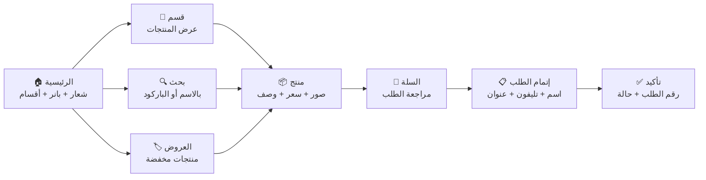
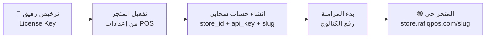
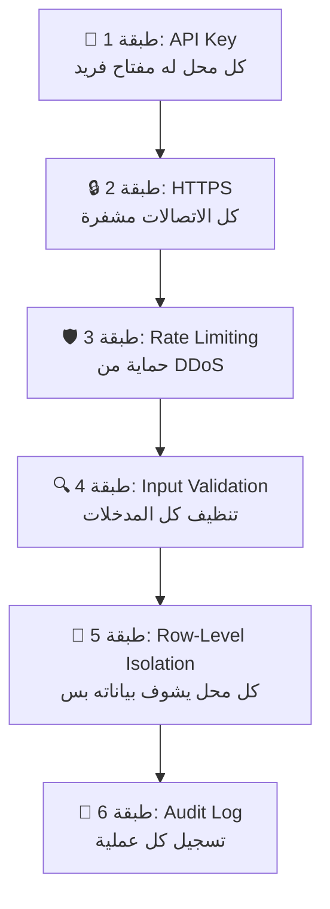

# وثيقة التصميم التفصيلية: متجر رفيق الإلكتروني (Rafiq Online Store)

> **وثيقة معمارية شاملة — الإصدار 1.0**
> تاريخ الإعداد: 9 نوفمبر 2026
> المُعد: فريق هندسة رفيق

---

## الفهرس

1. [الملخص التنفيذي](#1-الملخص-التنفيذي)
2. [المعمارية العامة](#2-المعمارية-العامة)
3. [استراتيجية صور المنتجات](#3-استراتيجية-صور-المنتجات)
4. [محرك المزامنة (Sync Engine)](#4-محرك-المزامنة-sync-engine)
5. [قالب المتجر الإلكتروني](#5-قالب-المتجر-الإلكتروني-web-store-template)
6. [لوحة تحكم صاحب المحل (Dashboard)](#6-لوحة-تحكم-صاحب-المحل-dashboard)
7. [نظام التعدد والترخيص (Multi-Tenancy)](#7-نظام-التعدد-والترخيص-multi-tenancy)
8. [تحليل Cloudflare Free Tier](#8-تحليل-cloudflare-free-tier)
9. [مقارنة البدائل المجانية](#9-مقارنة-البدائل-المجانية)
10. [مخطط قاعدة البيانات السحابية](#10-مخطط-قاعدة-البيانات-السحابية-cloud-schema)
11. [تصميم الـ API](#11-تصميم-الـ-api)
12. [حل التعارضات (Conflict Resolution)](#12-حل-التعارضات-conflict-resolution)
13. [الأمان](#13-الأمان-والحماية)
14. [التغييرات المطلوبة في الديسكتوب](#14-التغييرات-المطلوبة-في-الديسكتوب)
15. [سيناريوهات حرجة وحلولها](#15-سيناريوهات-حرجة-وحلولها)
16. [قابلية التوسع](#16-قابلية-التوسع-scalability)
17. [مراحل التنفيذ](#17-مراحل-التنفيذ)
18. [تقدير التكاليف](#18-تقدير-التكاليف)

---

## 1. الملخص التنفيذي

### الفكرة
تحويل كل محل يستخدم رفيق POS إلى متجر إلكتروني بنقرة واحدة — **قالب ويب موحد** يتغير لونه وشعاره حسب هوية المحل، ويعرض **منتجات المحل فقط** عبر رابط مخصص.

### القيمة التجارية
- **ميزة تنافسية فريدة:** POS + متجر إلكتروني في باكيج واحد (لا يوجد منافس محلي يقدم هذا)
- **مصدر دخل إضافي:** اشتراك شهري للميزة الأونلاين
- **ولاء العملاء:** صاحب المحل يعتمد على رفيق لكل شيء

### الحالة الحالية للمشروع

| البند | الوضع |
|---|---|
| محطات الباك لوج | **16 محطة مكتملة 100%** (622+ مهمة) |
| أحدث Migration | **الإصدار 66** |
| بنية تحتية سحابية موجودة | Cloudflare Workers لخادم التراخيص والتحديثات |
| محرك مزامنة بيانات | **غير موجود** — النظام أوفلاين 100% |
| صور المنتجات | **غير مدعومة حالياً** في قاعدة البيانات |

> [!IMPORTANT]
> هذا الفيتشر سيكون **محطة جديدة (Milestone 15+)** تُضاف بعد اكتمال واستقرار النظام الأساسي.

---

## 2. المعمارية العامة

### الرؤية الشاملة

```mermaid
flowchart TB
    subgraph DESKTOP["🖥️ جهاز المحل (Offline-First)"]
        POS["رفيق POS\nSQLite WAL\nWindows 7-11"]
        SYNC["محرك المزامنة\nSync Engine\nC# Background Thread"]
        LOCAL_IMG["صور محلية\n%ProgramData%/RafiqPOS/data/images/"]
    end

    subgraph CLOUD["☁️ Cloudflare Cloud"]
        WORKER_API["Workers API\nمزامنة + REST API"]
        D1["D1 Database\nبيانات كل المحلات"]
        R2["R2 Storage\nصور المنتجات"]
        KV["KV Store\nإعدادات الثيمات"]
        PAGES["Pages SPA\nالمتجر + الداشبورد"]
    end

    subgraph USERS["👥 المستخدمون"]
        CUSTOMER["الزبون\nيتصفح ويطلب"]
        OWNER["صاحب المحل\nداشبورد الويب"]
    end

    POS -->|"بيانات المنتجات\nالمبيعات والمخزون"| SYNC
    SYNC -->|"Delta Sync\nHTTPS POST"| WORKER_API
    SYNC -->|"رفع صور مضغوطة\nWebP max 800px"| R2
    WORKER_API -->|"أوردرات جديدة"| SYNC

    WORKER_API --> D1
    WORKER_API --> KV
    PAGES -->|"API Calls"| WORKER_API
    PAGES -->|"صور المنتجات"| R2

    CUSTOMER --> PAGES
    OWNER --> PAGES


### مبدأ العمل الأساسي

```
المحل (Offline) ──[عند توفر نت]──► السحابة ──► الزبون (Online)
                                      ▲
                   صاحب المحل (Dashboard) ──────┘
```

1. **المحل يشتغل أوفلاين** كالمعتاد — بيع، مخزون، فواتير
2. **لما يكون في نت** (حتى لو ضعيف/متقطع) → محرك المزامنة يرفع التغييرات
3. **الويب سايت يعرض** المنتجات من السحابة
4. **الزبون يطلب** → الطلب يتسجل في السحابة
5. **المحل يزامن** → الطلبات تنزل عنده في شاشة خاصة
6. **صاحب المحل يقدر يدخل** الداشبورد من أي مكان (موبايل/كمبيوتر)

### مبدأ مصدر الحقيقة (Source of Truth)

| البيان | مصدر الحقيقة | السبب |
|---|---|---|
| كتالوج المنتجات | **POS (المحل)** | صاحب المحل يضيف المنتجات على الجهاز |
| الأسعار | **POS (المحل)** | السعر الرسمي هو اللي على الكاشير |
| المخزون | **POS (المحل)** | الجرد الفعلي على الأرض |
| الطلبات الأونلاين | **السحابة** | الزبون بيطلب على الويب |
| إعدادات الثيم | **السحابة** | صاحب المحل يعدل من الداشبورد |
| المبيعات الأوفلاين | **POS (المحل)** | تُرسل كملخصات للداشبورد |

---

## 3. استراتيجية صور المنتجات

### السؤال: الصور هتتحط فين؟

> [!IMPORTANT]
> **الإجابة: في المكانين!** الصور تتخزن محلياً على الجهاز + نسخة مضغوطة على السحابة.

### التدفق الكامل للصور

```mermaid
flowchart LR
    A["📷 صاحب المحل\nيضيف صورة"] --> B{"من أين؟"}
    B -->|"من POS الديسكتوب"| C["حفظ محلي\nالصورة الأصلية"]
    B -->|"من داشبورد الويب"| D["رفع مباشر\nإلى R2"]

    C --> E["معالجة تلقائية\nWebP + Resize"]
    E --> F["رفع للسحابة\nعند المزامنة"]
    F --> G["R2 Storage\nCDN عالمي"]

    D --> H["معالجة بـ Worker\nWebP + Resize"]
    H --> G
    H --> I["مزامنة عكسية\nURL ينزل للـ POS"]


### مواصفات الصور التقنية

| البند | القيمة | السبب |
|---|---|---|
| **التخزين المحلي** | `%ProgramData%\RafiqPOS\data\images\products\{product_id}\` | نفس مسار قاعدة البيانات، بعيد عن UAC |
| **الصيغة المحلية** | JPEG/PNG أصلي | صاحب المحل يرفع أي صيغة |
| **الصيغة السحابية** | WebP | أصغر 30-50% من JPEG بنفس الجودة |
| **أقصى عدد صور/منتج** | 3 صور | توفير مساحة R2 |
| **أقصى حجم صورة أصلية** | 5MB | حماية من رفع صور ضخمة |
| **الأبعاد السحابية** | 800×800px (رئيسية) + 200×200px (مصغرة) | تغطية العرض + التحميل السريع |
| **جودة WebP** | 80% | توازن بين الجودة والحجم |
| **الحجم المتوقع/صورة** | ~60-120KB (رئيسية) + ~15KB (مصغرة) | ≈ 135KB لكل صورة |
| **مسار R2** | `stores/{store_id}/products/{product_id}/{index}.webp` | تنظيم واضح |

### حسابات المساحة

```
لكل منتج:   3 صور × 135KB = 405KB ≈ 0.4MB
لكل محل:    500 منتج × 0.4MB = 200MB
الفري تير:  10GB ÷ 200MB = ~50 محل على الفري تير

مع التحسين:
- لو متوسط 2 صورة/منتج = 270KB/منتج
- 300 منتج فعلي (مش كلهم عليهم صور) = 81MB/محل
- 10GB ÷ 81MB = ~123 محل ✅
```

> [!TIP]
> **التحسين الذكي:** مش كل المنتجات محتاجة صور على الويب. صاحب المحل يختار المنتجات اللي يعرضها أونلاين. منتج الملح والسكر مش محتاج صورة — المنتجات المميزة والعروض هي اللي تستاهل.

### معالجة الصور في C# (Desktop Side)

```
الخطوات:
1. صاحب المحل يختار صورة من الجهاز
2. الصورة الأصلية تتحفظ محلياً في مجلد المنتج
3. يتم إنشاء نسخة مصغرة (Thumbnail) محلياً للعرض في POS
4. عند المزامنة:
   a. قراءة الصورة الأصلية
   b. تصغير لـ 800×800 مع الحفاظ على النسبة
   c. تحويل لـ WebP بجودة 80%
   d. إنشاء مصغرة 200×200 WebP
   e. رفع الاثنين لـ R2 عبر Worker API
   f. حفظ الـ R2 URL في جدول sync_images
```

> [!WARNING]
> **قيد Windows 7:** مكتبة `System.Drawing` في .NET Framework 4.8 لا تدعم WebP مباشرة. الحل: رفع الصورة كـ JPEG مضغوط للـ Worker API، والـ Worker يحولها لـ WebP باستخدام Cloudflare Image Transformations أو مكتبة WASM.

---

## 4. محرك المزامنة (Sync Engine)

> [!CAUTION]
> **هذا هو الجزء الأصعب والأخطر في المشروع بالكامل.** أي خطأ في المزامنة يعني بيانات غلط على الويب أو طلبات ضائعة. التصميم لازم يكون bulletproof.

### المبادئ الأساسية

1. **Delta Sync فقط** — نرفع التغييرات بس، مش كل البيانات كل مرة
2. **Idempotent** — لو نفس البيانات اترفعت مرتين، النتيجة واحدة
3. **Non-Blocking** — المزامنة في Thread منفصل، ما تأثرش على الكاشير
4. **Resilient** — لو النت قطع في النص، نكمل من حيث وقفنا
5. **Bandwidth-Efficient** — ضغط البيانات، رفع الصور بالتدريج
6. **Ordered** — الكتالوج يتزامن الأول، بعدين المبيعات، بعدين الطلبات تنزل

### جدول المزامنة المحلي (sync_outbox)

يُضاف في SQLite المحلي (Migration v67):

```sql
-- صندوق الصادر: كل تغيير محتاج يترفع للسحابة
CREATE TABLE IF NOT EXISTS sync_outbox (
    id              TEXT PRIMARY KEY,           -- UUID v4
    entity_type     TEXT NOT NULL,              -- 'product' | 'category' | 'sale_summary' | 'stock_level' | 'image' | 'store_settings'
    entity_id       TEXT NOT NULL,              -- UUID of the changed entity
    operation       TEXT NOT NULL,              -- 'upsert' | 'soft_delete' | 'stock_update'
    payload_json    TEXT NOT NULL,              -- JSON of the changed data
    created_at      TEXT NOT NULL,              -- ISO 8601
    sync_status     TEXT NOT NULL DEFAULT 'pending',  -- 'pending' | 'syncing' | 'synced' | 'failed'
    retry_count     INTEGER NOT NULL DEFAULT 0,
    last_error      TEXT,
    synced_at       TEXT
);

-- صندوق الوارد: طلبات أونلاين جاية من السحابة
CREATE TABLE IF NOT EXISTS sync_inbox (
    id              TEXT PRIMARY KEY,           -- UUID v4
    order_id        TEXT NOT NULL UNIQUE,       -- Cloud order UUID
    order_data_json TEXT NOT NULL,              -- Full order JSON
    received_at     TEXT NOT NULL,
    process_status  TEXT NOT NULL DEFAULT 'new', -- 'new' | 'viewed' | 'accepted' | 'rejected' | 'completed'
    processed_at    TEXT
);

-- حالة المزامنة
CREATE TABLE IF NOT EXISTS sync_state (
    key             TEXT PRIMARY KEY,
    value           TEXT NOT NULL
    -- Keys: 'last_sync_timestamp', 'store_cloud_id', 'sync_api_key', 'online_store_enabled'
);

-- صور المنتجات (محلي)
CREATE TABLE IF NOT EXISTS product_images (
    id              TEXT PRIMARY KEY,
    product_id      TEXT NOT NULL,
    image_index     INTEGER NOT NULL DEFAULT 0,  -- 0, 1, 2
    local_path      TEXT NOT NULL,
    r2_url          TEXT,                        -- NULL until synced
    file_hash       TEXT NOT NULL,               -- SHA-256 for change detection
    created_at      TEXT NOT NULL,
    synced_at       TEXT,
    FOREIGN KEY (product_id) REFERENCES products(id),
    UNIQUE(product_id, image_index)
);
```

### دورة المزامنة (Sync Cycle)

```mermaid
flowchart TD
    START["⏰ Sync Timer\nكل 5 دقائق\nأو يدوي"] --> CHECK{"النت متاح؟\n+ الفيتشر مفعل؟"}
    CHECK -->|"لا"| SKIP["تخطي\nمحاولة بعد 5 دقائق"]
    CHECK -->|"نعم"| AUTH["1. مصادقة\nAPI Key + Store ID"]
    AUTH --> CATALOG["2. رفع تغييرات الكتالوج\nمنتجات + أقسام + أسعار"]
    CATALOG --> STOCK["3. رفع مستويات المخزون\nالكميات الحالية فقط"]
    STOCK --> IMAGES["4. رفع صور جديدة/معدلة\nصورة صورة مع progress"]
    IMAGES --> SALES["5. رفع ملخصات المبيعات\nيومي تجميعي"]
    SALES --> ORDERS["6. تنزيل طلبات جديدة\nمن السحابة"]
    ORDERS --> STATUS["7. رفع حالات الطلبات\nمقبول/مرفوض/جاهز"]
    STATUS --> SETTINGS["8. تنزيل تغييرات الإعدادات\nلو صاحب المحل غيّر حاجة من الداشبورد"]
    SETTINGS --> DONE["✅ تحديث last_sync_timestamp\nتسجيل في سجل المزامنة"]
    DONE --> WAIT["انتظار 5 دقائق"]
    WAIT --> START

    CATALOG -->|"خطأ"| RETRY["Exponential Backoff\n2s → 4s → 8s → 16s → max 5min"]
    RETRY --> CATALOG


### آلية Delta Sync بالتفصيل

```
كيف نعرف إيه اللي اتغير؟
─────────────────────────

الحل: Trigger-Based Outbox Pattern

1. عند أي INSERT/UPDATE/DELETE في جدول products:
   → C# code يضيف سطر في sync_outbox تلقائياً
   → payload_json يحتوي فقط على الحقول المتغيرة

2. عند المزامنة:
   → نقرأ كل الأسطر في sync_outbox حيث sync_status = 'pending'
   → نجمعهم في batch واحد (max 100 عملية/batch)
   → نرسلهم للـ Worker API كـ JSON array
   → لو نجحت: نحدث sync_status = 'synced'
   → لو فشلت: retry_count++ ونحاول تاني

3. الصور بشكل منفصل:
   → نقارن file_hash المحلي مع اللي اتزامن آخر مرة
   → لو مختلف: نرفع الصورة الجديدة
   → رفع صورة واحدة في كل request (عشان لو النت قطع)
```

### كود C# المبسط لمحرك المزامنة

```
Architecture:
─────────────
SyncEngine.cs (Main orchestrator)
├── SyncScheduler.cs      — Timer + manual trigger
├── OutboxManager.cs      — Read/write sync_outbox
├── CatalogSyncer.cs      — Products, categories, units
├── StockSyncer.cs         — Stock levels only
├── ImageSyncer.cs         — Image upload with progress
├── SalesSummarySyncer.cs  — Daily sales aggregates
├── OrderSyncer.cs         — Download + upload order statuses
├── SettingsSyncer.cs      — Theme, store info changes
└── SyncHttpClient.cs      — Retry logic, auth, compression

Key Design:
- Single background thread (not Task/async — .NET 4.8 compatibility)
- System.Threading.Timer for scheduling
- HttpWebRequest (not HttpClient) for Windows 7 TLS 1.2 support
- GZip compression on request/response bodies
- Circuit breaker: after 5 consecutive failures → wait 30 minutes
```

### حماية أداء الكاشير

| التقنية | التفصيل |
|---|---|
| **Thread منفصل** | المزامنة تشتغل في `System.Threading.Thread` مستقل تماماً عن UI Thread |
| **أولوية منخفضة** | `Thread.Priority = ThreadPriority.BelowNormal` |
| **Throttling** | رفع صورة واحدة كل 3 ثواني (عدم استهلاك النطاق) |
| **Pause عند البيع** | لو الكاشير فاتح فاتورة → المزامنة توقف مؤقتاً |
| **حد الذاكرة** | معالجة صورة واحدة في الذاكرة في نفس الوقت |
| **Timeout** | 15 ثانية لكل Request — لو أبطأ من كدا يلغي ويحاول بعدين |

---

## 5. قالب المتجر الإلكتروني (Web Store Template)

### الفكرة

ويب سايت **واحد** مبني بـ React (Cloudflare Pages) → يقرأ `store_slug` من الـ URL → يعرض بيانات وألوان المحل المحدد.

### هيكل الروابط

```
الخيار 1 (Path-based — أسهل):
  https://store.rafiqpos.com/souq-el-khair
  https://store.rafiqpos.com/pharmacy-el-nour
  https://store.rafiqpos.com/cafe-roma

الخيار 2 (Subdomain-based — أحترافي):
  https://souq-el-khair.rafiqpos.com
  https://pharmacy-el-nour.rafiqpos.com
  https://cafe-roma.rafiqpos.com

التوصية: الخيار 1 أولاً (أسهل في الإعداد مع Pages)
         ثم الخيار 2 كترقية مستقبلية
```

### شاشات المتجر الإلكتروني



### صفحات المتجر بالتفصيل

#### 1. الصفحة الرئيسية
- **الهيدر:** شعار المحل + اسمه + رقم التواصل
- **البانر:** صورة عريضة (صاحب المحل يرفعها من الداشبورد) أو تصميم تلقائي بألوان المحل
- **الأقسام:** كروت للأقسام الرئيسية مع صورة لكل قسم
- **منتجات مميزة:** أول 8-12 منتج مميز (صاحب المحل يختارهم)
- **العروض:** منتجات عليها خصم حالي
- **الفوتر:** عنوان المحل + ساعات العمل + رابط واتساب

#### 2. صفحة القسم
- **فلتر:** ترتيب بالسعر (أقل/أعلى) + الأحدث + الأكثر مبيعاً
- **عرض المنتجات:** كروت بصورة + اسم + سعر + زر إضافة للسلة
- **Pagination:** تحميل تدريجي (12 منتج في المرة)
- **بحث داخل القسم**

#### 3. صفحة المنتج
- **معرض صور:** Swiper/carousel لصور المنتج (1-3 صور)
- **الاسم والوصف:** بالعربي
- **السعر:** بالجنيه المصري (تحويل من القروش للعرض فقط!)
- **الوحدة:** قطعة / كيلو / لتر / علبة
- **المخزون:** "متوفر" أو "نفذ من المخزون" (بدون عرض الكمية الفعلية)
- **زر إضافة للسلة** مع اختيار الكمية
- **منتجات مشابهة** من نفس القسم

#### 4. السلة
- قائمة المنتجات مع الكميات والأسعار
- إجمالي الفاتورة (بالقروش داخلياً!)
- زر تعديل الكمية أو حذف منتج
- زر "إتمام الطلب"

#### 5. إتمام الطلب (Checkout)
- **اسم العميل** (مطلوب)
- **رقم الموبايل** (مطلوب — للتواصل)
- **العنوان** (مطلوب للتوصيل / اختياري للاستلام)
- **ملاحظات** (اختياري)
- **طريقة الاستلام:** توصيل / استلام من المحل
- **طريقة الدفع:** الدفع عند الاستلام (Cash on Delivery) — **لا دفع إلكتروني في المرحلة الأولى**
- **تأكيد الطلب** → رقم طلب + رسالة "هيتواصل معاك المحل"

#### 6. تتبع الطلب
- إدخال رقم الطلب + رقم الموبايل
- عرض حالة الطلب: `جديد → مقبول → جاري التجهيز → جاهز/في الطريق → تم التسليم`
- أو: `مرفوض` مع السبب

### تصميم الثيم المتغير (Dynamic Theming)

```css
/* CSS Variables تتغير حسب كل محل */
:root {
  --store-primary:    var(--from-kv);    /* اللون الأساسي */
  --store-secondary:  var(--from-kv);    /* اللون الثانوي */
  --store-accent:     var(--from-kv);    /* لون التمييز */
  --store-bg:         var(--from-kv);    /* لون الخلفية */
  --store-text:       var(--from-kv);    /* لون النص */
  --store-card-bg:    var(--from-kv);    /* لون الكروت */
  --store-btn-bg:     var(--from-kv);    /* لون الأزرار */
  --store-btn-text:   var(--from-kv);    /* لون نص الأزرار */
  --store-radius:     var(--from-kv);    /* حدة الزوايا */
}
```

**كيف بتشتغل:**
1. الزبون يفتح `store.rafiqpos.com/souq-el-khair`
2. الـ Worker يقرأ `souq-el-khair` من الـ URL
3. يجلب إعدادات الثيم من KV: `theme:souq-el-khair`
4. يحقن CSS Variables في الصفحة
5. كل عناصر الصفحة بتستخدم المتغيرات دي

**قوالب ثيمات جاهزة:**
- 🟢 **كلاسيك أخضر** — للسوبر ماركت (الافتراضي)
- 🔵 **أزرق طبي** — للصيدليات
- 🟤 **بني دافئ** — للكافيهات
- 🔴 **أحمر حيوي** — للمطاعم
- ⚫ **داكن أنيق** — للبوتيكات
- صاحب المحل يقدر يعدل الألوان يدوي من الداشبورد

---

## 6. لوحة تحكم صاحب المحل (Dashboard)

> [!IMPORTANT]
> **نعم، في داشبورد!** صاحب المحل يقدر يدخل من أي مكان (موبايل/كمبيوتر) ويشوف كل حاجة — المبيعات الأوفلاين + الأونلاين + المخزون + الطلبات.

### الدخول والمصادقة

```
رابط الداشبورد: https://dashboard.rafiqpos.com
                 أو
                 https://store.rafiqpos.com/dashboard

تسجيل الدخول:
- رقم الترخيص (License Key) + PIN صاحب المحل
- أو رقم الموبايل + كود OTP (مرحلة لاحقة)
- جلسة (Session) مدتها 7 أيام مع refresh token
```

### أقسام الداشبورد

```mermaid
flowchart TD
    DASH["📊 الداشبورد الرئيسي"] --> ORDERS["📋 إدارة الطلبات"]
    DASH --> SALES["💰 المبيعات"]
    DASH --> INVENTORY["📦 المخزون"]
    DASH --> PRODUCTS["🏷️ المنتجات"]
    DASH --> STORE_SETTINGS["⚙️ إعدادات المتجر"]
    DASH --> ANALYTICS["📈 التحليلات"]
    DASH --> NOTIFICATIONS["🔔 الإشعارات"]


### 6.1 الداشبورد الرئيسي (Overview)

صفحة واحدة تعرض ملخص شامل لحظي:

| الكارد | المحتوى | المصدر |
|---|---|---|
| **مبيعات اليوم** | إجمالي مبيعات اليوم (أوفلاين + أونلاين) | POS synced + Cloud orders |
| **طلبات جديدة** | عدد الطلبات الأونلاين المعلقة | Cloud D1 |
| **عدد المنتجات** | إجمالي المنتجات النشطة | POS synced |
| **تنبيهات المخزون** | منتجات وصلت لحد إعادة الطلب | POS synced |
| **آخر مزامنة** | متى آخر مرة الجهاز زامن | sync_state |
| **حالة المتجر** | أونلاين/أوفلاين + عدد الزوار اليوم | Cloud analytics |

**رسوم بيانية:**
- مبيعات آخر 7 أيام (Bar chart — أوفلاين بلون + أونلاين بلون)
- أكثر 5 منتجات مبيعاً (Horizontal bar)
- توزيع المبيعات بالساعة (Line chart)

### 6.2 إدارة الطلبات الأونلاين

| العمود | التفصيل |
|---|---|
| **رقم الطلب** | `#ORD-0001` تسلسلي لكل محل |
| **اسم العميل** | الاسم اللي أدخله الزبون |
| **رقم الموبايل** | مع زر اتصال مباشر وزر واتساب |
| **المنتجات** | قائمة قابلة للفتح بالأصناف والكميات |
| **الإجمالي** | بالجنيه المصري |
| **الحالة** | `جديد` ← `مقبول` ← `جاري التجهيز` ← `جاهز` ← `تم التسليم` |
| **الإجراءات** | قبول / رفض (مع سبب) / تغيير حالة / طباعة |

**إشعارات فورية:**
- صوت تنبيه عند طلب جديد (لو الداشبورد مفتوح)
- إشعار Push notification (مرحلة لاحقة)
- الطلبات المعلقة أكثر من 15 دقيقة تظهر بلون تحذيري

### 6.3 المبيعات (أوفلاين + أونلاين)

**بيانات المبيعات الأوفلاين** تُرسل كـ **ملخصات يومية مجمعة** (مش فاتورة فاتورة) للحماية:

```
ما يُرسل للسحابة:
──────────────────
✅ إجمالي مبيعات اليوم
✅ عدد الفواتير
✅ متوسط قيمة الفاتورة
✅ توزيع طرق الدفع (كاش / فيزا / آجل)
✅ أكثر 20 منتج مبيعاً (كميات فقط)
✅ المبيعات بالساعة (تجميعي)
✅ المرتجعات (عدد + إجمالي)

ما لا يُرسل أبداً:
──────────────────
❌ تفاصيل الفواتير الفردية
❌ أسماء عملاء الأوفلاين
❌ أرقام الهواتف
❌ بيانات الموظفين والرواتب
❌ PIN codes أو كلمات المرور
❌ بيانات حسابات الآجل التفصيلية
```

> [!CAUTION]
> **خصوصية البيانات أولوية قصوى.** لن تُرسل أي بيانات شخصية للعملاء أو تفاصيل مالية حساسة للسحابة. الملخصات التجميعية فقط كافية للداشبورد.

### 6.4 المخزون

- **عرض المخزون الحالي:** جدول بكل المنتجات مع الكمية المتاحة
- **تنبيهات نقص المخزون:** منتجات تحت حد إعادة الطلب
- **فلترة:** بالقسم / بحالة المخزون (متوفر / منخفض / نفذ)
- **المخزون المحجوز:** كميات محجوزة لطلبات أونلاين مقبولة لم تُسلَّم بعد

> [!NOTE]
> بيانات المخزون تأتي من آخر مزامنة. لو المحل باع بعد آخر مزامنة، الأرقام قد تختلف قليلاً. يظهر تنبيه: "آخر تحديث: منذ X دقيقة".

### 6.5 إدارة المنتجات (للعرض الأونلاين)

صاحب المحل يتحكم في:

| الإعداد | التفصيل |
|---|---|
| **عرض أونلاين** | تفعيل/إيقاف ظهور المنتج على الويب |
| **صور المنتج** | رفع/حذف/ترتيب (من الداشبورد مباشرة → R2) |
| **الوصف** | نص وصفي يظهر على صفحة المنتج |
| **منتج مميز** | تثبيته في الصفحة الرئيسية |
| **ترتيب العرض** | ترتيب المنتجات داخل القسم |

> [!IMPORTANT]
> **الأسعار والأسماء والأقسام لا تُعدَّل من الداشبورد** — مصدر الحقيقة هو POS. صاحب المحل يعدلها من الجهاز وتتزامن تلقائياً. الداشبورد يتحكم فقط فيما يخص العرض الأونلاين.

### 6.6 إعدادات المتجر الإلكتروني

| الإعداد | التفصيل |
|---|---|
| **اسم المتجر** | الاسم اللي يظهر على الويب |
| **الشعار** | رفع لوجو (PNG/SVG, max 500KB) |
| **البانر** | صورة عريضة للصفحة الرئيسية |
| **الألوان** | اختيار من قوالب جاهزة أو تخصيص يدوي |
| **Slug** | الجزء الخاص من الرابط (مرة واحدة) |
| **رقم التواصل** | واتساب + تليفون |
| **العنوان** | عنوان المحل الفعلي |
| **ساعات العمل** | من-إلى لكل يوم |
| **رسالة ترحيب** | نص يظهر في الهيدر |
| **حد أدنى للطلب** | مثلاً: لا يقبل طلبات أقل من 100 جنيه |
| **مناطق التوصيل** | قائمة مناطق + رسوم كل منطقة |
| **تفعيل/إيقاف المتجر** | إغلاق مؤقت (إجازة / صيانة) |

### 6.7 التحليلات

- **مبيعات أونلاين vs أوفلاين** — مقارنة شهرية
- **أكثر المنتجات طلباً أونلاين** — Top 10
- **متوسط قيمة الطلب الأونلاين**
- **معدل قبول/رفض الطلبات**
- **أوقات الذروة** — أكثر ساعات الطلب
- **عدد زوار المتجر** (Page views من Cloudflare Analytics)

---

## 7. نظام التعدد والترخيص (Multi-Tenancy)

### نموذج التعدد: Shared Database with Row-Level Isolation

```
كل المحلات في قاعدة D1 واحدة
─────────────────────────────
كل جدول فيه عمود: store_id TEXT NOT NULL
كل Query فيه شرط: WHERE store_id = ?

لماذا هذا النموذج؟
- أبسط في الإدارة (قاعدة واحدة)
- أوفر في D1 Free (10 databases max)
- كافي لـ 100-500 محل
- لو وصلنا 1000+ → نفكر في database-per-tenant عبر Turso
```

### ربط الترخيص بالمتجر الإلكتروني



**المستويات (Tiers):**

| المستوى | السعر المقترح | الميزات |
|---|---|---|
| **مجاني (تجربة)** | 0 ج.م / 14 يوم | متجر إلكتروني + 50 منتج + بدون داشبورد |
| **أساسي** | 99 ج.م / شهر | متجر + داشبورد + 200 منتج + طلبات |
| **احترافي** | 199 ج.م / شهر | كل شيء + منتجات لا محدودة + تحليلات + دومين مخصص |

---

## 8. تحليل Cloudflare Free Tier

> [!IMPORTANT]
> **الإجابة المختصرة: Cloudflare Free Tier يكفي لبداية ممتازة (10-30 محل) بدون دفع أي شيء.** ولما يكبر المشروع، التكلفة المدفوعة بسيطة جداً.

### الحدود التفصيلية والاستهلاك المتوقع

#### Workers (الـ API والمنطق)

| البند | الحد المجاني | استهلاك 10 محلات | استهلاك 50 محل | استهلاك 100 محل |
|---|---|---|---|---|
| Requests/يوم | **100,000** | ~5,000 | ~25,000 | ~60,000 |
| CPU Time/Request | **10ms** | ~3ms | ~3ms | ~3ms |

```
حسبة الـ Requests لـ 10 محلات:
- مزامنة POS: 10 محلات × 12 sync/يوم × 8 requests/sync = 960
- زوار المتجر: 10 محلات × 50 زائر/يوم × 5 pages/زائر = 2,500
- طلبات API: 10 محلات × 20 طلب/يوم = 200
- داشبورد: 10 أصحاب × 10 requests/يوم = 100
المجموع: ~3,760 request/يوم ← 100,000 حد = مرتاحين جداً ✅
```

#### D1 (قاعدة البيانات السحابية)

| البند | الحد المجاني | استهلاك 10 محلات | استهلاك 50 محل | استهلاك 100 محل |
|---|---|---|---|---|
| Storage | **5 GB** | ~100 MB | ~500 MB | ~1.2 GB |
| Rows Read/يوم | **5,000,000** | ~50,000 | ~250,000 | ~600,000 |
| Rows Written/يوم | **100,000** | ~2,000 | ~10,000 | ~25,000 |

```
حسبة المساحة لكل محل:
- منتجات: 500 × 0.5KB = 250KB
- أقسام: 20 × 0.2KB = 4KB
- طلبات (تراكمي/سنة): 1000 × 1KB = 1MB
- ملخصات مبيعات (تراكمي/سنة): 365 × 2KB = 730KB
- إعدادات: ~5KB
المجموع: ~2MB/محل/سنة (بدون تنظيف)
→ 5GB تكفي ~2,500 محل نظرياً ✅
```

#### R2 (تخزين الصور)

| البند | الحد المجاني | استهلاك 10 محلات | استهلاك 50 محل | استهلاك 100 محل |
|---|---|---|---|---|
| Storage | **10 GB** | ~800 MB | ~4 GB | ~8 GB |
| Class A (Writes)/شهر | **1,000,000** | ~3,000 | ~15,000 | ~30,000 |
| Class B (Reads)/شهر | **10,000,000** | ~150,000 | ~750,000 | ~1,800,000 |
| **Egress (Bandwidth)** | **مجاني 100%** | **\$0** | **\$0** | **\$0** |

> [!TIP]
> **الميزة القاتلة لـ R2:** مفيش رسوم Bandwidth إطلاقاً! لو 1000 زبون حمّلوا صور كل يوم، مفيش فلس واحد. هذا هو السبب الأهم لاختيار Cloudflare على أي بديل.

#### KV (إعدادات الثيمات)

| البند | الحد المجاني | استهلاك 10 محلات | استهلاك 50 محل |
|---|---|---|---|
| Reads/يوم | **100,000** | ~2,000 | ~10,000 |
| Writes/يوم | **1,000** | ~20 | ~100 |
| Storage | **1 GB** | ~1 MB | ~5 MB |

#### Pages (استضافة الويب)

| البند | الحد | ملاحظة |
|---|---|---|
| Bandwidth | **غير محدود** | مجاني تماماً |
| Sites | **غير محدود** | مجاني تماماً |
| Builds/شهر | **500** | أكثر من كافي |

### ملخص: متى نحتاج ندفع؟

```
🟢 0-30 محل:    Free Tier مريح تماماً — $0/شهر
🟡 30-80 محل:   R2 يبدأ يقترب من 10GB — محتاج ~$2-5/شهر
🟠 80-200 محل:  Workers Paid + R2 Paid — ~$10-20/شهر
🔴 200+ محل:    Enterprise needs — ~$25-50/شهر

ملاحظة: لو عندك 200 محل بيدفعوا 99 ج.م/شهر
= 19,800 ج.م/شهر إيراد
vs ~$50 = ~2,500 ج.م تكلفة سحابية
= هامش ربح 87% 🎉
```

---

## 9. مقارنة البدائل المجانية

### هل في بديل مجاني 100% أفضل من Cloudflare؟

> **الإجابة المختصرة: لا.** Cloudflare هو الأفضل لهذا الاستخدام المحدد. إليك المقارنة الشاملة:

| المعيار | Cloudflare | Supabase | Turso | Firebase |
|---|---|---|---|---|
| **قاعدة بيانات** | D1 (5GB) | Postgres (500MB) | libSQL (5GB, 100 DBs) | Firestore (1GB) |
| **تخزين ملفات** | R2 (10GB) | Storage (1GB) | ❌ لا يوجد | Storage (5GB) |
| **Bandwidth/Egress** | **مجاني 100%** | 2GB مجاني ثم مدفوع | ❌ لا يوجد | مدفوع بعد الحد |
| **Hosting** | Pages (غير محدود) | ❌ يحتاج بديل | ❌ يحتاج بديل | Hosting (10GB/شهر) |
| **Serverless Functions** | Workers (100K/يوم) | Edge Functions (500K/شهر) | ❌ لا يوجد | Cloud Functions (125K/شهر) |
| **Auth مدمج** | ❌ (نبنيه بأنفسنا) | ✅ (50K MAU) | ❌ لا يوجد | ✅ (مجاني) |
| **Real-time** | Durable Objects | ✅ Realtime | ❌ لا يوجد | ✅ Realtime |
| **Inactivity Pause** | **❌ لا يوقف أبداً** | ⚠️ يوقف بعد 7 أيام! | ❌ لا يوقف | ❌ لا يوقف |
| **نوع DB** | SQLite (مطابق لـ POS!) | PostgreSQL | SQLite | NoSQL (Document) |
| **Vendor Lock-in** | منخفض | منخفض (Open Source) | منخفض | **عالي جداً** |
| **بنية تحتية موجودة** | **✅ نستخدمه فعلاً!** | ❌ جديد | ❌ جديد | ❌ جديد |

### لماذا Cloudflare هو الأفضل لرفيق؟

1. **بنية موجودة:** خادم التراخيص والتحديثات يعمل فعلاً على Cloudflare Workers — نوسّع عليه
2. **R2 بلا Egress:** تخزين الصور بدون رسوم نقل بيانات = وفر ضخم مع نمو المستخدمين
3. **D1 = SQLite:** نفس قاعدة البيانات اللي في POS = تشابه في الكود والاستعلامات
4. **Pages مجاني بلا حدود:** الويب سايت والداشبورد مستضافين مجاناً بباندويث غير محدود
5. **لا يتوقف أبداً:** Supabase يوقف المشروع بعد 7 أيام بدون نشاط — كارثة لمحل يزامن مرة في الأسبوع
6. **Edge Computing:** الموقع سريع من أي مكان في العالم
7. **حساب واحد لكل شيء:** تراخيص + تحديثات + متجر + صور + داشبورد = إدارة واحدة

### بخصوص حساب Cloudflare منفصل

> **التوصية: نفس الحساب الحالي، مشاريع منفصلة.**

```
حساب Cloudflare الحالي (khaledislam9003)
├── Workers:
│   ├── rafiq-license-server     (موجود — التراخيص والتحديثات)
│   └── rafiq-store-api          (جديد — API المتجر الإلكتروني)
├── D1:
│   └── rafiq-stores-db          (جديد — بيانات المحلات)
├── R2:
│   └── rafiq-product-images     (جديد — صور المنتجات)
├── KV:
│   └── rafiq-store-themes       (جديد — إعدادات الثيمات)
└── Pages:
    └── rafiq-store-web          (جديد — الويب سايت + الداشبورد)
```

**مميزات نفس الحساب:** فاتورة واحدة، لوحة تحكم واحدة، مشاركة secrets بسهولة بين Workers.
**لو حبيت حساب منفصل:** مفيش مشكلة — بس هتحتاج تدير حسابين. مستحسن فقط لو في فريق تطوير منفصل.

---

## 10. مخطط قاعدة البيانات السحابية (Cloud Schema)

### D1 Database: `rafiq-stores-db`

```sql
-- ═══════════════════════════════════════════
-- 1. المحلات (Stores)
-- ═══════════════════════════════════════════
CREATE TABLE stores (
    id              TEXT PRIMARY KEY,
    license_key     TEXT NOT NULL UNIQUE,
    slug            TEXT NOT NULL UNIQUE,
    name            TEXT NOT NULL,
    phone           TEXT,
    whatsapp        TEXT,
    address         TEXT,
    working_hours   TEXT,              -- JSON: {"sat":"9:00-22:00",...}
    welcome_message TEXT,
    logo_url        TEXT,
    banner_url      TEXT,
    theme_preset    TEXT DEFAULT 'classic-green',
    theme_custom    TEXT,              -- JSON: custom CSS vars override
    min_order_amount INTEGER DEFAULT 0, -- بالقروش
    delivery_zones  TEXT,              -- JSON: [{"name":"وسط البلد","fee":1500}]
    is_active       INTEGER DEFAULT 1,
    is_paused       INTEGER DEFAULT 0, -- إغلاق مؤقت
    pause_message   TEXT,
    store_type      TEXT DEFAULT 'supermarket', -- pharmacy/cafe/restaurant
    api_key_hash    TEXT NOT NULL,     -- SHA-256 of store API key
    sync_version    INTEGER DEFAULT 0,
    last_sync_at    TEXT,
    created_at      TEXT NOT NULL,
    updated_at      TEXT NOT NULL
);

-- ═══════════════════════════════════════════
-- 2. الأقسام (Categories)
-- ═══════════════════════════════════════════
CREATE TABLE categories (
    id              TEXT PRIMARY KEY,
    store_id        TEXT NOT NULL,
    name            TEXT NOT NULL,
    parent_id       TEXT,
    image_url       TEXT,
    sort_order      INTEGER DEFAULT 0,
    is_active       INTEGER DEFAULT 1,
    is_online       INTEGER DEFAULT 1,  -- يظهر على الويب؟
    created_at      TEXT NOT NULL,
    updated_at      TEXT NOT NULL,
    FOREIGN KEY (store_id) REFERENCES stores(id)
);
CREATE INDEX idx_categories_store ON categories(store_id);

-- ═══════════════════════════════════════════
-- 3. المنتجات (Products)
-- ═══════════════════════════════════════════
CREATE TABLE products (
    id              TEXT PRIMARY KEY,
    store_id        TEXT NOT NULL,
    category_id     TEXT,
    name            TEXT NOT NULL,
    description     TEXT,              -- وصف يظهر على الويب
    barcode         TEXT,
    sku             TEXT,
    price_piasters  INTEGER NOT NULL,  -- السعر بالقروش
    compare_price   INTEGER,           -- سعر قبل الخصم (للعروض)
    cost_piasters   INTEGER,           -- سعر التكلفة (لا يظهر على الويب!)
    unit_name       TEXT DEFAULT 'قطعة',
    tax_rate        INTEGER DEFAULT 0, -- نسبة الضريبة × 100
    stock_quantity  INTEGER DEFAULT 0, -- مخزون بالمللي وحدات
    low_stock_threshold INTEGER DEFAULT 0,
    is_active       INTEGER DEFAULT 1,
    is_online       INTEGER DEFAULT 1, -- يظهر على الويب؟
    is_featured     INTEGER DEFAULT 0, -- منتج مميز بالصفحة الرئيسية
    sort_order      INTEGER DEFAULT 0,
    image_urls      TEXT,              -- JSON array: ["url1","url2","url3"]
    created_at      TEXT NOT NULL,
    updated_at      TEXT NOT NULL,
    FOREIGN KEY (store_id) REFERENCES stores(id),
    FOREIGN KEY (category_id) REFERENCES categories(id)
);
CREATE INDEX idx_products_store ON products(store_id);
CREATE INDEX idx_products_category ON products(store_id, category_id);
CREATE INDEX idx_products_featured ON products(store_id, is_featured)
    WHERE is_online = 1 AND is_active = 1;
CREATE INDEX idx_products_barcode ON products(store_id, barcode);

-- ═══════════════════════════════════════════
-- 4. الطلبات (Online Orders)
-- ═══════════════════════════════════════════
CREATE TABLE orders (
    id              TEXT PRIMARY KEY,
    store_id        TEXT NOT NULL,
    order_number    INTEGER NOT NULL,  -- متسلسل لكل محل: ORD-0001
    customer_name   TEXT NOT NULL,
    customer_phone  TEXT NOT NULL,
    customer_address TEXT,
    delivery_method TEXT NOT NULL,     -- 'delivery' | 'pickup'
    delivery_zone   TEXT,
    delivery_fee    INTEGER DEFAULT 0, -- بالقروش
    subtotal        INTEGER NOT NULL,  -- بالقروش
    total           INTEGER NOT NULL,  -- بالقروش (مع التوصيل)
    notes           TEXT,
    status          TEXT NOT NULL DEFAULT 'new',
    -- new → accepted → preparing → ready → delivered
    -- new → rejected
    rejection_reason TEXT,
    status_history  TEXT,              -- JSON: [{"status":"new","at":"..."},...]
    synced_to_pos   INTEGER DEFAULT 0,
    pos_invoice_id  TEXT,              -- UUID of linked POS invoice (after acceptance)
    created_at      TEXT NOT NULL,
    updated_at      TEXT NOT NULL,
    FOREIGN KEY (store_id) REFERENCES stores(id)
);
CREATE INDEX idx_orders_store_status ON orders(store_id, status);
CREATE INDEX idx_orders_store_date ON orders(store_id, created_at);
CREATE UNIQUE INDEX idx_orders_store_number ON orders(store_id, order_number);

-- ═══════════════════════════════════════════
-- 5. بنود الطلب (Order Items)
-- ═══════════════════════════════════════════
CREATE TABLE order_items (
    id              TEXT PRIMARY KEY,
    order_id        TEXT NOT NULL,
    product_id      TEXT NOT NULL,
    product_name    TEXT NOT NULL,      -- Snapshot: الاسم وقت الطلب
    product_price   INTEGER NOT NULL,   -- Snapshot: السعر بالقروش وقت الطلب
    quantity        INTEGER NOT NULL,   -- بالمللي وحدات
    line_total      INTEGER NOT NULL,   -- بالقروش
    notes           TEXT,
    FOREIGN KEY (order_id) REFERENCES orders(id),
    FOREIGN KEY (product_id) REFERENCES products(id)
);
CREATE INDEX idx_order_items_order ON order_items(order_id);

-- ═══════════════════════════════════════════
-- 6. ملخصات المبيعات الأوفلاين (Daily Summaries)
-- ═══════════════════════════════════════════
CREATE TABLE daily_sales_summaries (
    id              TEXT PRIMARY KEY,
    store_id        TEXT NOT NULL,
    summary_date    TEXT NOT NULL,      -- YYYY-MM-DD
    total_sales     INTEGER NOT NULL,   -- بالقروش
    invoice_count   INTEGER NOT NULL,
    avg_invoice     INTEGER NOT NULL,   -- بالقروش
    cash_total      INTEGER DEFAULT 0,
    card_total      INTEGER DEFAULT 0,
    credit_total    INTEGER DEFAULT 0,
    returns_count   INTEGER DEFAULT 0,
    returns_total   INTEGER DEFAULT 0,  -- بالقروش
    hourly_breakdown TEXT,              -- JSON: {"09":15000,"10":23000,...}
    top_products    TEXT,               -- JSON: [{"id":"...","name":"...","qty":50},...]
    synced_at       TEXT NOT NULL,
    FOREIGN KEY (store_id) REFERENCES stores(id),
    UNIQUE(store_id, summary_date)
);

-- ═══════════════════════════════════════════
-- 7. سجل المزامنة (Sync Log)
-- ═══════════════════════════════════════════
CREATE TABLE sync_log (
    id              TEXT PRIMARY KEY,
    store_id        TEXT NOT NULL,
    sync_type       TEXT NOT NULL,     -- 'full' | 'delta' | 'images' | 'orders'
    direction       TEXT NOT NULL,     -- 'up' | 'down'
    records_count   INTEGER DEFAULT 0,
    bytes_transferred INTEGER DEFAULT 0,
    duration_ms     INTEGER DEFAULT 0,
    status          TEXT NOT NULL,     -- 'success' | 'partial' | 'failed'
    error_message   TEXT,
    created_at      TEXT NOT NULL,
    FOREIGN KEY (store_id) REFERENCES stores(id)
);
CREATE INDEX idx_sync_log_store ON sync_log(store_id, created_at);

-- ═══════════════════════════════════════════
-- 8. إحصائيات الزوار (Simple Analytics)
-- ═══════════════════════════════════════════
CREATE TABLE page_views (
    id              TEXT PRIMARY KEY,
    store_id        TEXT NOT NULL,
    page_type       TEXT NOT NULL,     -- 'home' | 'category' | 'product' | 'cart' | 'checkout'
    page_id         TEXT,              -- product_id or category_id
    visitor_hash    TEXT,              -- Anonymized visitor fingerprint
    referrer        TEXT,
    view_date       TEXT NOT NULL,     -- YYYY-MM-DD
    created_at      TEXT NOT NULL,
    FOREIGN KEY (store_id) REFERENCES stores(id)
);
-- Daily aggregate index for dashboard queries
CREATE INDEX idx_pageviews_daily ON page_views(store_id, view_date);
```

---

## 11. تصميم الـ API

### Worker API Endpoints

```
Base URL: https://rafiq-store-api.{account}.workers.dev/api/v1

Authentication Headers:
  X-Store-Id: {store_uuid}
  X-Api-Key: {store_api_key}
  Content-Type: application/json
  Content-Encoding: gzip (optional)
```

### Sync Endpoints (POS ↔ Cloud)

| Method | Endpoint | الوصف | Rate Limit |
|---|---|---|---|
| `POST` | `/sync/catalog` | رفع تغييرات المنتجات والأقسام | 60/min |
| `POST` | `/sync/stock` | رفع مستويات المخزون | 120/min |
| `POST` | `/sync/images` | رفع صورة منتج | 30/min |
| `DELETE` | `/sync/images/{product_id}/{index}` | حذف صورة | 30/min |
| `POST` | `/sync/sales-summary` | رفع ملخص مبيعات يومي | 10/min |
| `GET` | `/sync/orders/pending` | تنزيل طلبات جديدة | 60/min |
| `POST` | `/sync/orders/status` | تحديث حالات طلبات | 60/min |
| `GET` | `/sync/settings` | تنزيل تغييرات إعدادات | 30/min |
| `POST` | `/sync/heartbeat` | نبضة حياة + آخر sync timestamp | 120/min |

### Store Frontend Endpoints (Website → Cloud)

| Method | Endpoint | الوصف |
|---|---|---|
| `GET` | `/store/{slug}` | بيانات المتجر + الثيم |
| `GET` | `/store/{slug}/categories` | أقسام المتجر |
| `GET` | `/store/{slug}/products?category={id}&page={n}` | منتجات مع pagination |
| `GET` | `/store/{slug}/products/{id}` | تفاصيل منتج واحد |
| `GET` | `/store/{slug}/products/featured` | المنتجات المميزة |
| `GET` | `/store/{slug}/search?q={term}` | بحث في المنتجات |
| `POST` | `/store/{slug}/orders` | إنشاء طلب جديد |
| `GET` | `/store/{slug}/orders/{id}?phone={phone}` | تتبع حالة طلب |

### Dashboard Endpoints (Owner → Cloud)

| Method | Endpoint | الوصف |
|---|---|---|
| `POST` | `/dashboard/auth/login` | تسجيل الدخول |
| `POST` | `/dashboard/auth/refresh` | تجديد الجلسة |
| `GET` | `/dashboard/overview` | ملخص الداشبورد |
| `GET` | `/dashboard/orders?status={s}&page={n}` | قائمة الطلبات |
| `PUT` | `/dashboard/orders/{id}/status` | تغيير حالة طلب |
| `GET` | `/dashboard/sales?from={date}&to={date}` | تقارير المبيعات |
| `GET` | `/dashboard/inventory` | حالة المخزون |
| `GET` | `/dashboard/products` | قائمة المنتجات مع إعدادات الأونلاين |
| `PUT` | `/dashboard/products/{id}/online-settings` | تعديل إعدادات العرض |
| `PUT` | `/dashboard/store/settings` | تحديث إعدادات المتجر |
| `PUT` | `/dashboard/store/theme` | تحديث الثيم |
| `POST` | `/dashboard/store/logo` | رفع الشعار |
| `GET` | `/dashboard/analytics?period={period}` | التحليلات |

---

## 12. حل التعارضات (Conflict Resolution)

### السيناريوهات الحرجة وحلولها

#### السيناريو 1: الزبون يطلب منتج والمحل باعه أوفلاين

```
المشكلة:
  المخزون على السحابة: 5 قطع (آخر مزامنة)
  المحل باع 4 قطع أوفلاين (لم يزامن بعد)
  زبون يطلب 3 قطع من الويب

الحل: نظام الحجز المتحفظ (Conservative Reservation)
  1. السحابة تحتفظ بهامش أمان 20% من المخزون
  2. المخزون المتاح للأونلاين = stock × 0.8
  3. في المثال: 5 × 0.8 = 4 متاح أونلاين
  4. + صاحب المحل يقدر يحدد "نسبة الحجز الأونلاين" يدوي
  5. لو الطلب اتقبل والمنتج نفذ فعلياً:
     → المحل يرفض الطلب مع رسالة للزبون
     → أو يعرض بديل
```

#### السيناريو 2: سعر المنتج اتغير والزبون في السلة

```
المشكلة:
  الزبون حط المنتج في السلة بسعر 50 ج.م
  صاحب المحل غيّر السعر لـ 60 ج.م
  الزبون يضغط "إتمام الطلب"

الحل: Price Lock at Cart + Validation at Checkout
  1. السلة تحفظ السعر وقت الإضافة (snapshot)
  2. عند إتمام الطلب: نتحقق من السعر الحالي
  3. لو السعر اختلف: نعرض رسالة "تم تحديث بعض الأسعار"
  4. الزبون يراجع ويوافق أو يلغي
  5. الطلب يتسجل بالسعر الجديد (الحالي)
```

#### السيناريو 3: المحل مفتحش الجهاز من أسبوع

```
المشكلة:
  آخر مزامنة من أسبوع
  الأسعار والمخزون قديمة
  الزبون يطلب بناءً على بيانات قديمة

الحل: Staleness Warning
  1. لو آخر مزامنة > 24 ساعة:
     → بانر تحذيري: "الأسعار والتوافر قد لا تكون محدثة"
  2. لو آخر مزامنة > 72 ساعة:
     → تعطيل الطلبات مع رسالة: "المتجر غير متاح حالياً"
  3. لو آخر مزامنة > 7 أيام:
     → إخفاء المتجر تماماً من أي محرك بحث
```

#### السيناريو 4: طلبان في نفس الوقت على آخر قطعة

```
المشكلة:
  المخزون المتاح: 1 قطعة
  زبونان يضغطان "إتمام الطلب" في نفس الثانية

الحل: Optimistic Locking في D1
  1. الطلب الأول يقفل المخزون (stock -= quantity)
  2. الطلب الثاني يفشل (stock < 0) → رسالة "نفذ من المخزون"
  3. نستخدم D1 transaction:
     BEGIN;
     UPDATE products SET stock_quantity = stock_quantity - ?
       WHERE id = ? AND stock_quantity >= ?;
     -- لو affected rows = 0 → rollback + رسالة نفاد
     COMMIT;
```

#### السيناريو 5: النت قطع في نص رفع الصور

```
الحل: Resumable Upload
  1. كل صورة لها file_hash (SHA-256)
  2. قبل الرفع: نسأل السحابة "عندك الـ hash ده؟"
  3. لو أيوا: نتخطى (already uploaded)
  4. لو لا: نرفع
  5. لو قطع في النص: الصورة صغيرة (< 150KB) = نعيد من الأول
  6. بعد الرفع: نتحقق من الـ hash على السحابة
```

---

## 13. الأمان والحماية

### طبقات الأمان



### تفاصيل الأمان

| البند | التطبيق |
|---|---|
| **API Key** | UUID v4 مشفر بـ SHA-256 في D1. يتولد عند تفعيل الفيتشر. يُخزن في sync_state محلياً |
| **HTTPS** | Cloudflare يوفر TLS مجاناً. C# يستخدم TLS 1.2 (مدعوم في Windows 7 SP1 + KB) |
| **Rate Limiting** | Cloudflare Workers rate limiting: 60 req/min لـ sync, 120 req/min لـ storefront |
| **Input Sanitization** | كل JSON input يُفحص ويُنظف من XSS/SQL injection في Worker |
| **Row Isolation** | كل Query يحتوي WHERE store_id = ? — لا استثناءات |
| **CORS** | Storefront: `store.rafiqpos.com` فقط. API: store-specific origin |
| **CSP** | Content Security Policy يمنع تحميل scripts خارجية |
| **No Secrets in Frontend** | API keys لا تظهر أبداً في كود JavaScript العام |

### حماية بيانات المحل

```
ما يمكن لصاحب محل A رؤيته:
  ✅ منتجاته وأسعاره
  ✅ طلباته الأونلاين
  ✅ ملخصات مبيعاته
  ✅ إعدادات متجره

ما لا يمكنه رؤيته أبداً:
  ❌ بيانات أي محل آخر
  ❌ عدد المحلات المسجلة
  ❌ إحصائيات النظام الكلية
  ❌ API keys محلات أخرى
```

---

## 14. التغييرات المطلوبة في الديسكتوب

### تغييرات C# (Desktop Host)

| الملف | التغيير |
|---|---|
| `MigrationRunner.cs` | إضافة Migration v67: جداول sync_outbox, sync_inbox, sync_state, product_images |
| **`SyncEngine.cs` (جديد)** | محرك المزامنة الكامل |
| **`SyncHttpClient.cs` (جديد)** | HTTP client مع retry و compression |
| **`ImageManager.cs` (جديد)** | إدارة صور المنتجات محلياً |
| `ProductService.cs` | إضافة كتابة في sync_outbox عند أي تغيير |
| `SaleService.cs` | إنشاء ملخصات يومية للمزامنة |
| `SettingsService.cs` | إضافة إعدادات المتجر الإلكتروني |
| `SecurityService.cs` | إضافة صلاحيات جديدة للمتجر الإلكتروني |
| `LicenseService.cs` | ربط تفعيل المتجر بالترخيص |
| `DatabaseService.cs` | إضافة IPC endpoints للمزامنة والصور |

### صلاحيات RBAC الجديدة

```
online_store.manage        — إدارة إعدادات المتجر الإلكتروني
online_store.view_orders   — عرض الطلبات الأونلاين
online_store.process_orders— قبول/رفض الطلبات
online_store.sync          — تشغيل المزامنة يدوياً
online_store.images        — إدارة صور المنتجات
online_store.dashboard     — الوصول للداشبورد
```

### تغييرات React (Frontend)

| الملف/المكون | التغيير |
|---|---|
| `App.tsx` | إضافة تبويب "المتجر الإلكتروني" مع فحص صلاحيات + feature flag |
| **`OnlineStoreView.tsx` (جديد)** | شاشة إدارة المتجر الإلكتروني داخل POS |
| **`OnlineOrdersPanel.tsx` (جديد)** | لوحة الطلبات الواردة (مع صوت تنبيه) |
| **`SyncStatusIndicator.tsx` (جديد)** | مؤشر حالة المزامنة في الهيدر |
| **`ProductImageManager.tsx` (جديد)** | مكون إدارة صور المنتج |
| `SettingsView.tsx` | إضافة قسم إعدادات المتجر الإلكتروني |
| `ProductsView.tsx` | إضافة عمود "أونلاين" + أيقونة صور |

### شاشة المتجر الإلكتروني داخل POS

```
┌─────────────────────────────────────────────────────┐
│  تبويب: المتجر الإلكتروني                           │
├─────────────┬───────────────────────────────────────┤
│             │                                       │
│  📋 الطلبات │  [طلب جديد #ORD-0015]                 │
│  (الواردة)  │  أحمد محمد — 01012345678              │
│             │  3 أصناف — 450.00 ج.م                 │
│  ⚙️ الإعدادات│  [قبول] [رفض] [تفاصيل]               │
│             │                                       │
│  📊 الحالة  │  ─────────────────────────            │
│  (مزامنة)   │                                       │
│             │  [طلب #ORD-0014] — مقبول              │
│  📷 الصور   │  محمد علي — 01098765432               │
│             │  5 أصناف — 820.00 ج.م                 │
│             │  [جاري التجهيز ▼]                     │
│             │                                       │
└─────────────┴───────────────────────────────────────┘
```

---

## 15. سيناريوهات حرجة وحلولها

### سيناريو: انقطاع الكهرباء أثناء المزامنة

```
المشكلة: الكهرباء قطعت والمزامنة شغالة
الخطر: بيانات نصها اترفع ونصها لا

الحل:
1. sync_outbox يستخدم حالات: pending → syncing → synced
2. عند بدء المزامنة: sync_status = 'syncing'
3. عند النجاح فقط: sync_status = 'synced'
4. لو قطعت الكهرباء: الحالة تفضل 'syncing'
5. عند إعادة التشغيل: أي سطر 'syncing' يرجع 'pending'
6. الـ API idempotent: لو نفس البيانات اترفعت مرتين = نفس النتيجة
7. SQLite WAL يحمي من تلف قاعدة البيانات المحلية
```

### سيناريو: صاحب المحل غيّر سعر من الداشبورد

```
المشكلة: صاحب المحل يعدّل السعر من الداشبورد
         بس المصدر الحقيقي هو POS

الحل: الداشبورد لا يسمح بتعديل الأسعار!
  - الداشبورد يتحكم فقط في:
    ✅ ظهور المنتج أونلاين (on/off)
    ✅ الصور والوصف
    ✅ ترتيب العرض
    ✅ منتج مميز (on/off)
  - الأسعار والأسماء والمخزون = من POS فقط
  - رسالة واضحة: "لتعديل السعر، استخدم برنامج رفيق على الجهاز"
```

### سيناريو: محل يرفع 10,000 صورة دفعة واحدة

```
المشكلة: محل كبير يرفع صور كتير → يستهلك R2

الحل: Rate Limiting + Quotas
  1. حد أقصى: 3 صور/منتج
  2. حد أقصى يومي: 100 صورة/يوم لكل محل
  3. حد أقصى إجمالي: حسب المستوى (200/500/unlimited)
  4. Throttling: صورة كل 3 ثواني
  5. لو تعدى الحد: رسالة "تم الوصول لحد الصور اليومي"
```

### سيناريو: الزبون يطلب من محل مقفول

```
المشكلة: المحل بيقفل 10 مساء — زبون يطلب 11 مساء

الحل: إعدادات ساعات العمل
  1. صاحب المحل يحدد ساعات العمل لكل يوم
  2. خارج أوقات العمل:
     - المتجر يفضل مفتوح للتصفح
     - زر "إتمام الطلب" يظهر: "المحل مغلق الآن — يمكنك الطلب بعد [وقت الفتح]"
     - أو: السماح بالطلب مع رسالة "سيتم تأكيد الطلب في ساعات العمل"
     - الخيار يرجع لصاحب المحل في الإعدادات
```

### سيناريو: 50 طلب في نفس الوقت (Flash Sale)

```
المشكلة: عرض قوي → طلبات كتير → المخزون ينقص بسرعة

الحل:
  1. D1 transactions تحمي من overselling
  2. كل طلب يخصم المخزون atomically
  3. لو نفذ المخزون → الطلب يُرفض تلقائياً
  4. رسالة واضحة للزبون
  5. Workers يتحمل الـ traffic (auto-scaling)
```

---

## 16. قابلية التوسع (Scalability)

### مراحل النمو

| المرحلة | المحلات | التقنية | التكلفة |
|---|---|---|---|
| **MVP** | 1-10 | Cloudflare Free | \$0 |
| **نمو مبكر** | 10-50 | Cloudflare Free + R2 Paid | \$2-5/شهر |
| **نمو متوسط** | 50-200 | Cloudflare Paid plan | \$10-25/شهر |
| **نمو كبير** | 200-1000 | Cloudflare Business | \$50-100/شهر |
| **Enterprise** | 1000+ | Multi-region + Durable Objects | Custom |

### نقاط التوسع المستقبلية

| الميزة | الوصف | المرحلة |
|---|---|---|
| **دفع إلكتروني** | فودافون كاش / إنستاباي / فوري | مرحلة 2 |
| **إشعارات Push** | واتساب Business API أو SMS | مرحلة 2 |
| **دومين مخصص** | `www.souq-elkhair.com` → CNAME | مرحلة 2 |
| **تطبيق موبايل** | PWA أو React Native | مرحلة 3 |
| **برنامج ولاء أونلاين** | نقاط مكافآت للزبائن | مرحلة 3 |
| **تقييمات المنتجات** | الزبائن يقيّموا المنتجات | مرحلة 3 |
| **Multi-branch** | محل واحد بعدة فروع | مرحلة 3 |
| **تحليلات AI** | توصيات منتجات ذكية | مرحلة 4 |

---

## 17. مراحل التنفيذ

### المرحلة 1: البنية التحتية (4-6 أسابيع)

```
الأسبوع 1-2: Cloud Infrastructure
  [ ] إنشاء D1 database + schema
  [ ] إنشاء R2 bucket
  [ ] إنشاء KV namespace
  [ ] بناء Worker API الأساسي (auth + CRUD)
  [ ] API endpoints لـ sync

الأسبوع 3-4: Sync Engine (C#)
  [ ] Migration v67 (جداول المزامنة المحلية)
  [ ] SyncEngine.cs + SyncHttpClient.cs
  [ ] CatalogSyncer (products + categories)
  [ ] StockSyncer
  [ ] OutboxManager + retry logic

الأسبوع 5-6: Testing
  [ ] وحدات اختبار للـ Sync Engine
  [ ] اختبار الـ API endpoints
  [ ] اختبار scenarios (انقطاع نت، تعارضات)
  [ ] اختبار على Windows 7 فعلي
```

### المرحلة 2: المتجر الإلكتروني (3-4 أسابيع)

```
الأسبوع 7-8: Store Frontend
  [ ] React SPA على Cloudflare Pages
  [ ] Dynamic theming system
  [ ] صفحات: رئيسية + أقسام + منتج + بحث
  [ ] سلة التسوق
  [ ] صفحة إتمام الطلب

الأسبوع 9-10: Integration
  [ ] ربط الـ frontend بـ Worker API
  [ ] صور المنتجات من R2
  [ ] إنشاء طلب + تتبع
  [ ] اختبار End-to-End
  [ ] تحسين الأداء + SEO أساسي
```

### المرحلة 3: الصور + الداشبورد (4-5 أسابيع)

```
الأسبوع 11-12: Image System
  [ ] ImageManager.cs في C#
  [ ] إدارة صور المنتج في POS (React component)
  [ ] ImageSyncer: رفع مضغوط لـ R2
  [ ] Worker: معالجة صور (resize + WebP)

الأسبوع 13-15: Dashboard
  [ ] مصادقة صاحب المحل (License + PIN)
  [ ] Dashboard Overview
  [ ] إدارة الطلبات (قبول/رفض/حالة)
  [ ] عرض المبيعات والمخزون
  [ ] إعدادات المتجر + الثيم
  [ ] SalesSummarySyncer في C#
```

### المرحلة 4: تكامل POS (2-3 أسابيع)

```
الأسبوع 16-17: POS Integration
  [ ] تبويب "المتجر الإلكتروني" في POS
  [ ] شاشة الطلبات الواردة مع صوت تنبيه
  [ ] مؤشر حالة المزامنة في الهيدر
  [ ] صلاحيات RBAC للمتجر الإلكتروني
  [ ] Feature flag: online_store
  [ ] إعدادات المتجر في شاشة الإعدادات

الأسبوع 18: Final Testing
  [ ] اختبار شامل End-to-End
  [ ] اختبار أداء (50+ منتج)
  [ ] اختبار Windows 7 + Windows 11
  [ ] اختبار أجهزة ضعيفة (2GB RAM)
  [ ] توثيق المستخدم
```

---

## 18. تقدير التكاليف

### تكلفة التطوير: وقت المطور فقط

لا توجد تكاليف بنية تحتية أثناء التطوير — كل شيء على Cloudflare Free Tier.

### تكلفة التشغيل الشهرية

| عدد المحلات | Cloudflare | دومين (سنوي) | إجمالي/شهر |
|---|---|---|---|
| **1-30** | \$0 (Free) | ~\$10/سنة = \$0.8/شهر | **~\$1** |
| **30-80** | ~\$5 (R2 overflow) | \$0.8 | **~\$6** |
| **80-200** | ~\$15 (Workers + R2) | \$0.8 | **~\$16** |
| **200-500** | ~\$35 | \$0.8 | **~\$36** |

### نموذج الإيرادات المقترح

| المستوى | سعر شهري | الميزات |
|---|---|---|
| **تجربة مجانية** | 0 ج.م (14 يوم) | كل الميزات |
| **أساسي** | 99 ج.م | متجر + طلبات + 200 منتج |
| **احترافي** | 199 ج.م | كل شيء + داشبورد + تحليلات |
| **بريميوم** | 349 ج.م | + دومين مخصص + دعم أولوية |

### تحليل الجدوى المالية

```
سيناريو: 50 محل على المستوى الأساسي
──────────────────────────────────
الإيرادات:  50 × 99 = 4,950 ج.م/شهر
التكاليف:   ~$6 = ~300 ج.م/شهر
صافي الربح: ~4,650 ج.م/شهر
هامش الربح: 94% 🎉

سيناريو: 200 محل مختلط
──────────────────────
100 أساسي × 99  = 9,900
 80 احترافي × 199 = 15,920
 20 بريميوم × 349 = 6,980
الإيرادات: 32,800 ج.م/شهر
التكاليف:  ~$36 = ~1,800 ج.م/شهر
صافي الربح: ~31,000 ج.م/شهر
هامش الربح: 95% 🎉🎉
```

---

## الخلاصة والتوصيات

> [!IMPORTANT]
> ### هل الفكرة ممكنة؟ **نعم، 100% ممكنة وعملية ومربحة.**

### التوصيات النهائية

1. **ابدأ بـ Cloudflare** — البنية التحتية موجودة فعلاً والـ Free Tier أكثر من كافي
2. **لا تحتاج حساب منفصل** — نفس الحساب الحالي مع مشاريع منفصلة
3. **لا يوجد بديل مجاني أفضل** — Cloudflare هو الأفضل لهذا الاستخدام (R2 zero egress + D1 SQLite + Pages unlimited)
4. **الصور في المكانين** — محلية على الجهاز + مضغوطة على R2
5. **نعم في داشبورد** — صاحب المحل يدير كل شيء من الموبايل
6. **المحل يفضل أوفلاين** — المزامنة إضافة وليست استبدال
7. **البيانات الحساسة لا تغادر الجهاز** — ملخصات تجميعية فقط
8. **مدة التنفيذ المتوقعة:** 16-18 أسبوع (4-5 أشهر)
9. **تكلفة التشغيل:** \$0 لأول 30 محل ثم تكاليف بسيطة جداً
10. **هذا الفيتشر يُنفذ بعد استقرار النظام الأساسي** — لا يُضاف لمحطات الباك لوج الحالية
