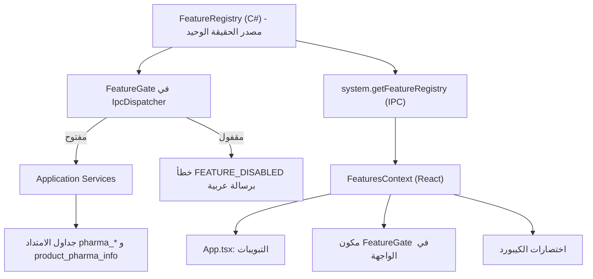
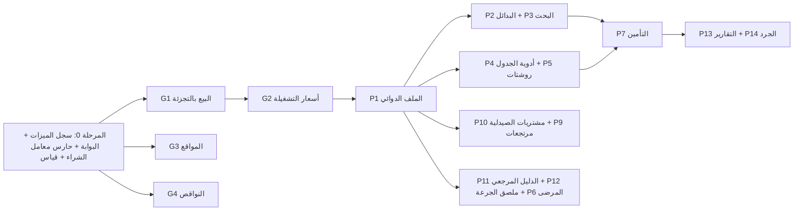

# خطة موديول الصيدليات + البيع بالتجزئة — رفيق POS (المحطة 13)

> **الهدف:** يشتغل رفيق في الصيدليات بنفس الجودة اللي بيشتغل بيها في السوبر ماركت، **من غير ما يتأثر أي محل تاني بأي شكل**. كل ميزة جديدة بتتفعل وتتقفل بمفتاح (Feature Flag) زي ماكينات الدفع بالظبط، وكمان الحماية بتكون من ناحية **الباك إند** مش الواجهة بس.

---

## 0. حاجات لقيتها في الكود الحالي ولازم تتظبط الأول

دي حاجات ظهرت من فحص الكود الفعلي، ولازم تتحسم قبل ما نبني عليها:

| # | اللي لقيته | المكان | الخطر | القرار |
|---|---|---|---|---|
| F1 | مفاتيح الميزات متعرفة في **5 أماكن منفصلة** (`GetFeatureFlags` كقائمة ثابتة في الكود، و`DEFAULT_FLAGS`، و`storeTemplates.ts`، والبيانات التجريبية في `ipc.ts`، والقوالب الاحتياطية `GetFallbackTemplates` + Migration 13) | [SettingsService.cs](file:///c:/Users/khale/OneDrive/Desktop/RAFIQ/desktop/Services/SettingsService.cs#L135-L151)، [featureTypes.ts](file:///c:/Users/khale/OneDrive/Desktop/RAFIQ/frontend/src/context/featureTypes.ts#L10-L20) | أي مفتاح جديد ممكن يتنسي في مكان منهم، فتحصل نتيجة مختلفة حسب المكان | نعمل **سجل ميزات مركزي** (P0-1) |
| F2 | المفاتيح **مش متطبقة في الباك إند خالص**. الإخفاء بيحصل في الواجهة بس (`App.tsx:868`)، و`IpcDispatcher` مابيفحصش أي مفتاح | `Bridge/*.cs` | ميزة مقفولة لسه ممكن تتنفذ بأمر IPC مباشر | نعمل **بوابة ميزات في الـ Dispatcher** (P0-1) |
| F3 | `purchase_items.conversion_factor` متخزن كـ `REAL`، وفي الموديل `PurchaseItem.ConversionFactor` نوعه `double` | `MigrationRunner.cs:1657 و 5134`، `PurchaseItem.cs:60` | **اتراجع وطلع مش خطر مالي** (التفاصيل في القسم 0.1): العمود ده وصفي بس، والمخزون والتكلفة مش بيتحسبوا منه | تقوية بسيطة بدون هجرة (P0-2) |
| F4 | `product_units` معمول على إن **الوحدة الأساسية هي أصغر وحدة**، و`conversion_factor` رقم صحيح أكبر من صفر | `MigrationRunner.cs:2976` | ممتاز للتجزئة، بس منتج متسجل بالعلبة كوحدة أساسية مش هينفع يتباع بالشريط إلا لو اتعمله **إعادة تأسيس (Rebase)** | خوارزمية Rebase ذرية (G1) |
| F5 | `product_batches` فيه `cost_price_piasters` بس، **ومفيهوش سعر بيع** | `MigrationRunner.cs:3918` | مينفعش نبيع نفس الدوا بسعرين (قديم/جديد) | عمود اختياري لسعر البيع (G2) |
| F6 | `sale_items` فيه `batch_id` **واحد بس لكل بند** | `MigrationRunner.cs:1109` | بند واحد بيسحب من تشغيلتين مش بيتسجل بدقة على مستوى البند (وارد إن `stock_movements` بتسجله، ولازم نتأكد) | جدول توزيع البند على التشغيلات (G2) |
| F7 | قالب `pharmacy` موجود، بس هو مجرد مجموعة مفاتيح عامة (صلاحية + وحدات) | [StoreTemplateService.cs:757](file:///c:/Users/khale/OneDrive/Desktop/RAFIQ/desktop/Services/StoreTemplateService.cs#L757-L775) | — | نوسّعه (P0-3) |
| F8 | سياسة "صفر منتجات محقونة" (`StoreCatalogSeeder` بيرجع قائمة فاضية) | [StoreCatalogSeeder.cs](file:///c:/Users/khale/OneDrive/Desktop/RAFIQ/desktop/Services/StoreCatalogSeeder.cs#L9-L19) | دليل الأدوية مينفعش يتحقن في `products` | دليل مرجعي منفصل (P11) |

### 0.1 نتيجة التحقيق في F3: مقصود ولا غلط؟

**الخلاصة: مش مقصود، بس كمان مش خطر على الفلوس.** يعني عدم اتساق في النوع، مش ثغرة مالية.

**الأدلة:**
1. **المواصفة بتقول رقم صحيح:** تاسك 161-4 في الباك لوج نصها "التحقق من صحة معامل التحويل (رقم صحيح موجب أكبر من صفر)". والجداول التانية كلها ماشية على كده: `product_units` و`sale_items` (`INTEGER`)، والموديلات `ProductUnit` و`SaleItem` و`ReturnItem` (`int`). فـ `purchase_items` هو الاستثناء الوحيد.
2. **مفيش أي قرار موثق إنه يبقى كسري:** لا في `AGENTS.md`، ولا في سكيل `rafiq-pos` (اللي بيقول صراحة: ممنوع `float` و`double` في الأسعار)، ولا في الباك لوج. واسم Migration 40 "Packaging Precision" المقصود بيه إضافة أعمدة التعبئة (`package_cost_piasters`)، مش دقة كسرية في المعامل.
3. **الواجهة عمرها ما بتبعت كسر:** في `PurchasesView.tsx:326` القيمة جاية من `parseInt(...)`، فالمعامل اللي بيوصل دايماً رقم صحيح.
4. **المعامل مش داخل في حساب المخزون:** في `PurchaseRepository.cs:245` الكمية المضافة = `QuantityMilli + BonusQuantityMilli`، والكمية دي جاية من الواجهة بالوحدة الأساسية جاهزة. والمعامل بيتخزن للعرض والتاريخ بس.
5. **الاستخدام المالي الوحيد ليه آمن:** في السطر 102 بيتحسب `UnitCost = round(PackageCost ÷ Factor)` بـ `decimal` وتقريب صريح والنتيجة `long`، وده بيحصل بس لو الواجهة مبعتتش تكلفة الوحدة. يعني مفيش `double` داخل في حساب فلوس.
6. **ملحوظة جانبية:** السطر 454 بيستخدم `ROUND(@newCost * conversion_factor)` بس على `product_units.conversion_factor` وده `INTEGER`، فمش متأثر.

**القرار المعدّل:** نلغي هجرة التصحيح من الخطة. وبدلها (P0-2) نعمل تقوية صغيرة في الكود من غير ما نلمس الداتا:
- `PurchaseRepository` يرفض أي معامل مش رقم صحيح برسالة عربية، فيبقى الحارس في الباك إند مش معتمد على `parseInt` في الواجهة.
- لما البيع بالتجزئة (G1) يحتاج المعامل، يقراه من `product_units` (`int`)، **مش** من `purchase_items`.
- تغيير نوع الموديل من `double` لـ `int` يتأجل لحد ما نعمل تحليل أثر بـ GitNexus على كل اللي بيقرا `PurchaseItem` (التقارير والإكسل والمرتجعات). وملحوظة: عمود `REAL` في SQLite بيخزن 12.0 من غير أي مشكلة، فمفيش داعي نعيد بناء الجدول.

> [!IMPORTANT]
> ملحوظة على كلامي في الرد اللي فات: قلت إن السيستم مغطي "65%" من احتياجات الصيدلية وإن الاستجابة "أقل من 30ms". الرقمين دول تقدير مني ومش مقاسين، فمتعتمدش عليهم. الكلام الصح والمتأكد منه موجود في الجدول اللي فوق.

---

## 1. عقد عدم التأثير (Zero-Regression Contract) — قواعد ملزمة لكل سطر هيتكتب

1. **الهجرات إضافية بس (Additive-only):** ممنوع `DROP` أو `RENAME` أو تغيير نوع عمود موجود في جداول المحلات (ما عدا تصحيح F3 بهجرة محسوبة). أي عمود جديد يكون `NULL` أو له `DEFAULT` محايد.
2. **جداول امتداد بدل ما نكبّر `products`:** بيانات الدوا تتحط في `product_pharma_info` (علاقة 1:1). السوبر ماركت عمره ما هيقرا منها ولا هيعمل عليها JOIN.
3. **الاستعلامات مشروطة بالمفتاح:** الـ JOIN على جداول الصيدلية (بحث المادة الفعالة، أسعار التشغيلة) يتعمل **بس لو المفتاح شغال**. استعلام البحث في السوبر ماركت يفضل زي ما هو بالحرف.
4. **قفل الميزة عمره ما يمسح بيانات:** القفل يخفي الواجهة ويمنع الكتابة من الباك إند، لكن **القراءة التاريخية متاحة دايماً**، يعني الفواتير القديمة تتطبع ومعاها بيانات الروشتة والتشغيلة.
5. **الافتراضي مقفول:** كل مفتاح جديد قيمته الافتراضية `false` في كل القوالب ما عدا القالب اللي محتاجه.
6. **اختبار ذهبي (Golden Test):** قبل أي دمج، نفس سيناريوهات البيع/المرتجع/الشراء/الإقفال على كل قالب من القوالب الـ11 والمفاتيح الجديدة مقفولة لازم تطلع **نفس الإجماليات والمخزون بالقرش**.
7. **ميزانية أداء:** البحث في الكاشير والمفاتيح الجديدة مقفولة ميبطأش ولا مللي ثانية قابلة للقياس. ولما تكون شغالة، نلتزم بسقف بنقيسه في P0-4 على جهاز 2GB / ويندوز 7.
8. **قيود البيئة:** C# 5 (مفيش `=>` للخصائص ولا `nameof` ولا `?.` في C#)، و.NET 4.8، وChromium 109، وTailwind 3.4، ومفيش `<select>`، ومفيش إيموجي، وأيقونات Lucide بس.
9. **قبل أي تعديل على دالة موجودة:** نشغّل `impact` من GitNexus ونسجل المستدعين ودرجة الخطر (القاعدة الإلزامية في AGENTS.md).

---

## 2. المعمارية: نمط "الموديول القابل للتفعيل"

### 2.1 تعريف الميزة في السجل (`FeatureDefinition`)
| الحقل | المعنى |
|---|---|
| `Key` | مثلاً `feature_loose_selling` |
| `NameAr` / `DescriptionAr` | اللي بيظهر لصاحب المحل في الإعدادات |
| `DefaultValue` | الافتراضي، ودايماً `false` للجديد |
| `Requires` | مفاتيح لازم تكون شغالة الأول (مثال: `feature_pharmacy` محتاج `feature_expiry_dates` و`feature_multi_units` و`feature_loose_selling`) |
| `OwnedCommands` | أوامر IPC اللي تترفض لو الميزة مقفولة |
| `OwnedPermissions` | مفاتيح الصلاحيات اللي تختفي من مصفوفة الصلاحيات لو الميزة مقفولة |
| `DisableGuard` | فحص قبل القفل (مثال: مينفعش تقفل التأمين وفيه مطالبات مفتوحة إلا بتأكيد) |

### 2.2 قواعد التفعيل والقفل
- **التفعيل:** لو فيه متطلب مقفول، الواجهة تعرض "الميزة دي محتاجة تفعيل: X و Y" وزرار "فعّل الكل".
- **القفل:** مينفعش تقفل متطلب وفيه ميزة شغالة معتمدة عليه، والرسالة تقول اسم الميزة المعتمدة.
- كل تغيير بيتسجل في `audit_logs` (المنطق ده موجود أصلاً في `SettingsService.Set`).
- المفاتيح بتتخزن في `app_settings` زي ما هي دلوقتي، فمفيش تغيير في التخزين.

---

## 3. المرحلة صفر — بنية تحتية لازمة قبل أي ميزة

### P0-1 — سجل الميزات المركزي + بوابة الباك إند
- **C#:** `Common/FeatureRegistry.cs` فيه كل التعريفات (الموجودة الـ9 + الجديدة). `SettingsService.GetFeatureFlags()` يبني القاموس من السجل بدل القائمة الثابتة، بنفس المفاتيح ونفس القيم الافتراضية الحالية بالظبط عشان مفيش حاجة تتغير.
- **Dispatcher:** قبل التوجيه، لو الأمر موجود في `OwnedCommands` لميزة مقفولة يرجع `{ ok:false, code:"FEATURE_DISABLED", message:"ميزة «...» غير مفعّلة في هذا المحل" }`.
- **تحذير:** تطبيق البوابة على أوامر `epay` و`wallets` الموجودة حالياً **تغيير في السلوك**. لازم نتأكد إن مفيش حد بيناديهم والمفتاح مقفول (زي التقارير أو الإقفال اليومي اللي بيقرا حركات ماكينات الدفع). **القرار:** البوابة تمنع الكتابة بس، وأوامر القراءة والتقارير التاريخية مستثناة.
- **React:** `FeaturesProvider` يجيب السجل من الباك إند، ويفضل `DEFAULT_FLAGS` كاحتياطي بس. وكمان نعمل مكون `<FeatureGate flag="...">`.
- **الإعدادات:** تبويب "ميزات المحل" بيتولد تلقائياً من السجل (الاسم والوصف والمتطلبات).
- **قبول:** اختبار بيبعت أمر من أوامر ميزة مقفولة فيترفض، وبعد ما تتفعل يتنفذ. وقيم كل القوالب الحالية متتغيرش.

### P0-2 — تقوية معامل تحويل الشراء (من غير هجرة)
- في `PurchaseRepository` جوه حلقة التحقق (جنب السطر 100): لو `ConversionFactor` مش رقم صحيح أو أقل من 1، نرمي `ArgumentException`: "معامل تحويل العبوة للصنف '...' يجب أن يكون رقماً صحيحاً موجباً".
- **مفيش أي تغيير في الداتا ولا في هيكل الجدول.** والفواتير القديمة بتتقري زي ما هي.
- قبل التعديل نشغّل `impact` على `PurchaseRepository` (الدالة اللي بتحفظ الفاتورة).
- **اختبار:** فاتورة بمعامل 12 تتحفظ عادي، وفاتورة بمعامل 12.5 جاية من IPC مباشرة تترفض، وكل اختبارات `PurchasesTestRunner` الحالية تفضل ناجحة.

### P0-3 — نظام القوالب
- القوالب تتبني من `FeatureRegistry` + خريطة "قالب ← مفاتيح". فيه هنا 3 مصادر لازم تفضل متزامنة: `GetFallbackTemplates` و`storeTemplates.ts` وبيانات `ipc.ts` التجريبية. **القرار:** الواجهة تاخد القوالب من الباك إند بس، والملف الثابت يفضل للمتصفح أثناء التطوير.
- **المحلات المثبّتة قبل كده بقالب `pharmacy`:** نعرض لهم رسالة مرة واحدة: "متاح موديول الصيدلية الكامل، تحب تفعّله؟". **ممنوع التفعيل التلقائي.**

### P0-4 — قياس خط الأساس (Baseline)
- نقيس زمن البحث في الكاشير وزمن حفظ الفاتورة والذاكرة على ويندوز 7 بجهاز 2GB، ومعانا 5,000 و20,000 صنف. الأرقام دي هي السقف اللي هنلتزم بيه.

---

## 4. ميزات عامة تفيد كل المحلات

### G1 — البيع بالتجزئة / فك العبوة (`feature_loose_selling`)
**مين هيستفيد:** الصيدلية (علبة ← شريط ← قرص)، والسوبر ماركت (خرطوشة ← علبة ← سيجارة، طبق ← بيضة، كرتونة ← علبة)، والمكتبة (دستة ← قلم).

#### G1.1 المفهوم
- خاصية على مستوى المنتج اسمها **"يباع مفكوك"**. مفتاح المحل بيظهر الخاصية، والمنتج نفسه بيقرر.
- المخزون يفضل **دايماً بأصغر وحدة** (القاعدة الحالية في `product_units`). العلبة والشريط مجرد وحدات بمعامل تحويل صحيح.

#### G1.2 معالج التعبئة (Packaging Wizard) في شاشة الصنف
- مستويات لحد 4: (كرتونة) ← علبة ← شريط ← قرص. مثال: "العلبة فيها **3** شرائط، والشريط فيه **10** أقراص"، يعني معامل العلبة = 30 والشريط = 10 والقرص = 1.
- قوالب جاهزة للاختيار السريع: سجاير (10×20)، بيض (30)، دوا (شرائط×أقراص)، أمبولات، أكياس.
- المعالج بيولّد صفوف `product_units` تلقائياً، ومعاها اسم كل وحدة، وباركود اختياري لكل مستوى، و`is_divisible = 0`.
- **الوحدة الافتراضية للبيع** (`default_sale_unit_id`): المعنى إن الباركود لما يتمسح يضيف أنهي وحدة؟ العلبة عادةً.
- **الوحدة الافتراضية للشراء** و**وحدة عرض المخزون**.

#### G1.3 التسعير
- كل وحدة ليها `sell_price_piasters` صريح، **ومفيش قسمة وقت البيع**.
- **سعر مقترح:** `ceil(سعر العلبة ÷ عدد الشرائط)` مقرّب لأقرب وحدة تقريب يحددها المحل (5 أو 25 أو 50 قرش)، وده كله حسابات أعداد صحيحة.
- **تحذير مش منع:** لو (سعر الشريط × عدد الشرائط) أقل من سعر العلبة، يظهر "بيع الشرائط أرخص من العلبة".
- **تغيير سعر العلبة:** يظهر سؤال "تحدّث أسعار الشريط والقرص بنفس النسبة؟" وفيه ثلاث اختيارات: نعم / لا / تعديل يدوي، وكل ده بيتسجل في `product_price_history`.

#### G1.4 التكلفة وتكلفة المبيعات (COGS) — بدون كسور
- التكلفة الأساسية تتخزن **على مستوى العبوة** (`cost_price_piasters` للوحدة الكبيرة).
- تكلفة بند البيع = `(تكلفة العبوة × الكمية بالوحدة الأساسية + factor/2) ÷ factor` بقسمة صحيحة مع تقريب، ومرة واحدة على مستوى البند، مش على مستوى القرص.
- الفرق الأقصى قرش واحد في البند، وده بيتوثق في الكود. وتقييم المخزون يتحسب من العبوة كمان.

#### G1.5 إعادة التأسيس (Rebase) — أخطر نقطة في الميزة
**الموقف:** منتج متسجل وحدته الأساسية "علبة" ورصيده 10 علب، وصاحب المحل عايز يبيعه بالقرص.

الخوارزمية بتتنفذ **في معاملة ذرية واحدة**:
1. **فحوصات ما قبل التنفيذ (ترفض لو فشلت):** مفيش وردية فيها فاتورة معلّقة (`held_sales`) فيها الصنف، ومفيش جرد مفتوح عليه، والمعامل الجديد رقم صحيح بين 2 و10,000.
2. `products.stock_quantity_milli *= F` و`min_stock_quantity_milli *= F`.
3. `product_batches.quantity_milli *= F` لكل التشغيلات.
4. `product_variants` لو موجودة. **القرار:** مينفعش نعمل Rebase لمنتج ليه متغيرات في الإصدار الأول.
5. الوحدة القديمة "علبة" تتحول `conversion_factor = F, is_base_unit = 0`، ونعمل وحدة أساسية جديدة "قرص" بـ `factor = 1`.
6. `products.price_piasters` و`cost_piasters` يتحولوا لسعر وتكلفة الوحدة الأساسية الجديدة (مقربين)، والأسعار الصريحة للوحدات تفضل هي المرجع.
7. نسجل حركة `stock_movements` من نوع `UNIT_REBASE` بفرق صفر وفيها المعامل، ونسجل في `audit_logs` مين عمل كده وإمتى والقيم قبل وبعد.
8. **التاريخ ميتغيرش:** `sale_items` القديمة محتفظة بـ `conversion_factor` و`unit_name` بتوعها، فالمرتجعات القديمة بتتحسب صح. **لازم نتأكد** إن `ReturnRepository` بيستخدم الـ factor المحفوظ في البند ومش بيقرا وحدة المنتج الحالية.
9. **عكس العملية:** مينفعش ترجع للعلبة كوحدة أساسية لو الرصيد مش من مضاعفات F. ولو من مضاعفاتها، العكس مسموح بنفس الآلية.

#### G1.6 الكاشير
- مسح باركود العلبة يضيف العلبة. **مسح باركود الشريط** (لو متسجل) يضيف الشريط على طول.
- **تبديل الوحدة في البند المحدد:** مفتاح واحد (مقترح `/` أو `U`، وهنتأكد إنه مش متعارض مع الاختصارات الحالية) يلفّ بين علبة ← شريط ← قرص، وفيه كمان قائمة وحدات بالماوس. السعر يتحدث فوراً من سعر الوحدة.
- كتابة `2*` قبل المسح بتفضل شغالة زي ما هي.
- العرض في سلة الكاشير: "بانادول — **شريط** (10 أقراص) × 2".
- فحص الرصيد بيتعمل بالوحدة الأساسية (موجود فعلاً، `baseDemand`)، فلو الرصيد 7 أقراص وطلبت شريط (10) يتمنع أو يظهر تحذير حسب إعداد البيع بالسالب.

#### G1.7 عرض المخزون المختلط
- دالة عرض واحدة مشتركة (C# + TS): 307 أقراص = "**10 علب + 0 شريط + 7 أقراص**"، ولو بسّطناها: "10 علب و 7 أقراص".
- بتستخدم في: جدول الأصناف، والكاشير، والتقارير، والجرد، والإكسل.
- علامة **"علبة مفتوحة"** لو الرصيد مش من مضاعفات العلبة، وده بيساعد في الجرد.

#### G1.8 الشراء والمرتجعات والجرد والإكسل
- **الشراء:** بأي وحدة، والتخزين بيتحول للأساسية. وتكلفة العبوة في فاتورة الشراء بتحدّث تكلفة الوحدة.
- **المرتجع:** يرجع بنفس الوحدة اللي اتباع بيها، ولو عايز ترجع شريط من علبة اتباعت فده جزئي ومسموح بالوحدة الأساسية.
- **الجرد:** إدخال مختلط (علب + شرائط + أقراص) وبيتجمع للأساسية.
- **الإكسل:** أعمدة جديدة اختيارية: `pack_levels` و`units_per_pack` وسعر كل مستوى. والاستيراد القديم بدونها يفضل شغال زي ما هو.

#### G1.9 الصلاحيات
- `products.packaging.edit` تعديل التعبئة، و`products.unit_rebase` إعادة التأسيس (خطيرة: الافتراضي `root` و`admin` بس)، و`pos.change_unit` تبديل الوحدة في الكاشير (الافتراضي مسموح للكاشير).

#### G1.10 القبول
- سجاير: علبة 20 سيجارة. بيع 3 سجاير بعد علبة كاملة، والرصيد والتكلفة والربح يطلعوا صح بالقرش.
- دوا: 30 قرص. Rebase من 10 علب يطلع 300 قرص، وبيع شريط يطلع 290، ومرتجع فاتورة قديمة اتباعت بالعلبة قبل الـ Rebase يرجّع 30 قرص.
- محل والمفتاح مقفول: الواجهة والسلوك متطابقين 100% مع النسخة الحالية.

---

### G2 — أسعار التشغيلة (`feature_batch_pricing`) — يحتاج `feature_expiry_dates`
**مين هيستفيد:** الصيدلية (تسعيرة جبرية قديمة وجديدة)، والسوبر ماركت (بضاعة قديمة بسعر قديم بعد الزيادة).

- **الجداول:**
  - `product_batches.sell_price_piasters INTEGER NULL`، والـ `NULL` معناها نستخدم سعر المنتج.
  - `product_batches.public_price_piasters INTEGER NULL` وده سعر الجمهور المطبوع على العلبة (للصيدلية).
  - جدول جديد `sale_item_batch_allocations(id, sale_item_id, batch_id, quantity_milli, unit_price_piasters, unit_cost_piasters)` وبيسجل البند سحب من أنهي تشغيلة وبأنهي سعر.
- **منطق البيع:**
  1. FEFO بيختار التشغيلة (موجود).
  2. لو البند محتاج كمية من تشغيلتين **بسعرين مختلفين**، يتقسم **لبندين** في السلة، وكل بند بسعر تشغيلته، والكاشير بيشوف ده قدامه.
  3. لو التشغيلتين بنفس السعر، يفضل بند واحد وفيه توزيعين في جدول التوزيع.
  4. **اختيار تشغيلة يدوي** (العميل جايب العلبة بالسعر القديم): صلاحية `pos.select_batch`.
- **السعر مع البيع بالتجزئة:** سعر التشغيلة بيتحط للوحدة الكبيرة، وسعر الشريط بيتشتق بنفس نسبة الوحدات المسجلة. **القرار المطلوب:** نسبة ولا جدول أسعار لكل وحدة لكل تشغيلة؟ أنا مقترح **النسبة** في الإصدار الأول.
- **التحقق من السعر:** `IsCataloguePrice` لازم يقبل سعر التشغيلة المختارة كسعر كتالوج. ودي **دالة حساسة** لازم نحلل أثرها الأول.
- **المرتجع:** يرجع لنفس التشغيلة بنفس سعرها (من جدول التوزيع).
- **قبول:** تشغيلة قديمة 40 ج و جديدة 60 ج، وطلب 3 والقديمة فيها 2: يطلع بندين (2×40 + 1×60). الإجمالي والربح والمخزون كل تشغيلة صح.

### G3 — مواقع التخزين (`feature_shelf_locations`)
- جدول `storage_locations(id, code, name, type[shelf|drawer|fridge|store], is_active)` + `products.location_id NULL` (أو `product_locations` لو الصنف في أكتر من مكان، **القرار:** مكان واحد في الإصدار الأول).
- يظهر في نتائج البحث بالكاشير بخط صغير: "درج A-14"، وتقرير جرد حسب المكان، وطباعة ملصق رف.
- **صلاحيات:** `inventory.locations.manage`.

### G4 — دفتر النواقص وطلب الموزع (`feature_shortage_book`)
- جدول `shortage_entries(id, product_id NULL, free_text, requested_qty_milli, customer_id NULL, source[pos|low_stock|manual], status[open|ordered|received|cancelled], created_by, created_at)`.
- **من الكاشير:** اختصار "سجّل ناقص" بيقبل اسم حر حتى لو الصنف مش متسجل، وده بيدّي **مقياس للمبيعات الضايعة**.
- **تلقائي:** الأصناف اللي وصلت حد الطلب.
- **تحويل النواقص لـ "مسودة فاتورة شراء"** مقسمة حسب المورد المفضل للصنف (`products.preferred_supplier_id NULL`).
- **صلاحيات:** `shortage.view` و`shortage.manage` و`shortage.convert_to_purchase`.

---

## 5. موديول الصيدلية (`feature_pharmacy` — المفتاح الرئيسي)
**المتطلبات:** `feature_expiry_dates` و`feature_multi_units` و`feature_loose_selling`. وكل ميزة فرعية ليها مفتاح خاص بيها عشان المحل يفعّل اللي محتاجه بس.

### P1 — الملف الدوائي للصنف
**الجدول** `product_pharma_info` (المفتاح الأساسي = `product_id`، علاقة 1:1):
| العمود | النوع | ملاحظة |
|---|---|---|
| `scientific_name` | TEXT | الاسم العلمي للعرض |
| `normalized_scientific_name` | TEXT + فهرس | للبحث (عربي/إنجليزي بعد التطبيع) |
| `dosage_form_id` | TEXT FK | أقراص، كبسول، شراب، حقن، كريم، نقط، بخاخ، لبوس، فوار، أكياس… (جدول مرجعي قابل للتعديل) |
| `strength_text` | TEXT | "500 mg"، "250mg/5ml" (للعرض) |
| `route` | TEXT | فموي / موضعي / حقن / استنشاق |
| `manufacturer_id` | TEXT FK | جدول `pharma_manufacturers` |
| `registration_no` | TEXT NULL | رقم التسجيل |
| `rx_status` | TEXT | `otc` / `rx` / `controlled` |
| `controlled_schedule` | TEXT NULL | جدول 1 / جدول 2 / … |
| `storage_condition` | TEXT | `room` / `fridge` / `freezer` |
| `usage_notes` | TEXT NULL | تعليمات تتطبع على ملصق الجرعة |
| `therapeutic_class_id` | TEXT NULL FK | للبدائل العلاجية |

- **الواجهة:** قسم "بيانات دوائية" في نافذة الصنف، يظهر **بس** لو `feature_pharmacy` شغال. ومحل السوبر ماركت مش هيشوفه أبداً.
- **الصلاحيات:** `pharma.drug_info.edit`.

### P2 — المواد الفعالة والبدائل والمثائل (`feature_pharma_alternatives`)
- **الجداول:**
  - `active_ingredients(id, name_en, name_ar, normalized_name)`.
  - `product_ingredients(product_id, ingredient_id, strength_value_micro INTEGER, strength_unit, PRIMARY KEY(product_id, ingredient_id))`. التركيز بيتخزن رقم صحيح بالميكرو (500mg = 500000) عشان المقارنة تبقى دقيقة.
  - `therapeutic_classes(id, name)`.
- **خوارزمية التصنيف** (بتتحسب في C#، والنتيجة مرتبة):
  1. **مثيل مطابق:** نفس مجموعة المواد الفعالة + نفس التركيز لكل مادة + نفس الشكل الدوائي.
  2. **مثيل بشكل مختلف:** نفس المواد والتركيز، شكل مختلف (أقراص ↔ فوار).
  3. **نفس المادة بتركيز مختلف.**
  4. **بديل علاجي:** نفس `therapeutic_class_id`.
  - جوه كل مجموعة الترتيب: **الموجود في المخزون الأول**، وبعدين الأقرب في السعر، وبعدين الأبعد في الصلاحية.
- **الواجهة (F8 مقترح، وهنتأكد إنه مش متعارض):** لوحة جانبية فيها: الاسم، والشركة، والسعر، والرصيد المختلط، وأقرب صلاحية، وزرار "استبدال في السلة" و"إضافة".
- **الأداء:** فهرس على `product_ingredients(ingredient_id)` والاستعلام بيتنفذ عند الطلب بس، مش مع كل بحث.
- **صلاحيات:** `pharma.alternatives.view` (الافتراضي مسموح للكل).

### P3 — البحث الصيدلي
- لما المفتاح يكون شغال، بحث الكاشير بيدوّر كمان في `normalized_scientific_name` وأسماء المواد الفعالة. **ده بحث إضافي (UNION) مشروط**، والاستعلام الأصلي ميتلمسش.
- النتيجة بتعرض شارة "علمي: Paracetamol 500mg".
- **الأداء:** نلتزم بسقف P0-4 ومعانا 20,000 صنف.

### P4 — الأدوية الخاضعة للرقابة (`feature_controlled_drugs`)
- **الجدول** `controlled_dispenses(id, sale_id, sale_item_id, product_id, batch_id, quantity_milli, patient_name, patient_national_id NULL, patient_phone NULL, doctor_name, doctor_license_no NULL, prescription_no NULL, prescription_date, dispensed_by, approved_by NULL, created_at)`.
- **الحقول (حسب قرارك):** الرقم القومي **مش إلزامي**. الإلزامي بشكل افتراضي: اسم المريض، واسم الطبيب، وتاريخ الروشتة. وكل الحقول التانية اختيارية.
  - في الإعدادات (تحت مفتاح الميزة) قائمة "الحقول الإلزامية عند صرف أدوية الجدول" يحددها صاحب الصيدلية بنفسه، والتحقق بيتعمل في الباك إند حسب القائمة دي. فلو القانون أو التفتيش طلب حقل زيادة، بيتفعل من الإعدادات من غير ما نعدّل الكود.
  - **غير قابل للتعديل:** مفيش UPDATE ولا DELETE من الكود، والتصحيح بقيد معاكس `type='correction'` فيه السبب (القاعدة 2).
- **في الكاشير:** إضافة صنف `rx_status='controlled'` بتفتح نافذة إلزامية للبيانات. **مفيش إتمام للبيع بدونها**، والفحص ده في `SaleService` جوه نفس المعاملة، مش في الواجهة بس.
- لو الكاشير معندوش `pharma.controlled.dispense` يبقى محتاج **اعتماد صيدلي** (نفس آلية الاعتماد الإداري الموجودة في تخطي الصلاحية).
- **ممنوع:** تعليق فاتورة فيها دوا جدول، والتعديل على الكمية بعد إدخال البيانات بيطلب إعادة التأكيد.
- **المرتجع:** بيتسجل قيد معاكس في الدفتر ولازم اعتماد.
- **التقرير:** "دفتر أدوية الجدول" لكل صنف: رصيد أول المدة، والوارد (من المشتريات)، والمنصرف بالتفصيل، والرصيد. ويتصدّر PDF أو طباعة A4 للتفتيش.
- **الخصوصية:** لو الرقم القومي اتكتب، بيتخزن مشفّر (نستخدم `EncryptionService` الموجودة) ويظهر مقنّع `29********12` لغير `pharma.controlled.view_full`.
- **الصلاحيات:** `pharma.controlled.dispense` و`pharma.controlled.approve` و`pharma.controlled.register_view` و`pharma.controlled.view_full`.

### P5 — الروشتات (`feature_prescriptions`)
- **الجدول** `prescriptions(id, customer_id NULL, patient_name, doctor_name, clinic NULL, prescription_date, notes, image_path NULL, created_by, created_at)` + `sale_prescriptions(sale_id, prescription_id)`.
- **صورة الروشتة (اختيارية):** بتتحفظ في `%ProgramData%\RafiqPOS\data\prescriptions\yyyy\MM\` وحجمها الأقصى 1.5MB بعد الضغط، **وبتدخل في النسخ الاحتياطي**. ولازم نحلل أثر ده على `BackupService` لأن الحجم هيكبر.
- **صرف متكرر:** "اصرف نفس الروشتة تاني" بيعمل سلة بنفس الأصناف.

### P6 — ملف المريض والأمراض المزمنة (`feature_patient_profiles`)
- **امتداد للعملاء** `customer_patient_info(customer_id PK, birth_year NULL, gender NULL, allergies TEXT, chronic_conditions TEXT, notes)` + `chronic_medications(id, customer_id, product_id, daily_qty_milli, last_dispensed_at, next_due_date)`.
- **تنبيه "مرضى مزمنين مستحقين الصرف"** في لوحة التحكم (مفيش إنترنت، فالتواصل بيكون يدوي بالتليفون).
- **تحذير حساسية:** لو العميل مسجل عنده حساسية من مادة فعالة موجودة في صنف بالسلة يظهر تحذير، **مش منع**.
- **صلاحيات:** `patients.view` و`patients.edit`.

### P7 — التأمين الطبي والتعاقدات (`feature_insurance`)
- **الجداول:**
  - `insurance_companies(id, name, phone, is_active)`.
  - `insurance_contracts(id, company_id, name, patient_share_bps INTEGER, cap_per_invoice_piasters NULL, cap_per_month_piasters NULL, valid_from, valid_to, excludes_cosmetics INTEGER)`. **النسب بنقاط الأساس كرقم صحيح** (20% = 2000 bps، نفس نمط `CalculateEpayServiceFee`).
  - `insurance_exclusions(contract_id, category_id NULL, product_id NULL)`.
  - `insurance_members(id, contract_id, customer_id, member_no, valid_to)`.
  - `insurance_claim_lines(id, sale_id, contract_id, member_id, covered_piasters, patient_piasters, company_piasters, status[pending|claimed|paid|rejected], claim_batch_id NULL)`.
  - `insurance_claim_batches(id, company_id, period, total_piasters, status, submitted_at, settled_at)`.
- **الحساب** (في `SaleService` جوه نفس المعاملة):
  1. البنود المستثناة حصة المريض فيها 100%.
  2. المغطى × `patient_share_bps` / 10000 بتقريب صحيح = حصة المريض، **والباقي = حصة الشركة** (عشان المجموع يبقى مضبوط دايماً).
  3. نطبق السقف، واللي زاد عليه يتحمله المريض.
- **الدفع:** الفاتورة بيتسجل فيها `payments` بطريقتين: نقدي (حصة المريض) و`insurance` (حصة الشركة)، وجدول المدفوعات المنفصل موجود أصلاً.
  - **مهم جداً:** طريقة الدفع `insurance` **مش فلوس في الدرج**. لازم `DrawerCashCalculator` و`DailyClosingService` يستبعدوها من النقدية المتوقعة. **ودي دوال حساسة جداً لازم نحلل أثرها.**
- **المطالبة الشهرية:** تجميع البنود المعلقة لكل شركة ← دفعة مطالبة ← طباعة A4 + إكسل ← تسجيل التحصيل (كامل/جزئي/رفض بسبب). وفروق الرفض بتتحول على المريض أو مصروف حسب قرار المالك.
- **الصلاحيات:** `insurance.manage_contracts` و`insurance.sell` و`insurance.claims.manage` و`insurance.claims.settle`.

### P8 — أصناف الثلاجة
- بتتحدد من `storage_condition` في P1. بتظهر شارة "ثلاجة" في الكاشير، وسطر "يحفظ في الثلاجة" على الإيصال، وتقرير جرد خاص بالثلاجة. **ومفيش جداول إضافية.**

### P9 — مرتجعات الصلاحية للموزع (`feature_expiry_returns`)
- **الإعداد على المورد:** `suppliers.expiry_return_window_days NULL` و`expiry_return_credit_bps NULL` (نسبة القيمة اللي المورد بيرجعها).
- **تقرير "قابل للإرجاع قبل الانتهاء":** التشغيلات اللي تاريخها داخل نافذة المورد بتاعها.
- **تحويل لمسودة مرتجع مشتريات** باستخدام `purchase_returns` الموجودة، مربوط بالتشغيلة.
- **الإعدام (Write-off)** لمنتهي الصلاحية: حركة مخزون `EXPIRED_WRITE_OFF` بقيمة التكلفة ومحضر مطبوع، **ومفيش حذف**.

### P10 — مشتريات الصيدلية (سعر الجمهور − خصم الموزع)
- في فاتورة الشراء بنضيف (لما المفتاح يكون شغال): **سعر الجمهور للوحدة** + **نسبة خصم الموزع bps** + بونص (موجود: `bonus_quantity_milli`).
- التكلفة = سعر الجمهور × (10000 − bps) / 10000 بتقريب صحيح، والبونص بيوزّع التكلفة على الكمية الإجمالية (لازم نتأكد من المنطق الحالي للبونص في `PurchaseRepository`).
- **سعر البيع = سعر الجمهور** بيتحط على التشغيلة الجديدة (G2) تلقائياً، **ومش بيغيّر سعر التشغيلات القديمة**.

### P11 — دليل الأدوية المرجعي (`feature_drug_reference`)
- **مش بيتحقن في `products`** (احتراماً لسياسة F8). جدول مرجعي منفصل `drug_reference(barcode, trade_name, scientific_name, form, strength, manufacturer, pack_desc, public_price_piasters, source, imported_at)`.
- **مصدر البيانات (قرار نهائي):** **استيراد من إكسل بس**، ومفيش أي داتا أدوية جاهزة جوه البرنامج، لأن مفيش مصدر مرخص.
  - البرنامج بيطلّع **ملف إكسل فاضي جاهز (قالب)** بالأعمدة المطلوبة من شاشة الاستيراد، ويملاه الصيدلي أو ياخده من الموزع بتاعه.
  - **معاينة قبل الحفظ:** عدد الصفوف الجديدة والمحدّثة والمرفوضة، وسبب رفض كل صف (باركود متكرر، سعر مش رقم، اسم ناقص).
  - **إعادة الاستيراد:** الصف اللي باركوده موجود يتحدث في `drug_reference` بس، و**عمره ما يغيّر سعر صنف موجود فعلاً في `products`**. لو السعر في الدليل اختلف عن سعر الصنف، يظهر تقرير "فروق أسعار مع الدليل" والقرار للصيدلي.
  - الاستيراد بيستخدم نفس مكتبة ClosedXML ونفس نمط `ExcelService` الموجود.
- **السلوك:** باركود مش متسجل في الكاشير ← "موجود في الدليل: بانادول 500 — أضفه للأصناف؟" ← يفتح نافذة الصنف وبياناته متعبية، والمستخدم يدخل الرصيد والتكلفة.
- **الأداء:** الجدول ممكن يبقى 25 ألف صف، والفهرسة على `barcode` و`normalized` بس، ومش بيدخل في البحث العادي.

### P12 — ملصق الجرعة
- طباعة على الطابعة الحرارية (`PrinterService` موجود): اسم المريض، والدوا، والجرعة من عبارات عربية جاهزة ("قرص كل 8 ساعات بعد الأكل")، والتاريخ، واسم الصيدلية.
- عبارات الجرعة ممكن تتعدل من الإعدادات. **ومفيش إيموجي.**

### P13 — تقارير الصيدلية
| التقرير | المصدر |
|---|---|
| خريطة الصلاحيات حسب الشهر (قيمة بالتكلفة) | `product_batches` |
| دفتر أدوية الجدول | `controlled_dispenses` |
| مطالبات التأمين ومتابعتها | `insurance_claim_*` |
| المبيعات الضايعة (نواقص اتسجلت) | `shortage_entries` |
| الربح حسب الشركة المصنعة والمادة الفعالة | `sale_items` + `product_pharma_info` |
| الأصناف الراكدة (من غير بيع من N يوم) مع الصلاحية | مبيعات + تشغيلات |
| مرضى مزمنين مستحقين | `chronic_medications` |

- كل تقرير تحت مفتاحه، وصلاحية `reports.pharma.*`.

### P14 — الجرد الصيدلي
- جرد حسب **المكان** (G3) أو **الشركة** أو **حرف**، وإدخال مختلط بالوحدات (G1.7)، **وعلى مستوى التشغيلة** (التشغيلة + الكمية).
- الفروقات بتتسجل كقيود تسوية على التشغيلة المحددة (`AdjustBatchStock` موجودة، ولازم نحلل أثرها قبل ما نستخدمها في الجرد الجماعي).

---

## 6. مصفوفة الصلاحيات الجديدة (القاعدة 8 — في الثلاث طبقات)

| المفتاح | root | admin | cashier | الميزة |
|---|---|---|---|---|
| `products.packaging.edit` | ✔ | ✔ | ✘ | G1 |
| `products.unit_rebase` | ✔ | ✔ | ✘ | G1 |
| `pos.change_unit` | ✔ | ✔ | ✔ | G1 |
| `pos.select_batch` | ✔ | ✔ | ✘ | G2 |
| `inventory.locations.manage` | ✔ | ✔ | ✘ | G3 |
| `shortage.view` / `shortage.manage` / `shortage.convert_to_purchase` | ✔ | ✔ | ✔/✔/✘ | G4 |
| `pharma.drug_info.edit` | ✔ | ✔ | ✘ | P1 |
| `pharma.alternatives.view` | ✔ | ✔ | ✔ | P2 |
| `pharma.controlled.dispense` | ✔ | ✔ | ✘ | P4 |
| `pharma.controlled.approve` | ✔ | ✔ | ✘ | P4 |
| `pharma.controlled.register_view` / `view_full` | ✔ | ✔/✘ | ✘ | P4 |
| `prescriptions.manage` | ✔ | ✔ | ✔ | P5 |
| `patients.view` / `patients.edit` | ✔ | ✔ | ✔/✘ | P6 |
| `insurance.manage_contracts` | ✔ | ✔ | ✘ | P7 |
| `insurance.sell` | ✔ | ✔ | ✔ | P7 |
| `insurance.claims.manage` / `settle` | ✔ | ✔ | ✘ | P7 |
| `pharma.expiry_returns.manage` | ✔ | ✔ | ✘ | P9 |
| `pharma.drug_reference.import` | ✔ | ✔ | ✘ | P11 |
| `reports.pharma.*` | ✔ | ✔ | ✘ | P13 |

- في `SecurityService.cs`: `ALL_PERMISSIONS` و`GetPermissionsForRole` و`SyncPermissionAliases`.
- في `UserManagerModal.tsx`: مجموعات جديدة في `PERMISSION_GROUPS`، **وبتختفي المجموعة كلها لو الميزة مقفولة** (`OwnedPermissions`).
- في `App.tsx`: `hasPermission(...) && isEnabled(...)`.

---

## 7. الهجرات (Migrations 42 وما بعدها) — الترتيب

| رقم | المحتوى | ملاحظة |
|---|---|---|
| — | مفيش هجرة لـ P0-2 (تقوية في الكود بس) | P0-2 |
| 42 | `products.default_sale_unit_id` و`default_purchase_unit_id` و`display_unit_id` و`is_loose_sellable` (كلها NULL/0) | G1 |
| 43 | `product_batches.sell_price_piasters` و`public_price_piasters` NULL + `sale_item_batch_allocations` | G2 |
| 44 | `storage_locations` + `products.location_id` + `products.preferred_supplier_id` + `shortage_entries` | G3 وG4 |
| 45 | `product_pharma_info` و`pharma_dosage_forms` و`pharma_manufacturers` و`active_ingredients` و`product_ingredients` و`therapeutic_classes` | P1 وP2 |
| 46 | `controlled_dispenses` و`prescriptions` و`sale_prescriptions` | P4 وP5 |
| 47 | `customer_patient_info` و`chronic_medications` | P6 |
| 48 | جداول التأمين | P7 |
| 49 | `suppliers.expiry_return_*` + `drug_reference` | P9 وP11 |

- كل هجرة **في معاملة واحدة ومحمية بـ `PRAGMA table_info`** (نفس النمط الحالي) **وقابلة لإعادة التشغيل** (Idempotent).
- نسخة احتياطية تلقائية قبل الهجرات (لازم نتأكد إنها موجودة في `MigrationService`).

---

## 8. ترتيب التنفيذ (المحطة 13)

| الموجة | المحتوى | ليه بالترتيب ده |
|---|---|---|
| 1 | P0-1 → P0-4 | الحماية والعزل قبل أي ميزة |
| 2 | G1 | أكبر قيمة، وبتفيد كل المحلات، وفيها أخطر تعديل (Rebase) |
| 3 | G2 ثم G3 وG4 | G2 بتلمس قلب البيع، فبتيجي بعد ما G1 تستقر |
| 4 | P1 وP2 وP3 | أساس الصيدلية |
| 5 | P4 وP5 وP8 وP12 | الامتثال القانوني |
| 6 | P10 وP9 وP11 | المشتريات والدليل |
| 7 | P7 | التأمين (بيلمس الإقفال اليومي، فلازم يكون آخر حاجة في الدوال الحساسة) |
| 8 | P6 وP13 وP14 | تقارير وتحسينات |

- **كل موجة بتتقفل** بـ: `npm run lint` و`npm run build` (صفر تحذيرات) + بناء MSBuild + الاختبارات الذهبية على الـ11 قالب + اختبار ويندوز 7 + تحديث `PROJECT_BACKLOG.md`.

---

## 9. خطة الاختبار (مستوى سينيور)

1. **اختبارات ذهبية للتوافق:** على كل قالب من الـ11 والمفاتيح الجديدة مقفولة، نعمل 50 فاتورة ثابتة + مرتجعات + شراء + إقفال يوم، ونقارن الإجماليات والمخزون بالقرش قبل وبعد.
2. **اختبارات Rebase:** رصيد صفر، ورصيد سالب (لو مسموح)، وتشغيلات متعددة، وفاتورة معلقة (لازم تترفض)، ومرتجع فاتورة قديمة، وانقطاع كهربا وسط المعاملة (Chaos — `ChaosEngineeringTestRunner` موجود).
3. **اختبارات التقسيم:** بند بتشغيلتين بسعرين، وخصم فاتورة موزّع على بنود مقسومة (`DistributeInvoiceDiscount`)، وضريبة.
4. **اختبارات التأمين:** المجموع = حصة المريض + حصة الشركة بالقرش دايماً، والسقف، والاستثناء، وخروج طريقة `insurance` من نقدية الدرج.
5. **اختبارات البوابة:** كل أمر IPC جديد ومفتاحه مقفول لازم يرجع `FEATURE_DISABLED`.
6. **اختبارات الصلاحيات:** كاشير بيحاول يصرف دوا جدول من غير اعتماد، والرفض لازم يحصل في الباك إند.
7. **الأداء:** 20,000 صنف + 25,000 في الدليل على ويندوز 7 بجهاز 2GB، في حدود سقف P0-4.
8. **الواجهة:** 1024×768 من غير تمرير أفقي لكل شاشة جديدة، والمرجع البصري من `stitch_rafeeq_pos_system_ui_design/`، ولو مفيش شاشة مطابقة نستخدم نفس الهوية.

---

## 10. قرارات محتاجة رأيك قبل التنفيذ

1. **Rebase:** مسموح لصاحب المحل بس، ولا كمان لـ admin؟ (اقتراحي: `root` و`admin`.)
2. **أسعار التشغيلة مع الوحدات:** سعر الشريط يتشتق **بالنسبة** من سعر علبة التشغيلة (اقتراحي)، ولا جدول أسعار كامل لكل وحدة لكل تشغيلة؟
3. ~~دليل الأدوية~~ **اتحسم:** استيراد من إكسل بس.
4. **التأمين:** هل المرحلة الأولى محتاجة السقف الشهري للعضو، ولا السقف على مستوى الفاتورة كفاية؟
5. ~~أدوية الجدول~~ **اتحسم:** الرقم القومي اختياري، والحقول الإلزامية بيحددها صاحب الصيدلية من الإعدادات.
7. ~~معامل تحويل الشراء REAL~~ **اتحسم:** مش مقصود بس مش خطر مالي، فهنعمل حارس في الكود من غير هجرة (القسم 0.1).
6. **بوابة الباك إند على ميزات الدفع الحالية:** نطبقها على أوامر الكتابة لـ `epay` و`wallets` الموجودة دلوقتي ولا نخليها للميزات الجديدة بس؟ (اقتراحي: نطبقها، مع استثناء القراءة والتقارير.)
